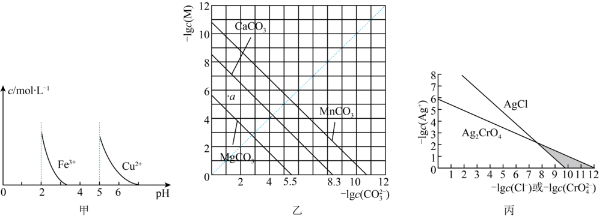

# Chemistry - 题目 36

**ID**: acfc8eb26eca4ff2981887056179c6fb
**年级**: Grade 12
**难度**: Medium-Hard
**题型**: Multiple-choice

## 题目
根据下列图示所得出的结论正确的是​​​​​​​‌

## 解答

1. A．加入NaOH会引入新的杂质钠离子，可以加入CuO，A错误；
2. B．根据图像， ${\rm -{\lg}{}\left ({Ca{{}^{2+}}}\right )=0，-{\lg}{}\left ({CO{{}_{3}^{2-}}}\right )=8.3}$ ，则 ${\rm {\rm{c}}\left ({Ca{{}^{2+}}}\right )=1{\rm mol}/{\rm{L}}，{\rm{c}}\left ({CO{{}_{3}^{2-}}}\right )=10{{}^{-8.3}}{\rm mol}/{\rm{L}}}$ ， ${\rm {\rm{K}}{{}_{CaCO{{}_{3}}}}={\rm{c}}\left ({Ca{{}^{2+}}}\right ){\rm{c}}\left ({CO{{}_{3}^{2-}}}\right )=10{{}^{-8.3}}}$ ，同理， ${\rm {\rm{K}}{{}_{MgCO{{}_{3}}}}={\rm{c}}\left ({Mg{{}^{2+}}}\right ){\rm{c}}\left ({CO{{}_{3}^{2-}}}\right )=10{{}^{-5.5}}}$ ，根据反应，平衡常数 ${\rm {\rm{K}}=\frac {{\rm{c}}\left ({Mg{{}^{2+}}}\right )}{{\rm{c}}\left ({Ca{{}^{2+}}}\right )}=\frac {{\rm{c}}\left ({Mg{{}^{2+}}}\right ){\rm{c}}\left ({CO{{}_{3}^{2-}}}\right )}{{\rm{c}}\left ({Ca{{}^{2+}}}\right ){\rm{c}}\left ({CO{{}_{3}^{2-}}}\right )}=\frac {{\rm{K}}{{}_{MgCO{{}_{3}}}}}{{\rm{K}}{{}_{CaCO{{}_{3}}}}}=\frac {10{{}^{-5.5}}}{10-{{}^{8.3}}}=10{{}^{2.8}}}$ ，B正确；
3. C．根据图像，曲线下方的区域生成沉淀，曲线上方为不溶物的不饱和溶液，故阴影部分只有Ag_{2}CrO_{4}沉淀，C错误；
4. D．由图像可知，浓度较大时，当Ag^{+}浓度相同时， ${\rm {\rm{c}}\left ({CrO{{}_{4}^{2-}}}\right )>{\rm{c}}\left ({Cl{{}^{-}}}\right )}$ ，根据沉淀溶解平衡的原理，可知溶液中银离子先和氯离子反应，不能做指示剂，D错误
5. 故答案为：B。

## 知识点

**中文**:
  - 沉淀的溶解与生成

**English**:
  - Dissolution and Formation of Precipitates

---
