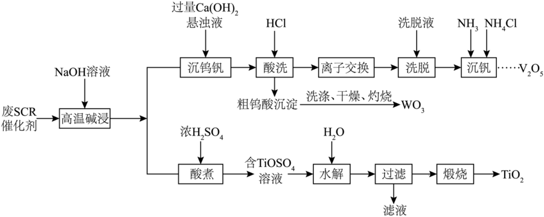

# Chemistry - 题目 135

**ID**: bdcbfe9593c542ab85345ba78242928f
**年级**: Grade 12
**难度**: Medium-Hard
**题型**: 非选择题

## 题目
废SCR催化剂(含 ${\rm{T}}{\rm{i}}{\rm{O}}{{}_{2}}$ 、 ${\rm{V}}{{}_{2}}{\rm{O}}{{}_{5}}$ 、 ${\rm{W}}{\rm{O}}{{}_{3}}$ )具有重要的经济价值，一种从废SCR催化剂回收钒、钨、钛等有价值化合物的工艺流程如图所示。​​​​​​​‌已知：① ${\rm{V}}{{}_{2}}{\rm{O}}{{}_{5}}$ ， ${\rm{W}}{\rm{O}}{{}_{3}}$ ， ${\rm{T}}{\rm{i}}{\rm{O}}{{}_{2}}$ 都能与 ${\rm{N}}{\rm{a}}{\rm{O}}{\rm{H}}$ 溶液反应，生成可溶性的 ${\rm{N}}{\rm{a}}{\rm{V}}{\rm{O}}{{}_{3}}$ ， ${\rm{N}}{\rm{a}}{{}_{2}}{\rm{W}}{\rm{O}}{{}_{4}}$ ，难溶于水的 ${\rm{N}}{\rm{a}}{{}_{2}}{\rm{O}}\cdot {\rm{x}}{\rm{T}}{\rm{i}}{\rm{O}}{{}_{2}}$ 。② ${\rm{T}}{\rm{i}}{\rm{O}}{\rm{S}}{\rm{O}}{{}_{4}}$ 易溶于水，属于强电解质。偏钛酸难溶于水，其化学式可表示为 ${\rm{T}}{\rm{i}}{\rm{O}}\left ({{\rm{O}}{\rm{H}}}\right ){{}_{2}}$ 或 ${\rm{H}}{{}_{2}}{\rm{T}}{\rm{i}}{\rm{O}}{{}_{3}}$ 。(1)可以提高“高温碱浸”效率的措施为(任写一种)，该步骤后通过(填操作名称)可以实现钛与钒，钨分离。(2)“沉钨钒”时 ${\rm{N}}{\rm{a}}{{}_{2}}{\rm{W}}{\rm{O}}{{}_{4}}$ 转化为 ${\rm{C}}{\rm{a}}{\rm{W}}{\rm{O}}{{}_{4}}$ 沉降分离，已知温度为T时 $K{{}_{{\rm{s}}{\rm{p}}}}\left ({{\rm{C}}{\rm{a}}{\rm{W}}{\rm{O}}{{}_{4}}}\right )=1\times 10{^{-10}}$ ， $K{{}_{{\rm{s}}{\rm{p}}}}\left [{\rm{C}}{\rm{a}}\left ({{\rm{O}}{\rm{H}}}\right ){{}_{2}}\right ]=4\times 10{^{-7}}$ ，当溶液中 ${\rm{W}}{\rm{O}}{{}_{4}^{2-}}$ 恰好沉淀完全(离子浓度等于 $10{^{-5}}{\rm{m}}{\rm{o}}{\rm{l}}\cdot {\rm{L}}{^{-1}}$ )时，溶液中 $c\left ({{\rm{O}}{\rm{H}}{^{-}}}\right )=$。(3)已知“酸洗”后钒以 $\left [{\rm{H}}{{}_{2}}{\rm{V}}{{}_{10}}{\rm{O}}{{}_{28}}\right ]{^{4-}}$ 形式存在，流程中“离子交换”和“洗脱”的目的是。(4)粗 ${\rm{H}}{{}_{2}}{\rm{W}}{\rm{O}}{{}_{4}}$ 沉淀洗涤过程中，判断洗涤干净的实验操作为。(5)“酸煮”步骤的化学方程式为。(6)流程中“滤液”溶质的成分为。

## 解答

1. （1）可以提高“高温碱浸”效率的措施为增大 ${\rm{N}}{\rm{a}}{\rm{O}}{\rm{H}}$ 的浓度或搅拌；该步骤后通得到可溶性的 ${\rm{N}}{\rm{a}}{\rm{V}}{\rm{O}}{{}_{3}}$ ， ${\rm{N}}{\rm{a}}{{}_{2}}{\rm{W}}{\rm{O}}{{}_{4}}$ 滤液和难溶于水的 ${\rm{N}}{\rm{a}}{{}_{2}}{\rm{O}}\cdot {\rm{x}}{\rm{T}}{\rm{i}}{\rm{O}}{{}_{2}}$ ，通过过滤可以实现钛与钒，钨分离；
2. （2）当溶液中 ${\rm{W}}{\rm{O}}{{}_{4}^{2-}}$ 恰好沉淀完全(离子浓度等于 $10{^{-5}}{\rm{m}}{\rm{o}}{\rm{l}}/{\rm{L}}$ )时， ${\rm c(Ca^{2+})=}\frac {{\rm{K}}{{}_{{\rm{s}}{\rm{p}}}}\left ({{\rm{C}}{\rm{a}}{\rm{W}}{\rm{O}}{{}_{{{4}}}}}\right )}{{\rm{c}}{\rm{(}}{\rm{W}}{\rm{O}}{{}_{{{4}}}^{{{2}}{{-}}}}{\rm{)}}}{\rm =}$  $\frac {{{1}}\times {{1}}{{0}}{^{{{-}}{{1}}{{0}}}}}{{{1}}{{0}}{^{{{-}}{{5}}}}}{\rm mol}$ / ${\rm L=}10{^{-5}}{\rm{m}}{\rm{o}}{\rm{l}}/{\rm{L}}$ ，此时 $c\left ({{\rm{O}}{\rm{H}}{^{-}}}\right )=$  $\sqrt {\frac {K{{}_{{\rm{s}}{\rm{p}}}}\left [{\rm{C}}{\rm{a}}\left ({{\rm{O}}{\rm{H}}}\right ){{}_{{{2}}}}\right ]}{{\rm{c}}{\rm{(}}{\rm{C}}{\rm{a}}{^{{{2}}{{+}}}}{\rm{)}}}}{\rm mol}$ / ${\rm L=}\sqrt {\frac {4\times 10{^{-7}}}{{{1}}{{0}}{^{{{-}}{{5}}}}}}{\rm mol}$ /L=0.2 mol/L；
3. （3）由分析可知，流程中“离子交换”和“洗脱”的目的是富集钒元素，除去杂质离子；
4. （4）粗 ${\rm{H}}{{}_{2}}{\rm{W}}{\rm{O}}{{}_{4}}$ 中可能会含有未洗净的HCl，检验其中是否含 $Cl{^{-}}$ 即可判断是否洗涤干净，操作是取最后一次洗涤液于洁净试管中，加入稀硝酸酸化，再加入适量硝酸银溶液，若不出现白色沉淀，说明洗涤干净；
5. （5）“酸煮”过程中 ${\rm{N}}{\rm{a}}{{}_{2}}{\rm{O}}\cdot {\rm{x}}{\rm{T}}{\rm{i}}{\rm{O}}{{}_{2}}$ 与浓 ${\rm{H}}{{}_{{{2}}}}{\rm{S}}{\rm{O}}{{}_{4}}$ 反应生成 $TiOSO{{}_{4}}$ 、 ${\rm{N}}{\rm{a}}{{}_{{{2}}}}{\rm{S}}{\rm{O}}{{}_{{{4}}}}$ 和 ${\rm{H}}{{}_{{{2}}}}{\rm{O}}$ ，化学方程式为： ${\rm{N}}{\rm{a}}{{}_{2}}{\rm{O}}\cdot {\rm{x}}{\rm{T}}{\rm{i}}{\rm{O}}{{}_{2}}+\left ({{\rm{x}}+1}\right ){\rm{H}}{{}_{2}}{\rm{S}}{\rm{O}}{{}_{4}}$ (浓) $\hspace{-0.5em}\begin{array}{}{\underline{\underline {{\rm{Δ}}}}}\\\;\end{array}\hspace{-0.5em}{\rm{x}}{\rm{T}}{\rm{i}}{\rm{O}}{\rm{S}}{\rm{O}}{{}_{4}}+\left ({{\rm{x}}+1}\right ){\rm{H}}{{}_{2}}{\rm{O}}+{\rm{N}}{\rm{a}}{{}_{2}}{\rm{S}}{\rm{O}}{{}_{4}}$ ；
6. （6） ${\rm{T}}{\rm{i}}{\rm{O}}{\rm{S}}{\rm{O}}{{}_{4}}$ 在稀溶液中发生水解反应生成 ${\rm{T}}{\rm{i}}{\rm{O}}{{}_{{{2}}}}\cdot {\rm{x}}{\rm{H}}{{}_{{{2}}}}{\rm{O}}$ 和硫酸，水解的离子方程式为 ${\rm{T}}{\rm{i}}{\rm{O}}{^{{{2}}{{+}}}}{{+}}\left ({{\rm{x}}{{+}}{{1}}}\right ){\rm{H}}{{}_{{{2}}}}{\rm{O}}{\rm{=}}{\rm{T}}{\rm{i}}{\rm{O}}{{}_{{{2}}}}\cdot {\rm{x}}{\rm{H}}{{}_{{{2}}}}{\rm{O}}\downarrow {{+}}{{2}}{\rm{H}}{^{{{+}}}}$ ，故滤液中含有 ${\rm{N}}{\rm{a}}{{}_{{{2}}}}{\rm{S}}{\rm{O}}{{}_{{{4}}}}$ 、 ${\rm{H}}{{}_{{{2}}}}{\rm{S}}{\rm{O}}{{}_{4}}$ 。

## 知识点

**中文**:
  - 晶体的洗涤
  - 陌生氧化还原反应方程式的书写

**English**:
  - Washing of Crystals
  - Writing Equations for Unfamiliar Redox Reactions

---
