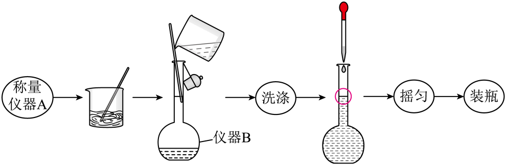
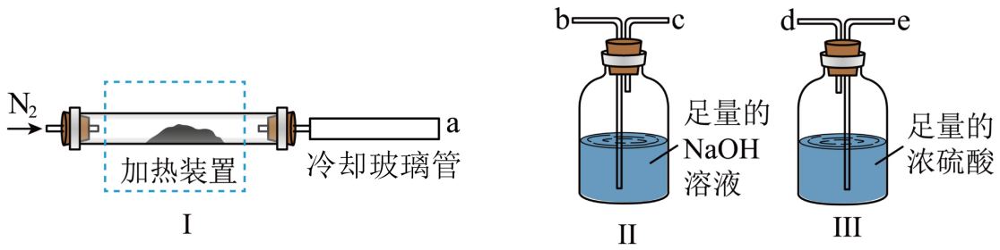

# Chemistry - 题目 248

**ID**: c84ef74880134cd39430bfe98eda4d5f
**年级**: Grade 12
**难度**: Medium-Hard
**题型**: 非选择题

## 题目
碳酸镁晶体是一种新型吸波隐形材料中的增强剂。​​​​​​​‌回答下列问题：I．合成该物质的步骤如下：步骤1：配制一定浓度的 ${\rm{M}}{\rm{g}}{\rm{S}}{\rm{O}}{{}_{4}}$ 溶液和 ${\rm{N}}{\rm{H}}{{}_{4}}{\rm{H}}{\rm{C}}{\rm{O}}{{}_{3}}$ 溶液；步骤2：量取一定量的 ${\rm{N}}{\rm{H}}{{}_{4}}{\rm{H}}{\rm{C}}{\rm{O}}{{}_{3}}$ 溶液于容器中，搅拌并逐滴加入 ${\rm{M}}{\rm{g}}{\rm{S}}{\rm{O}}{{}_{4}}$ 溶液，温度控制在50℃，用氨水调节溶液pH至9.5；步骤3：放置1 h后，过滤、洗涤、干燥，得碳酸镁晶体产品[ ${\rm{M}}{\rm{g}}{\rm{C}}{\rm{O}}{{}_{3}}\cdot {\rm{H}}{{}_{2}}{\rm{O}}$ ( $n=1\sim 5$ )]。(1)称取 $3.3$   ${\rm{g}}$   ${\rm{M}}{\rm{g}}{\rm{S}}{\rm{O}}{{}_{4}}$ 样品配制240 mL溶液的流程如图所示：写出实验仪器的名称：A；B。(2)配制溶液过程中仅用少量蒸馏水洗涤烧杯内壁和玻璃棒1次，则配得的 ${\rm{M}}{\rm{g}}{\rm{S}}{\rm{O}}{{}_{4}}$ 溶液的物质的量浓度(填“偏高”“偏低”或“无影响”)。(3)步骤2中反应的离子方程式为。II．测定产品 ${\rm{M}}{\rm{g}}{\rm{C}}{\rm{O}}{{}_{3}}\cdot n{\rm{H}}{{}_{2}}{\rm{O}}$ 中的 $n$ 值(仪器和药品如图所示)。(4)上述装置的连接顺序为(按气流方向，用接口字母表示)，其中装置II的作用是。(5)加热前先通入 ${\rm{N}}{{}_{2}}$ 排尽装置中的空气，称取装置II、III的初始质量后，边加热边通入 ${\rm{N}}{{}_{2}}$ 的作用是。(6)若冷却玻璃管中无残留物，要准确测定n值。已知：①装置I反应前后质量差为 $m{{}_{1}}$ ②装置II反应前后质量差为 $m{{}_{2}}$ ，用 $m{{}_{1}}$ 、 $m{{}_{2}}$ 表示 $n=$。

## 解答

1. （1）实验仪器A为称量 ${\rm{M}}{\rm{g}}{\rm{S}}{\rm{O}}{{}_{4}}$ 的仪器，所以名称为托盘天平；仪器B是配置250 mL 溶液的仪器，所以B为250 mL 容量瓶；
2. （2）仅用少量蒸馏水洗涤烧杯内壁和玻璃棒1次会导致 ${\rm{M}}{\rm{g}}{\rm{S}}{\rm{O}}{{}_{4}}$ 残留在烧杯内壁和玻璃棒，溶质流失，配得的 ${\rm{M}}{\rm{g}}{\rm{S}}{\rm{O}}{{}_{4}}$ 溶液的物质的量浓度偏低；
3. （3）步骤 ${\rm 2，}{\rm{N}}{\rm{H}}{{}_{4}}{\rm{H}}{\rm{C}}{\rm{O}}{{}_{3}}$ 溶液中逐滴加入 ${\rm{M}}{\rm{g}}{\rm{S}}{\rm{O}}{{}_{4}}$ 发生的离子反应为： ${\rm{M}}{\rm{g}}{^{{{2}}{{+}}}}{{+}}{{2}}{\rm{N}}{\rm{H}}{{}_{{{3}}}}\cdot {\rm{H}}{{}_{{{2}}}}{\rm{O}}{{+}}{{2}}{\rm{H}}{\rm{C}}{\rm{O}}{{}_{{{3}}}^{{{-}}}}{\rm{=}}{\rm{M}}{\rm{g}}{\rm{C}}{\rm{O}}{{}_{{{3}}}}\downarrow {{+}}{{2}}{\rm{N}}{\rm{H}}{{}_{{{4}}}^{{{+}}}}{{+}}{{2}}{\rm{H}}{{}_{{{2}}}}{\rm{O}}{{+}}{\rm{C}}{\rm{O}}{{}_{{{3}}}^{{{2}}{{-}}}}$ ；
4. （4）高温加热 ${\rm{M}}{\rm{g}}{\rm{C}}{\rm{O}}{{}_{3}}\cdot n{\rm{H}}{{}_{2}}{\rm{O}}$ ，产生 ${\rm{C}}{\rm{O}}{{}_{{{2}}}}$ 和 ${\rm{H}}{{}_{{{2}}}}{\rm{O}}$ ；反应方程式为：  ${\rm{M}}{\rm{g}}{\rm{C}}{\rm{O}}{{}_{{{3}}}}\cdot n{\rm{H}}{{}_{{{2}}}}{\rm{O}}\hspace{-0.5em}\begin{array}{}{\underline{{\underline{~~高温~~}}}}\atop{}\end{array}\hspace{-0.5em}{\rm{C}}{\rm{O}}{{}_{{{2}}}}+n{\rm{H}}{{}_{{{2}}}}{\rm{O}}{{+}}{\rm{M}}{\rm{g}}{\rm{O}}$ ，通过测定 ${\rm{C}}{\rm{O}}{{}_{{{2}}}}$ 和 ${\rm{H}}{{}_{{{2}}}}{\rm{O}}$ 的质量，就可以测出  ${\rm{M}}{\rm{g}}{\rm{C}}{\rm{O}}{{}_{3}}\cdot n{\rm{H}}{{}_{2}}{\rm{O}}$ 结晶水的含量；装置II用于吸收测量 ${\rm{C}}{\rm{O}}{{}_{{{2}}}}$ 以便测定样品中碳元素的含量， 所以正确的连接顺序为a→e、d→b→c；
5. （5）通入 ${\rm{N}}{{}_{2}}$ ，为了将分解生成的气体全部带入装置II或III中，使其完全吸收；
6. （6）①装置I反应前后质量差为 $m{{}_{1}}$ ，即 $m({\rm{H}}{{}_{{{2}}}}{\rm{O}})+m({\rm{C}}{\rm{O}}{{}_{{{2}}}})=m{{}_{1}}$ ；②装置II反应前后质量差为 $m{{}_{2}}$ ，即 $m({\rm{C}}{\rm{O}}{{}_{{{2}}}})=m{{}_{2}}$ ，则 $m({\rm{H}}{{}_{{{2}}}}{\rm{O}})=m{{}_{1}}-m{{}_{2}}$ ，根据方程式的， $\hspace{-0.5em}\begin{array}{}{\rm{M}}{\rm{g}}{\rm{C}}{\rm{O}}{{}_{{{3}}}}\cdot n{\rm{H}}{{}_{{{2}}}}{\rm{O}}&\hspace{-0.5em}\begin{array}{}{\underline{{\underline{~~高温~~}}}}\atop{}\end{array}\hspace{-0.5em}&{\rm{C}}{\rm{O}}{{}_{{{2}}}}&+&n{\rm{H}}{{}_{{{2}}}}{\rm{O}}&+&{\rm{M}}{\rm{g}}{\rm{O}}\\\;&\;&44&\;&18n&\;&\;\\\;&\;&m{{}_{2}}&\;&m{{}_{1}}-m{{}_{2}}&\;&\;\end{array}\hspace{-0.5em}$ ，则 $\frac {44}{m{{}_{2}}}=\frac {18n}{m{{}_{1}}-m{{}_{2}}}$ ，即 $n=\frac {22(m{{}_{1}}-m{{}_{2}})}{9m{{}_{2}}}$ 。

## 知识点

**中文**:
  - 配制一定物质的量浓度溶液的实验仪器
  - 配制一定物质的量浓度溶液的实验步骤
  - 配制一定物质的量浓度溶液的误差分析

**English**:
  - Apparatus for Solution Preparation
  - Experimental Steps for Solution Preparation
  - Error Analysis in Solution Preparation

---
