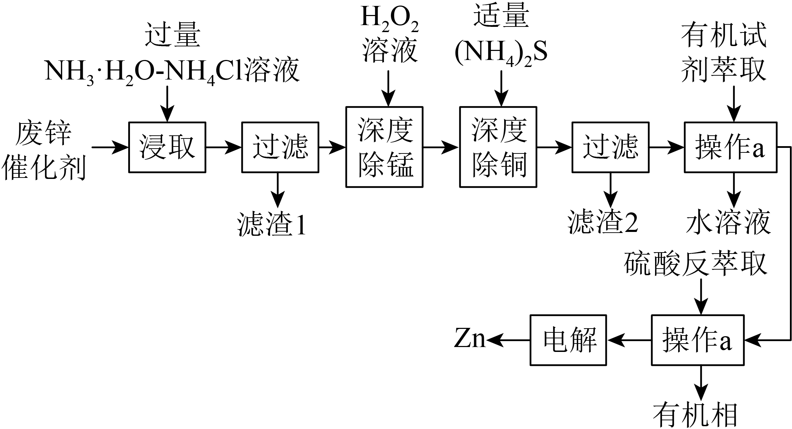
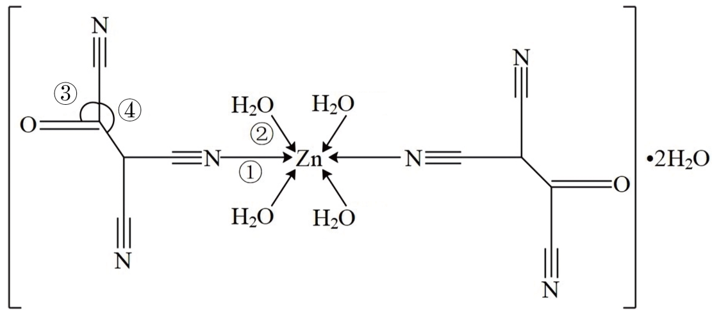

# Chemistry - 题目 351

**ID**: cc0abd44068a4b4abef0ceccd99c909b
**年级**: Grade 12
**难度**: Medium-Hard
**题型**: 非选择题

## 题目
锌及其化合物被广泛应用于汽车、建筑、船舶、电池等行业。​​​​​​​‌现某科研小组以固体废锌催化剂(主要成分是ZnO，含少量Fe_{2}O_{3}、CuO、MnO、SiO_{2}等杂质)为原料制备锌的工艺流程如图所示：已知：①“浸取”时，ZnO和CuO转化为[Zn(NH_{3})_{4}]^{2+}、[Cu(NH_{3})_{4}]^{2+}进入溶液。②25℃时，K_{sp}(CuS)=6.4×10^{-36}，K_{sp}(ZnS)=1.6×10^{-24}。③“有机试剂萃取”发生 ${\rm Zn^{2+}+2HR}\rightleftharpoons $ ZnR_{2}+2H^{+}(HR代表有机萃取剂，易挥发)。（1）“浸取”适宜温度为30℃，继续升温浸出率下降的原因为。（2）“滤渣1”的主要成分为Mn(OH)_{2}、。（3）“深度除锰”是将残留的Mn^{2+}转化为MnO_{2}，写出该过程的离子方程式：。（4）“深度除铜”需控制(NH_{4})_{2}S的用量，过多会造成。(用离子方程式表示)（5）整个过程中除有机萃取剂外还可循环利用的物质有。（6）Zn原子能形成多种配位化合物，一种锌的配合物结构如图：配位键①和②相比，较稳定的是；键角③键角④(填“>“、“<“、“=“)，原因为。

## 解答

1. （1）“浸取”温度为30℃时，锌的浸出率可达90.6%，继续升温浸出率反而下降，其原因为：温度升高，氨气挥发量增加且NH_{4}Cl发生分解，生成[Zn(NH_{3})_{4}]^{2+}的量减少，不利于废锌催化剂中锌的浸出；
2. （2）据分析可知，滤渣1为： ${\rm{M}}{\rm{n}}\left ({{\rm{O}}{\rm{H}}}\right ){{}_{2}}$ 、Fe(OH)_{3}、SiO_{2}，故答案为：Fe(OH)_{3}、SiO_{2}；
3. （3）在氨水存在的碱性条件下，过氧化氢和锰离子发生氧化还原反应生成二氧化锰沉淀和水、铵根离子，反应为： ${\rm{M}}{\rm{n}}{^{2+}}+2{\rm{N}}{\rm{H}}{{}_{3}}\cdot {\rm{H}}{{}_{2}}{\rm{O}}+{\rm{H}}{{}_{2}}{\rm{O}}{{}_{2}}={\rm{M}}{\rm{n}}{\rm{O}}{{}_{2}}\downarrow +2{\rm{N}}{\rm{H}}{{}_{4}^{+}}+2{\rm{H}}{{}_{2}}{\rm{O}}$ ；
4. （4）硫离子可以和锌离子形成沉淀，则锌的最终回收率下降的原因是：过量的硫离子和将锌转化为硫化锌沉淀，反应为[Zn(NH_{3})_{4}]^{2+}+S^{2-}=ZnS↓+4NH_{3}↑；故答案为：[Zn(NH_{3})_{4}]^{2+}+S^{2-}=ZnS↓+4NH_{3}↑；
5. （5）加入有机萃取剂萃取分离出含锌的有机相，其水溶液中含有氯化铵，加入硫酸反萃取得到含锌的水相，电解得到锌和硫酸，则整个过程中除有机萃取剂外还可循环利用的物质有：NH_{4}Cl、H_{2}SO_{4}；
6. （6）
7. N和O相比，N的电负性弱，更容易提供孤电子对，配位键更加稳定，故更加稳定的是配位键①；键角③是双键和单键之间的排斥力，电子云密度大，排斥力较大，键角较大，键角④是单键和单键之间的排斥力，电子云密度小，排斥力较小，键角较小，故键角③>键角④；
8. 故答案为：①；>；键角③是双键和单键之间的排斥力，电子云密度大，排斥力较大，键角较大，键角④是单键和单键之间的排斥力，电子云密度小，排斥力较小，键角较小，故键角③>键角④。

## 知识点

**中文**:
  - 配合物的成键情况
  - 陌生氧化还原反应方程式的书写
  - 配合物的结构与性质

**English**:
  - Bonding in Complexes
  - Writing Equations for Unfamiliar Redox Reactions
  - Structure and Properties of Complexes

---
