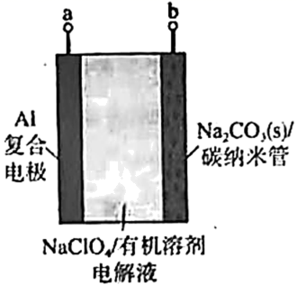

# Chemistry - 题目 160

**ID**: e649c55206f94f8db0959186c919ee38
**年级**: Grade 12
**难度**: Medium-Hard
**题型**: Multiple-choice

## 题目
我国科学家利用Na_{2}CO_{3}和碳纳米管组装“无Na预填装”的Na-CO_{2}二次电池(如下图所示)。​​​​​​​‌b电极中的碳纳米管可作导体、反应物和CO_{2}通道等。电池的总反应 ${\rm{2}}{\rm{N}}{\rm{a}}_{{\rm{2}}}{\rm{C}}{\rm{O}}_{{\rm{3}}}{\rm{+}}{\rm{C}}\xrightleftharpoons [\mathrm{{\rm{放}}{\rm{电}}}]{\mathrm{{\rm{充}}{\rm{电}}}}{\rm{3}}{\rm{C}}{\rm{O}}_{{\rm{2}}}{\rm{↑}}{\rm{+}}{\rm{4}}{\rm{N}}{\rm{a}}$ ，下列关于该电池的说法不正确的是

## 解答

1. A．由于该电池工作时有钠单质参与，钠会与水反应降低效率，所以不能用水配制电解液，A正确；
2. B．根据题意可知该电池组装好时Al符合电极上没有钠单质，所以要先充电，生成钠单质，然后才能放电，B正确；
3. C．放电时a极为负极，而原电池中阳离子向正极移动，即Na^{+}向b电极移动，C错误；
4. D．充电时b为阳极，Na_{2}CO_{3}(s)/碳纳米管电极上C被氧化为二氧化碳，电极反应为2Na_{2}CO_{3}+C-4e^{-}=4Na^{+}+3CO_{2}↑，D正确；
5. 综上所述答案为C。

## 知识点

**中文**:
  - 加聚反应
  - 缩聚反应
  - 高分子化合物结构简式的书写
  - 高分子化合物单体的推断
  - 高分子化合物的通性、分类

**English**:
  - Addition Polymerization
  - Condensation Polymerization
  - Writing Structural Formulas of Polymers
  - Deducing Monomers
  - General Properties and Classification

---
