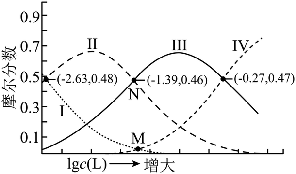

# Chemistry - 题目 94

**ID**: ecb12af1dbeb49cc961dafb892ab8a13
**年级**: Grade 12
**难度**: Medium-Hard
**题型**: Multiple-choice

## 题目
铜(I)与有机物 ${\rm{L}}$ 可结合形成多种配合物，在水溶液中存在如下平衡： ${\rm{C}}{\rm{u}}{^{+}}\xrightleftharpoons []{\mathrm{{\rm{K}}{{}_{1}}}}{\rm{C}}{\rm{u}}{\rm{L}}{^{+}}\xrightleftharpoons []{\mathrm{{\rm{K}}{{}_{2}}}}{\rm{C}}{\rm{u}}{\rm{L}}{{}_{2}^{+}}\xrightleftharpoons []{\mathrm{{\rm{K}}{{}_{3}}}}{\rm{C}}{\rm{u}}{\rm{L}}{{}_{3}^{+}}$ ，某水溶液体系中含铜物种的摩尔分数随 ${\rm \mathrm{\lg }c(\text{L})}$ 变化关系如图所示(忽略溶液体积变化)，总铜浓度为 $1.0\times 10{^{-3}}{\rm{m}}{\rm{o}}{\rm{l}}\cdot {\rm{L}}{^{-1}}$ 。​​​​​​​‌下列描述正确的是（      ）

## 解答

1. A．由分析，曲线 ${\rm{I}}$ 所代表的微粒为 ${\rm{C}}{\rm{u}}{^{+}}{\rm ，A}$ 错误；
2. B．N点 ${\rm \text{c}({\text{CuL}}_{\text{2}}^{\text{+}})=}$  ${\rm \text{c}({\text{CuL}}^{\text{+}})}$ ， ${\rm \mathrm{\lg }c(\text{L})=-1.39}$ ， ${\rm{C}}{\rm{u}}{\rm{L}}{^{+}}+{\rm{L}}\rightleftharpoons {\rm{C}}{\rm{u}}{\rm{L}}{{}_{2}^{+}}$ 的平衡常数 ${\rm {\text{K}}_{\text{2}}\text{=}\frac{\text{c}({\text{CuL}}_{\text{2}}^{\text{+}})}{\text{c}({\text{CuL}}^{\text{+}})\text{c}(\text{L})}\text{=}\frac{\text{1}}{\text{c}(\text{L})}\text{=}{10}^{1.39}，B}$ 正确；
3. C．由题意可知， ${\rm {\text{K}}_{1}\text{=}\frac{\text{c}({\text{CuL}}^{+})}{\text{c}({\text{Cu}}^{+})\text{c}(\text{L})}}$ 、 ${\rm {\text{K}}_{\text{2}}\text{=}\frac{\text{c}({\text{CuL}}_{\text{2}}^{\text{+}})}{\text{c}({\text{CuL}}^{\text{+}})\text{c}(\text{L})}}$ 、 ${\rm {\text{K}}_{3}\text{=}\frac{\text{c}({\text{CuL}}_{3}^{\text{+}})}{\text{c}({\text{CuL}}_{\text{2}}^{\text{+}})\text{c}(\text{L})}}$ ， ${\rm {\mathrm{\lg K}}_{1}+{\mathrm{\lg K}}_{2}+{\mathrm{\lg K}}_{3}\text{=}\lg ({\text{K}}_{1}{\text{K}}_{2}{\text{K}}_{3})\mathrm{=\lg }\frac{\text{c}({\text{CuL}}_{3}^{\text{+}})}{\text{c}({\text{Cu}}^{+}){\text{c}}^{\text{3}}(\text{L})}，M}$ 点 ${\rm{c}}\left ({{\rm{C}}{\rm{u}}{^{+}}}\right )$  ${\rm =\text{c}({\text{CuL}}_{3}^{\text{+}})}$ ， ${\rm {\mathrm{\lg K}}_{1}+{\mathrm{\lg K}}_{2}+{\mathrm{\lg K}}_{3}\mathrm{=\lg }\frac{1}{{\text{c}}^{\text{3}}(\text{L})}=-3\lg \text{c}(\text{L})}$ ， ${\rm \lg \text{c}(\text{L})\text{=-}\frac{{\mathrm{\lg K}}_{1}+{\mathrm{\lg K}}_{2}+{\mathrm{\lg K}}_{3}}{3}，C}$ 正确；
4. D．由铜守恒， ${\rm{N}}$ 点， ${\rm c({\text{Cu}}^{+})\text{+}c({\text{CuL}}^{+})+c({\text{CuL}}_{2}^{+})+c({\text{CuL}}_{3}^{+})=1.0×{10}^{-3}\text{{\rm mol}}\cdot {\text{L}}^{-1}，D}$ 错误；
5. 故选BC。

## 知识点

**中文**:
  - 与物质百分含量变化有关图像的分析
  - 溶液中微粒间的电荷守恒、质子守恒、物料守恒
  - 溶液中微粒浓度大小比较

**English**:
  - Graphs involving Percentage Content
  - Charge Balance, Proton Balance, and Material Balance
  - Comparison of Particle Concentrations

---
