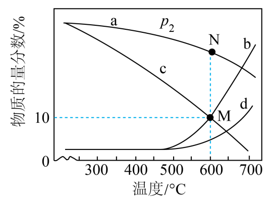

# Chemistry - 题目 258

**ID**: efe6a3c17c6d4a978b6429b75cb53781
**年级**: Grade 12
**难度**: Medium-Hard
**题型**: Multiple-choice

## 题目
科学家利用多聚物来捕获 ${\rm{C}}{\rm{O}}{{}_{2}}$ ，使 ${\rm{C}}{\rm{O}}{{}_{2}}$ 与 ${\rm{H}}{{}_{2}}$ 在催化剂表面生成 ${\rm{C}}{\rm{H}}{{}_{3}}{\rm{O}}{\rm{H}}$ 和 ${\rm{H}}{{}_{2}}{\rm{O}}$ ，涉及以下反应：反应Ⅰ： ${\rm{C}}{\rm{O}}{{}_{2}}\left ({{\rm{g}}}\right )+3{\rm{H}}{{}_{2}}\left ({{\rm{g}}}\right )\rightleftharpoons {\rm{C}}{\rm{H}}{{}_{3}}{\rm{O}}{\rm{H}}\left ({{\rm{g}}}\right )+{\rm{H}}{{}_{2}}{\rm{O}}\left ({{\rm{g}}}\right )$    $ΔH{{}_{1}}<0$反应Ⅱ： ${\rm{C}}{\rm{O}}{{}_{2}}\left ({{\rm{g}}}\right )+{\rm{H}}{{}_{2}}\left ({{\rm{g}}}\right )\rightleftharpoons {\rm{C}}{\rm{O}}\left ({{\rm{g}}}\right )+{\rm{H}}{{}_{2}}{\rm{O}}\left ({{\rm{g}}}\right )$    $ΔH{{}_{2}}>0$在恒压密闭容器中充入 $6{\rm{m}}{\rm{o}}{\rm{l}}{\rm{H}}{{}_{2}}$ 与 $2{\rm{m}}{\rm{o}}{\rm{l}}{\rm{C}}{\rm{O}}{{}_{2}}$ ，分别在 $p{{}_{1}}$ 、 $p{{}_{2}}$ ( $p{{}_{1}}<p{{}_{2}}$ )压强下反应。​​​​​​​‌平衡体系中，CO及 ${\rm{C}}{\rm{H}}{{}_{3}}{\rm{O}}{\rm{H}}$ 的物质的量分数随温度的变化关系如图。下列说法不正确的是（      ）已知： ${\rm{C}}{\rm{H}}{{}_{3}}{\rm{O}}{\rm{H}}$ 的选择性 $=\frac {转化为{\rm{C}}{\rm{H}}{{}_{3}}{\rm{O}}{\rm{H}}的n\left ({{\rm{C}}{\rm{O}}{{}_{2}}}\right )}{消耗的n\left ({{\rm{C}}{\rm{O}}{{}_{2}}}\right )}\times 100{\rm{\%}}$

## 解答

1. A．温度相同时，对于反应Ⅰ，压强越大，平衡正向移动，甲醇的选择性 ${\rm{N}}>{\rm{M}}{\rm ，A}$ 正确；
2. B．据分析，曲线b表示压强为 $p{{}_{1}}$ 时CO的物质的量分数随温度的变化关系，B正确；
3. C．恒压条件下，平衡后再充入惰性气体，反应体系的体积增大，反应Ⅰ和Ⅱ的气体分压减小，反应Ⅰ的平衡逆向移动， $n\left ({{\rm{C}}{\rm{O}}{{}_{2}}}\right )$ 增大， $n\left ({{\rm{H}}{{}_{2}}{\rm{O}}}\right )$ 减小，使反应Ⅱ的化学平衡正向移动，C错误；
4. D．对反应Ⅰ使用催化活性更高的催化剂，使 ${\rm{C}}{\rm{O}}{{}_{2}}$ 转化为更多的 ${\rm{C}}{\rm{H}}{{}_{3}}{\rm{O}}{\rm{H}}$ ，能提高 ${\rm{C}}{\rm{H}}{{}_{3}}{\rm{O}}{\rm{H}}$ 的选择性，D正确；
5. 故答案为：C。

## 知识点

**中文**:
  - 活化能及其对化学反应速率的影响
  - 温度对化学平衡的影响

**English**:
  - Activation Energy and Its Effect on Rate
  - Effect of Temperature

---
