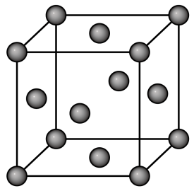

# Chemistry - 题目 161

**ID**: f6d3ac22a23d4f86b17ab75ba5362d91
**年级**: Grade 12
**难度**: Medium-Hard
**题型**: 非选择题

## 题目
某实验小组从废定影液中回收银。​​​​​​​‌操作如下：I.沉银。从印刷、照相等行业上收集废定影液，废定影液中含有 ${\rm{N}}{\rm{a}}{{}_{3}}\left [{\rm{A}}{\rm{g}}\left ({{\rm{S}}{{}_{2}}{\rm{O}}{{}_{3}}}\right ){{}_{2}}\right ]$ 。向废定影液中加入足量 ${\rm{N}}{\rm{a}}{{}_{2}}{\rm{S}}$ 溶液，得到 ${\rm{A}}{\rm{g}}{{}_{2}}{\rm{S}}$ 固体和滤液 ${\rm{X}}$ 。如果将滤液 ${\rm{X}}$ 在氮气气氛中蒸发、灼烧可得到固体 ${\rm{N}}{\rm{a}}{{}_{2}}{\rm{S}}{{}_{2}}{\rm{O}}{{}_{3}}$ 。(1)沉淀剂选择 ${\rm{N}}{\rm{a}}{{}_{2}}{\rm{S}}$ 而不选择 ${\rm{H}}{{}_{2}}{\rm{S}}$ 的主要原因是。(2)写出沉银时发生反应的离子方程式：。II.焙烧。将分离出来的 ${\rm{A}}{\rm{g}}{{}_{2}}{\rm{S}}$ 在空气中加热800~900℃得到金属银(粗)和气体 ${\rm{S}}{\rm{O}}{{}_{2}}$ ，将 ${\rm{S}}{\rm{O}}{{}_{2}}$ 通入品红溶液中，溶液褪色，则 ${\rm{S}}{\rm{O}}{{}_{2}}$ 通入适当配比的 ${\rm{N}}{\rm{a}}{{}_{2}}{\rm{S}}$ 和 ${\rm{N}}{\rm{a}}{{}_{2}}{\rm{C}}{\rm{O}}{{}_{3}}$ 混合液中可以制备 ${\rm{N}}{\rm{a}}{{}_{2}}{\rm{S}}{{}_{2}}{\rm{O}}{{}_{3}}$ 。(3)制备 ${\rm{N}}{\rm{a}}{{}_{2}}{\rm{S}}{{}_{2}}{\rm{O}}{{}_{3}}$ 反应中， ${\rm{S}}{\rm{O}}{{}_{2}}$ 、 ${\rm{N}}{\rm{a}}{{}_{2}}{\rm{S}}$ 、 ${\rm{N}}{\rm{a}}{{}_{2}}{\rm{C}}{\rm{O}}{{}_{3}}$ 的物质的量之比为(写最简比)。III.提纯。粗银经下列步骤提纯：①酸溶。将粗银溶解于1：1的硝酸(1体积浓硝酸和1体积水)中，得到 ${\rm{A}}{\rm{g}}{\rm{N}}{\rm{O}}{{}_{3}}$ 溶液；②沉银。向 ${\rm{A}}{\rm{g}}{\rm{N}}{\rm{O}}{{}_{3}}$ 溶液中加入足量盐酸，得到 ${\rm{A}}{\rm{g}}{\rm{C}}{\rm{l}}$ 浊液；③置换。在浊液中加入适量铁粉，搅拌，充分反应；④洗涤、干燥。先用物理方法除去过量铁粉，后用盐酸洗涤，最后用水洗，经干燥得到银粉。(4)粗银溶于1：1的硝酸而不选用浓硝酸，其主要原因是。(5)已知： ${\rm{A}}{\rm{g}}{^{+}}\left ({{\rm{a}}{\rm{q}}}\right )+2{\rm{S}}{{}_{2}}{\rm{O}}{{}_{3}^{2-}}\left ({{\rm{a}}{\rm{q}}}\right )\rightleftharpoons \left [{\rm{A}}{\rm{g}}\left ({{\rm{S}}{{}_{2}}{\rm{O}}{{}_{3}}}\right ){{}_{2}}\right ]{^{3-}}\left ({{\rm{a}}{\rm{q}}}\right )$    $K=10{^{13.5}}$ ， $K{{}_{{\rm{s}}{\rm{p}}}}\left ({{\rm{A}}{\rm{g}}{{}_{2}}{\rm{S}}}\right )=6.7\times 10{^{-50}}$ 。通过计算证明 ${\rm{N}}{\rm{a}}{{}_{2}}{\rm{S}}$ 与 ${\rm{N}}{\rm{a}}{{}_{3}}\left [{\rm{A}}{\rm{g}}\left ({{\rm{S}}{{}_{2}}{\rm{O}}{{}_{3}}}\right ){{}_{2}}\right ]$ 反应不可逆：。(6)银晶胞如图所示。银原子的配位数为。

## 解答

1. （1）硫化氢气体有毒，污染环境；
2. （2）产物除硫化银外，还有硫代硫酸钠( ${\rm{N}}{\rm{a}}{{}_{2}}{\rm{S}}{{}_{2}}{\rm{O}}{{}_{3}}$ )，离子方程式为： $2\left [{\rm{A}}{\rm{g}}\left ({{\rm{S}}{{}_{2}}{\rm{O}}{{}_{3}}}\right ){{}_{2}}\right ]{^{3-}}+{\rm{S}}{^{2-}}={\rm{A}}{\rm{g}}{{}_{2}}{\rm{S}}\downarrow +4{\rm{S}}{{}_{2}}{\rm{O}}{{}_{3}^{2-}}$ ；
3. （3）硫化银在空气中灼烧生成银和二氧化硫。将 ${\rm{S}}{\rm{O}}{{}_{2}}$ 通入适当配比的 ${\rm{N}}{\rm{a}}{{}_{2}}{\rm{S}}$ 和 ${\rm{N}}{\rm{a}}{{}_{2}}{\rm{C}}{\rm{O}}{{}_{3}}$ 混合液中制备 ${\rm{N}}{\rm{a}}{{}_{2}}{\rm{S}}{{}_{2}}{\rm{O}}{{}_{3}}$ 的反应为 $4{\rm{S}}{\rm{O}}{{}_{2}}+2{\rm{N}}{\rm{a}}{{}_{2}}{\rm{S}}+{\rm{N}}{\rm{a}}{{}_{2}}{\rm{C}}{\rm{O}}{{}_{3}}=3{\rm{N}}{\rm{a}}{{}_{2}}{\rm{S}}{{}_{2}}{\rm{O}}{{}_{3}}+{\rm{C}}{\rm{O}}{{}_{2}}$ ， ${\rm{S}}{\rm{O}}{{}_{2}}$ 、 ${\rm{N}}{\rm{a}}{{}_{2}}{\rm{S}}$ 、 ${\rm{N}}{\rm{a}}{{}_{2}}{\rm{C}}{\rm{O}}{{}_{3}}$ 的物质的量之比为4:2:1；
4. （4）银分别与稀硝酸、浓硝酸反应的化学方程式为 ${\rm{A}}{\rm{g}}+2{\rm{H}}{\rm{N}}{\rm{O}}{{}_{3}}\left ({浓}\right )={\rm{A}}{\rm{g}}{\rm{N}}{\rm{O}}{{}_{3}}+{\rm{N}}{\rm{O}}{{}_{2}}\uparrow +{\rm{H}}{{}_{2}}{\rm{O}}$ ， $3{\rm{A}}{\rm{g}}+4{\rm{H}}{\rm{N}}{\rm{O}}{{}_{3}}\left ({稀}\right )=3{\rm{A}}{\rm{g}}{\rm{N}}{\rm{O}}{{}_{3}}+{\rm{N}}{\rm{O}}\uparrow +2{\rm{H}}{{}_{2}}{\rm{O}}$ 。 $4{\rm{m}}{\rm{o}}{\rm{l}}$ 稀硝酸能溶解 $3{\rm{m}}{\rm{o}}{\rm{l}}{\rm{A}}{\rm{g}}$ ，放出 $1{\rm{m}}{\rm{o}}{\rm{l}}{\rm{N}}{\rm{O}}$ ，而 $4{\rm{m}}{\rm{o}}{\rm{l}}$ 浓硝酸只溶解 $2{\rm{m}}{\rm{o}}{\rm{l}}{\rm{A}}{\rm{g}}$ ，放出 $2{\rm{m}}{\rm{o}}{\rm{l}}{\rm{N}}{\rm{O}}{{}_{2}}$ ，生成等量的 ${\rm{A}}{\rm{g}}{\rm{N}}{\rm{O}}{{}_{3}}$ ， $1:1$ 的硝酸的原料利用率高，污染排放少；
5. （5） ${\rm{S}}{^{2-}}+2\left [{\rm{A}}{\rm{g}}\left ({{\rm{S}}{{}_{2}}{\rm{O}}{{}_{3}}}\right ){{}_{2}}\right ]{^{3-}}={\rm{A}}{\rm{g}}{{}_{2}}{\rm{S}}\downarrow +4{\rm{S}}{{}_{2}}{\rm{O}}{{}_{3}^{2-}}$ 的平衡常数 $K=\frac {c{^{4}}\left ({{\rm{S}}{{}_{2}}{\rm{O}}{{}_{3}^{2-}}}\right )\cdot c{^{2}}\left ({{\rm{A}}{\rm{g}}{^{+}}}\right )}{c{^{2}}\left \{\left [{\rm{A}}{\rm{g}}\left ({{\rm{S}}{{}_{2}}{\rm{O}}{{}_{3}}}\right ){{}_{2}}\right ]{^{3-}}\right \}\cdot c\left ({{\rm{S}}{^{2-}}}\right )\cdot c{^{2}}\left ({{\rm{A}}{\rm{g}}{^{+}}}\right )}=$  $\frac {1}{K{^{2}}}\cdot \frac {1}{K{{}_{{\rm{s}}{\rm{p}}}}\left ({{\rm{A}}{\rm{g}}{{}_{2}}{\rm{S}}}\right )}=\frac {1}{{\left({10{^{13.5}}}\right)^{2}}}\times \frac {1}{6.7\times 10{^{-50}}}\approx 1.49\times 10{^{22}}$ ，一般地认为平衡常数大于 $10{^{5}}$ 时化学反应不可逆；
6. （6）以顶点的银原子为研究对象，距离其最近的银原子位于面心，有12个，所以银原子的配位数为12。

## 知识点

**中文**:
  - 硫化氢与硫化物
  - 离子方程式的书写及正误判断
  - 配合物 超分子

**English**:
  - Hydrogen Sulfide and Sulfides
  - Writing and Verifying Ionic Equations
  - Complexes and Supramolecules

---
