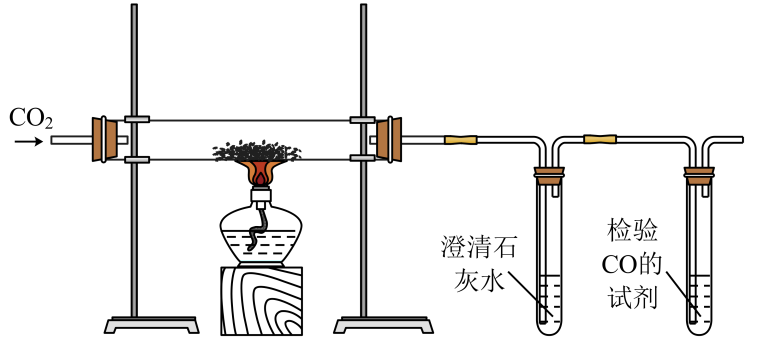

# Chemistry - 题目 110

**ID**: fb45dab6464a4cbe90cef4bda531421b
**年级**: Grade 12
**难度**: Medium-Hard
**题型**: Multiple-choice

## 题目
实验小组研究Na与CO_{2}的反应，装置、步骤和现象如下：实验步骤和现象：i. 通入CO_{2}至澄清石灰水变浑浊后，点燃酒精灯。​​​​​​​‌ii. 一段时间后，硬质玻璃管中有白色物质产生，管壁上有黑色物质出现。检验CO的试剂未见明显变化。iii. 将硬质玻璃管中的固体溶于水，未见气泡产生；过滤，向滤液中加入过量BaCl_{2}溶液，产生白色沉淀；再次过滤，滤液呈碱性；取白色沉淀加入盐酸，产生气体。iv. 将管壁上的黑色物质与浓硫酸混合加热，生成能使品红溶液褪色的气体。下列说法不正确的是（      ）

## 解答

1. A. 通入CO_{2}至澄清石灰水变浑浊后，可以排除试管内原有氧气的干扰，故A正确；
2. B. 将硬质玻璃管中的固体溶于水，未见气泡产生，说明不存在Na_{2}O_{2}；向滤液中加入过量BaCl_{2}溶液，产生白色沉淀，加入盐酸，产生气体说明白色固体中存在Na_{2}CO_{3}；再次过滤，滤液呈碱性，说明白色固体中也存在Na_{2}O，故B错误；
3. C. 黑色物质是C，C和浓硫酸在加热条件下发生反应：C + 2H_{2}SO_{4}(浓) $\hspace{-0.5em}\begin{array}{}{\underline{{\underline{~~Δ~~}}}}\atop{}\end{array}\hspace{-0.5em}$  CO_{2}↑+ 2SO_{2}↑+ 2H_{2}O，故C正确；
4. D. K和Na都是IA族的碱金属，化学性质相似，且K比Na更加活泼，根据以上实验推测：CO_{2}与金属K也可以发生反应并被还原，故D正确；
5. 故选B。

## 知识点

**中文**:
  - 钠与其他物质的反应

**English**:
  - Reaction of Sodium with Other Substances

---
