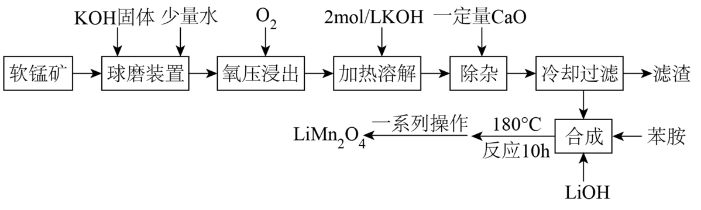

# Chemistry - 题目 49

**ID**: fdd5b2dd1ec84493a3fe74eaea007205
**年级**: Grade 12
**难度**: Medium-Hard
**题型**: 非选择题

## 题目
锰酸锂(LiMn_{2}O_{4})是锂电池的正极材料，以软锰矿为原料，生产锰酸锂的流程如下：已知：①软锰矿的成分如下：成分MnO_{2}Fe_{2}O_{3}CaOSiO_{2}其他不反应杂质质量分数69.6%7.6%5.6%9.0%8.2%②K_{2}MnO_{4}在强碱性溶液(pH大于13.5)中稳定，在酸性、中性和弱碱性环境中会发生歧化反应生成 ${\rm {\rm{M}}{\rm{n}}{\rm{O}}{{}_{{\rm{4}}}^{{\rm{-}}}}}$ 和MnO_{2}。​​​​​​​‌③苯胺(C_{6}H_{5}NH_{2})还原性较强，在该条件下可被氧化为硝基苯(C_{6}H_{5}NO_{2})。④锰酸锂为灰黑色粉末，离子化合物，易溶于水，难溶于无水乙醇。(1)“氧压浸出”的浸出温度为260°C，并维持500r/min的速率搅拌，此时发生的氧化还原反应的化学方程式为。(2)“加热溶解”和“除杂”时均要严格控制溶液pH的原因是，“除杂”中加入CaO后，需要适当加热并搅拌的目的是，若此时溶液中c( ${\rm {\rm{M}}{\rm{n}}{\rm{O}}{{}_{{\rm{4}}}^{{\rm{2}}{\rm{-}}}}}$ )=2.5mol/L，则1m^{3}溶液中理论上需要加入的CaO的质量为kg。(3)“一系列的操作”是将所得溶液加热浓缩、冷却结晶、过滤、洗涤、干燥，其中洗涤的试剂最好选用。

## 解答

1. （1）“氧压浸出”的浸出温度为260°C，二氧化锰和氧气、氢氧化钾发生氧化还原反应生成锰酸钾和水，2MnO_{2}+4KOH+O_{2}${\rm \begin{array}{}{\underline{{\underline{~{\rm{2}}{\rm{6}}{\rm{0}}℃~}}}}\atop{}\end{array}}$ 2K_{2}MnO_{4}+2H_{2}O；
2. （2）已知，K_{2}MnO_{4}在强碱性溶液(pH大于13.5)中稳定，在酸性、中性和弱碱性环境中会发生歧化反应生成 ${\rm {\rm{M}}{\rm{n}}{\rm{O}}{{}_{{\rm{4}}}^{{\rm{-}}}}}$ 和MnO_{2}；“加热溶解”和“除杂”时均要严格控制溶液pH的原因是防止锰酸钾在酸性、中性和弱碱性环境中发生歧化反应；“除杂”中加入CaO后，氧化钙和水生成氢氧化钙，氢氧化钙和硅酸根离子生成硅酸钙沉淀，操作需要适当加热并搅拌的目的是加快反应速率，使CaSiO_{3}颗粒增大便于过滤；
3. 若此时溶液中c( ${\rm {\rm{M}}{\rm{n}}{\rm{O}}{{}_{{\rm{4}}}^{{\rm{2}}{\rm{-}}}}}$ )=2.5mol/L，更加锰元素守恒可知 ${\rm {\rm{n}}\left ({{\rm{M}}{\rm{n}}{\rm{O}}{{}_{2}}}\right ){\rm{=}}{\rm{n}}\left ({{\rm{M}}{\rm{n}}{\rm{O}}{{}_{{\rm{4}}}^{{\rm{2}}{\rm{-}}}}}\right ){\rm{=}}2.5{\rm{m}}{\rm{o}}{\rm{l}}{\rm{/}}{\rm{L}}\times {\rm{1}}{\rm{0}}{{}^{{\rm{3}}}}{\rm{L}}{\rm{=}}{\rm{2}}{\rm{.}}{\rm{5}}\times {\rm{1}}{\rm{0}}{{}^{{\rm{3}}}}{\rm{m}}{\rm{o}}{\rm{l}}}$ ， ${\rm {\rm{m}}\left ({{\rm{M}}{\rm{n}}{\rm{O}}{{}_{2}}}\right ){\rm{=}}{\rm{2}}{\rm{.}}{\rm{5}}\times {\rm{1}}{\rm{0}}{{}^{{\rm{3}}}}{\rm{m}}{\rm{o}}{\rm{l}}\times 87{\rm{g}}{\rm{/}}{\rm{m}}{\rm{o}}{\rm{l}}{\rm{=}}217.5{\rm{k}}{\rm{g}}}$ ，根据表格数据可知， ${\rm {\rm{m}}\left ({{\rm{S}}{\rm{i}}{\rm{O}}{{}_{2}}}\right ){\rm{=}}217.5{\rm{k}}{\rm{g}}\times \frac {9.0\%}{69.6\%}{\rm{=}}{\rm{2}}{\rm{8}}{\rm{.}}{\rm{1}}{\rm{2}}{\rm{5}}{\rm{k}}{\rm{g}}}$ 、 ${\rm {\rm{m}}\left ({{\rm{C}}{\rm{a}}{\rm{O}}}\right ){\rm{=}}217.5{\rm{k}}{\rm{g}}\times \frac {5.6\%}{69.6\%}{\rm{=}}{\rm{1}}{\rm{7}}{\rm{.}}{\rm{5}}{\rm{k}}{\rm{g}}}$ ，硅元素转化为硅酸钙需要消耗氧化钙，根据元素守恒可知， ${\rm {\rm{S}}{\rm{i}}{\rm{O}}{{}_{2}}\sim {\rm{C}}{\rm{a}}{\rm{S}}{\rm{i}}{\rm{O}}{{}_{{\rm{3}}}}\sim {\rm{C}}{\rm{a}}{\rm{O}}}$ ，则二氧化硅需要消耗氧化钙 ${\rm {\rm{n}}\left ({{\rm{C}}{\rm{a}}{\rm{O}}}\right ){\rm{=}}{\rm{n}}\left ({{\rm{S}}{\rm{i}}{\rm{O}}{{}_{2}}}\right ){\rm{=}}\frac {{\rm{2}}{\rm{8}}{\rm{.}}{\rm{1}}{\rm{2}}{\rm{5}}{\rm{k}}{\rm{g}}}{60{\rm{g}}{\rm{/}}{\rm{m}}{\rm{o}}{\rm{l}}}{\rm{=}}{\rm{4}}{\rm{6}}{\rm{8}}{\rm{.}}{\rm{7}}{\rm{5}}{\rm{m}}{\rm{o}}{\rm{l}}}$ ， ${\rm {\rm{m}}\left ({{\rm{C}}{\rm{a}}{\rm{O}}}\right ){\rm{=}}{\rm{4}}{\rm{6}}{\rm{8}}{\rm{.}}{\rm{7}}{\rm{5}}{\rm{m}}{\rm{o}}{\rm{l}}\times 56{\rm{g}}{\rm{/}}{\rm{m}}{\rm{o}}{\rm{l}}{\rm{=}}2{\rm{6}}{\rm{.}}{\rm{2}}{\rm{5}}{\rm{k}}{\rm{g}}}$ ，则需要在加入氧化钙质量为26.25kg-17.5kg=8.75kg；
4. （3）锰酸锂为灰黑色粉末，离子化合物，易溶于水，难溶于无水乙醇。故洗涤的试剂最好选用95%的乙醇溶液，故选C；
5. （4）①若反应时，N元素的化合价不变，锰元素化合价由+3.5变为+2、氧元素化合价由-1变为0，根据电子守恒、质量守恒配平，反应为 ${\rm {\rm{2}}{\rm{M}}{\rm{n}}{{}_{{\rm{2}}}}{\rm{O}}{{}_{{\rm{4}}}^{{\rm{-}}}}{\rm{+}}{\rm{3}}{\rm{H}}{{}_{{\rm{2}}}}{\rm{O}}{{}_{{\rm{2}}}}{\rm{+}}{\rm{1}}{\rm{0}}{\rm{H}}{{}^{{\rm{+}}}}{\rm{=}}{\rm{4}}{\rm{M}}{\rm{n}}{{}^{{\rm{2}}{\rm{+}}}}{\rm{+}}{\rm{3}}{\rm{O}}{{}_{{\rm{2}}}}\uparrow {\rm{+}}{\rm{8}}{\rm{H}}{{}_{{\rm{2}}}}{\rm{O}}}$ ；
6. ②Mn^{2+}与EDTA反应的化学计量数之比为1：1，结合锰元素守恒可知，样品中锰酸锂的纯度为 ${\rm \frac {{\rm{0}}{\rm{.}}{\rm{3}}{\rm{0}}{\rm{0}}{\rm{0}}{\rm{m}}{\rm{o}}{\rm{l}}{\rm{/}}{\rm{L}}\times 20.00\times 10{{}^{{\rm{-}}{\rm{3}}}}{\rm{L}}\times \frac {1}{2}\times 181{\rm{g}}{\rm{/}}{\rm{m}}{\rm{o}}{\rm{l}}}{0.5800{\rm{g}}}\times {\rm{1}}{\rm{0}}{\rm{0}}{\rm{\%}}{\rm{=}}94\%}$ 。

## 知识点

**中文**:
  - 酸碱中和滴定的拓展应用
  - 陌生氧化还原反应方程式的书写

**English**:
  - Extended Applications of Titration
  - Writing Equations for Unfamiliar Redox Reactions

---
