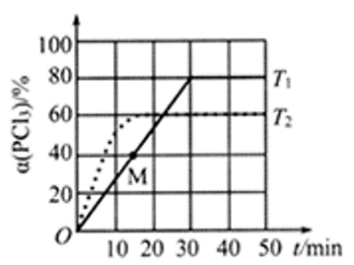

# Chemistry - 题目 264

**ID**: 0ba6398d6ac044e7ad6a090d001f2d87
**年级**: Grade 12
**难度**: Medium-Hard
**题型**: Multiple-select

## 题目
向某恒容密闭容器中充入等物质的量的 ${\rm{P}}{\rm{C}}{\rm{l}}_{{\rm{3}}}{\rm{(}}{\rm{g}}{\rm{)}}$ 和 ${\rm{C}}{\rm{l}}_{{\rm{2}}}{\rm{(}}{\rm{g}}{\rm{)}}$ ，发生如下反应： ${\rm{P}}{\rm{C}}{\rm{l}}_{{\rm{3}}}{\rm{(}}{\rm{g}}{\rm{)}}{\rm{+}}{\rm{C}}{\rm{l}}_{{\rm{2}}}{\rm{(}}{\rm{g}}{\rm{)}}\xrightleftharpoons [\mathrm{\}]{\mathrm{\}}{\rm{P}}{\rm{C}}{\rm{l}}_{{\rm{5}}}{\rm{(}}{\rm{g}}{\rm{)}}$ ，测得不同温度下 ${\rm{P}}{\rm{C}}{\rm{l}}_{{\rm{3}}}{\rm{(}}{\rm{g}}{\rm{)}}$ 的转化率α与时间的关系如图所示。​​​​​​​‌其速率方程为： ${\rm{v}}_{{\rm{正}}}{\rm{=}}{\rm{k}}_{{\rm{正}}}\cdot {\rm{c}}\left ({{\rm{P}}{\rm{C}}{\rm{l}}_{{\rm{3}}}}\right )\cdot {\rm{c}}\left ({{\rm{C}}{\rm{l}}_{{\rm{2}}}}\right )$ ， ${\rm{v}}_{{\rm{正}}}{\rm{=}}{\rm{k}}_{{\rm{逆}}}\cdot {\rm{c}}\left ({{\rm{P}}{\rm{C}}{\rm{l}}_{{\rm{5}}}}\right )$ (k是速率常数，只与温度有关)，下列说法错误的是

## 解答

1. A．由图可知，T_{2}先达到平衡，说明速率快，说明T_{2}> T_{1}, T_{2}平衡时PCl_{3}的转化率低，说明升高温度平衡向逆反应方向移动，说正反应为放热反应， ${\rm{Δ}}{\rm{H}}<0$ ，A正确；
2. B．M点未达到平衡，则正反应速率大于逆反应速率，即K_{正}c(PCl_{3})c(Cl_{2})> K_{逆}c(PCl_{5})，故 $\frac {{\rm{k}}_{正}}{{\rm{k}}_{逆}}$ ＞ $\frac {{\rm{c}}\left ({{\rm{P}}{\rm{C}}{\rm{l}}_{{\rm{5}}}}\right )}{{\rm{c}}\left ({{\rm{P}}{\rm{C}}{\rm{l}}_{{\rm{3}}}}\right )\cdot {\rm{c}}\left ({{\rm{C}}{\rm{l}}_{{\rm{2}}}}\right )}$ ，B正确；
3. C．正反应为放热反应，升高温度，平衡向左移动，K值减小，说明k_{正}增大的倍数小于于k_{逆}增大的倍数，C错误；
4. D．T_{1}时，PCl_{5}转化率为80%，c(Cl_{2})=0.25mol/L，设初始物质的量浓度为xmol/L，列出三段式： $\begin{array}{}&{\rm{P}}{\rm{C}}{\rm{l}}_{{\rm{3}}}{\rm{(}}{\rm{g}}{\rm{)}}&{\rm{+}}&{\rm{C}}{\rm{l}}_{{\rm{2}}}{\rm{(}}{\rm{g}}{\rm{)}}&\rightleftarrows &{\rm{P}}{\rm{C}}{\rm{l}}_{{\rm{5}}}{\rm{(}}{\rm{g}}{\rm{)}}\\{\rm{初}}{\rm{始}}{\rm{(}}{\rm{m}}{\rm{o}}{\rm{l}}{\rm{/}}{\rm{L}}{\rm{)}}&{\rm{x}}&&{\rm{x}}&&{\rm{0}}\\{\rm{转}}{\rm{化}}{\rm{(}}{\rm{m}}{\rm{o}}{\rm{l}}{\rm{/}}{\rm{L}}{\rm{)}}&{\rm{0}}{\rm{.}}{\rm{8}}{\rm{x}}&&{\rm{0}}{\rm{.}}{\rm{8}}{\rm{x}}&&{\rm{0}}{\rm{.}}{\rm{8}}{\rm{x}}\\{\rm{平}}{\rm{衡}}{\rm{(}}{\rm{m}}{\rm{o}}{\rm{l}}{\rm{/}}{\rm{L}}{\rm{)}}&{\rm{0}}{\rm{.}}{\rm{2}}{\rm{x}}&&{\rm{0}}{\rm{.}}{\rm{2}}{\rm{5}}&&{\rm{0}}{\rm{.}}{\rm{8}}{\rm{x}}\end{array}$  则 $\frac {{\rm{k}}_{正}}{{\rm{k}}_{逆}}$ = $\frac {{\rm{c}}\left ({{\rm{P}}{\rm{C}}{\rm{l}}_{{\rm{5}}}}\right )}{{\rm{c}}\left ({{\rm{P}}{\rm{C}}{\rm{l}}_{{\rm{3}}}}\right )\cdot {\rm{c}}\left ({{\rm{C}}{\rm{l}}_{{\rm{2}}}}\right )}$ = $\frac {{\rm{0}}{\rm{.}}{\rm{8}}{\rm{x}}}{0.2x\times 0.25}=16$ ，D错误；
5. 故选CD。

## 知识点

**中文**:
  - 化学反应速率的调控作用
  - 吸热反应和放热反应
  - 综合分析外界条件对化学平衡状态的影响

**English**:
  - Regulation of Reaction Rate
  - Endothermic and Exothermic Reactions
  - Comprehensive Analysis of External Conditions

---
