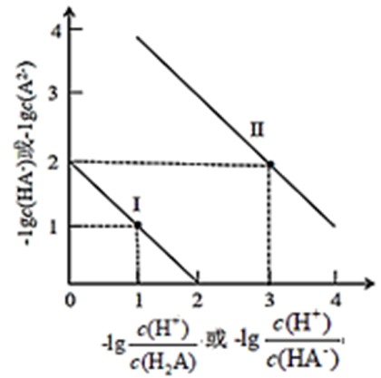

# Chemistry - 题目 309

**ID**: 3f72b538a1e7433fbd3d19e01d8e1728
**年级**: Grade 12
**难度**: Medium-Hard
**题型**: Multiple-select

## 题目
25℃时，用 NaOH 溶液滴定H_{2}A 溶液，溶液中 ${\rm{-}}{\rm{l}}{\rm{g}}\frac {c{\rm{(}}{\rm{H}}^{{\rm{+}}}{\rm{)}}}{c{\rm{(}}{\rm{H}}_{{\rm{2}}}{\rm{A}}{\rm{)}}}$ 和 ${\rm{-}}{\lg}c{\rm{(}}{\rm{H}}{\rm{A}}^{{\rm{-}}}{\rm{)}}$ 、 ${\rm{-}}{\rm{l}}{\rm{g}}\frac {c{\rm{(}}{\rm{H}}^{{\rm{+}}}{\rm{)}}}{c{\rm{(}}{\rm{H}}{\rm{A}}^{{\rm{-}}}{\rm{)}}}$ 和 ${\rm{-}}{\lg}c{\rm{(}}{\rm{A}}^{{\rm{2}}{\rm{-}}}{\rm{)}}$ 关系如图所示，下列说法正确的是​​​​​​​‌

## 解答

1. A．由曲线Ⅱ可知， ${\rm{-}}{\rm{l}}{\rm{g}}\frac {c{\rm{(}}{\rm{H}}^{{\rm{+}}}{\rm{)}}}{c{\rm{(}}{\rm{H}}_{{\rm{2}}}{\rm{A}}{\rm{)}}}$ =1时， ${\rm{-}}{\lg}c{\rm{(}}{\rm{H}}{\rm{A}}^{{\rm{-}}}{\rm{)}}$ =1，则K_{a1}= $\frac {c({\rm{H}}^{+}{\rm{)}}\cdot c({\rm{H}}{\rm{A}}^{-})}{c({\rm{H}}_{2}{\rm{A}})}$ =10^{-1}×10^{-1}=10^{-2}，A不正确；
2. B．由曲线Ⅰ可知， ${\rm{-}}{\rm{l}}{\rm{g}}\frac {c{\rm{(}}{\rm{H}}^{{\rm{+}}}{\rm{)}}}{c{\rm{(}}{\rm{H}}{\rm{A}}^{{\rm{-}}}{\rm{)}}}$ =3时， ${\rm{-}}{\lg}c{\rm{(}}{\rm{A}}^{{\rm{2}}{\rm{-}}}{\rm{)}}$ =2，则K_{a2}= $\frac {c({\rm{H}}^{+}{\rm{)}}\cdot c({\rm{A}}^{2-})}{c({\rm{H}}{\rm{A}}^{-})}$ =10^{-3}×10^{-2}=10^{-5}，滴定过程中，当 pH=5 时，由K_{a2}= $\frac {c({\rm{H}}^{+}{\rm{)}}\cdot c({\rm{A}}^{2-})}{c({\rm{H}}{\rm{A}}^{-})}$ 可得出c(A^{2−})=c(HA^{−})，依据电荷守恒，c(Na^{+})+c(H^{+})=2c(A^{2−})+c(HA^{−})+c(OH^{−})=3c(A^{2−})+c(OH^{−})，B正确；
3. C．已知 H_{2}CO_{3}的K_{a1}=4.3×10^{-7}，K_{a2}=5.6×10^{-11}，则酸的电离程度的大小顺序为c(H_{2}A)＞c(HA^{−})＞c(H_{2}CO_{3})＞c( ${\rm{H}}{\rm{C}}{\rm{O}}_{3}^{-}$ )，所以足量Na_{2}CO_{3}溶液中滴入少量H_{2}A溶液，发生的离子反应为：H_{2}A + 2 ${\rm{C}}{\rm{O}}_{3}^{2-}$ = 2 ${\rm{H}}{\rm{C}}{\rm{O}}_{3}^{-}$ +A^{2-}，C正确；
4. D．向H_{2}A 溶液中加入等体积等浓度的NaOH 溶液，完全反应生成NaHA，而HA^{-}的电离常数为10^{-5}，水解常数为 $\frac {10^{-14}}{10^{-2}}$ =10^{-12}，所以HA^{-}在溶液中以电离为主，溶液显酸性，D不正确；
5. 故选BC。

## 知识点

**中文**:
  - 弱电解质的电离平衡
  - 溶液中微粒间的电荷守恒、质子守恒、物料守恒

**English**:
  - Ionization Equilibrium of Weak Electrolytes
  - Charge Balance, Proton Balance, and Material Balance

---
