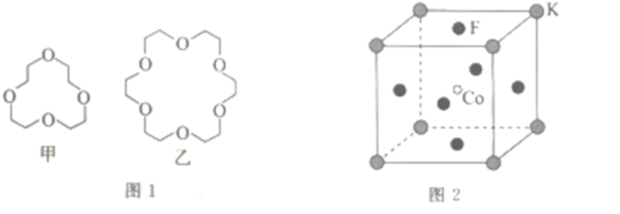

# Chemistry - 题目 9

**ID**: b8e95904dd914d60aafa805fcc0dff8d
**年级**: Grade 12
**难度**: Medium-Hard
**题型**: 结构与性质

## 题目
${\rm{K}}{\rm{C}}{\rm{o}}{\rm{F}}_{3}$ 有电极化特性、非磁绝缘性、光致发光性等多种优异性能。​​​​​​​‌回答下类问题：(1)基态Co原子的价层电子排布图为；金属Co的熔点、沸点均高于金属K的原因为。(2) ${\rm{O}}{\rm{F}}_{2}$ 、 ${\rm{N}}{\rm{F}}_{3}$ 、 ${\rm{C}}{\rm{F}}_{4}$ 的键角由大到小的顺序为；C、N、O、F的第一电离能由大到小的顺序为。(3)碱金属离子镶入适合的冠醚空腔可形成特殊材料，两种冠醚结构如图1所示。①冠醚中O原子的杂化形式为；H、C、O的电负性由小到大的顺序为。② ${\rm{K}}^{+}$ 不能镶入甲中而易镶入乙中的原因为。(4) ${\rm{K}}{\rm{C}}{\rm{o}}{\rm{F}}_{3}$ 具有钙钛矿型立方结构，其晶胞中处于面心的F形成正八面体空隙，结构如图2所示。①每个晶胞中由K和F共同形成的正四面体空隙有个。②晶胞的另一种表示中，Co处于各顶角位置，则K处于位置。③若晶胞参数为a pm，阿伏加德罗常数的值为 ${\rm{N}}_{{\rm{A}}}$ ，晶体密度ρ=${\rm{g}}\cdot {\rm{c}}{\rm{m}}^{{\rm{-}}{\rm{3}}}$ 。

## 解答

1. (1)基态Co原子的价层电子排布图为：；Co金属离子半径小，所带电荷高，Co金属键比K强，所以金属Co的熔点、沸点均高于金属K；
2. (2)孤电子对-孤电子对斥力＞孤电子对-价电子斥力＞价电子-价电子斥力，所以 ${\rm{O}}{\rm{F}}_{2}$ 、 ${\rm{N}}{\rm{F}}_{3}$ 、 ${\rm{C}}{\rm{F}}_{4}$ 的键角由大到小的顺序为： ${\rm{C}}{\rm{F}}_{4}$ ＞ ${\rm{N}}{\rm{F}}_{3}$ ＞ ${\rm{O}}{\rm{F}}_{2}$ ；同一周期从左到右，第一电离能逐渐增大的，N是半充满结构，较稳定，第一电离能大于O，所以C、N、O、F的第一电离能由大到小的顺序为：F＞N＞O＞C；
3. (3)①冠醚分子中O原子形成2个 ${\rm{σ}}$ 键，根据氧原子的最外层电子数可知O原子价层还有2个孤电子对，所以O原子的价层电子对数为4，为sp^{3}杂化；同一周期从左到右，电负性逐渐增大，同一主族从上到下，电负性逐渐减小，所以电负性：H＜C＜O；
4. ②K+半径较大，因此 ${\rm{K}}^{+}$ 不能镶入甲中而易镶入乙中；
5. (4)①由晶胞图可看出，每个晶胞中由K和F共同形成的正四面体空隙有8个；
6. ②晶胞的另一种表示中，Co处于各顶角位置，则K处于体心位置；
7. ③ ${\rm{C}}{\rm{o}}$ 原子个数为1，K原子个数为 $\frac {1}{8}\times 8{\rm{=}}1$ ，F原子个数 $\frac {1}{2}\times 6{\rm{=}}3$ ，晶胞体积 ${\rm{V}}{\rm{=}}\left ({{\rm{a}}\times {\rm{1}}{\rm{0}}^{{\rm{-}}{\rm{7}}}{\rm{c}}{\rm{m}}}\right )^{{\rm{3}}}{\rm{=}}{\rm{a}}\times {\rm{1}}{\rm{0}}^{{\rm{-}}{\rm{2}}{\rm{1}}}{\rm{c}}{\rm{m}}^{3}$ ，晶体密度 ${\rm{ρ}}{\rm{=}}\frac {{\rm{m}}}{{\rm{V}}}{\rm{=}}\frac {{\rm{M}}}{{\rm{V}}{\rm{N}}_{{\rm{A}}}}=\frac {155}{{\rm{a}}\times {\rm{1}}{\rm{0}}^{{\rm{-}}{\rm{2}}{\rm{1}}}{\rm{N}}_{{\rm{A}}}}{\rm{g}}\cdot {\rm{c}}{\rm{m}}^{{\rm{-}}{\rm{3}}}=\frac {155}{{\rm{a}}{\rm{N}}_{{\rm{A}}}}\times 10^{21}{\rm{g}}\cdot {\rm{c}}{\rm{m}}^{{\rm{-}}{\rm{3}}}$ 。

## 知识点

**中文**:
  - 原子轨道的图形描述

**English**:
  - Graphical Description of Atomic Orbitals

---
