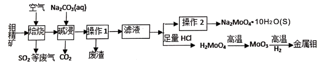
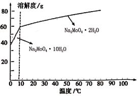

# Chemistry - 题目 62

**ID**: b9632a2801254e8db336c39803d47a4b
**年级**: Grade 12
**难度**: Medium
**题型**: 工业流程题

## 题目
钼(Mo)是一种重要的过渡金属元素，在电子行业有可能取代石墨烯，其化合物钼酸钠晶体(Na_{2}MoO_{4}·10H_{2}O)可制造金属缓蚀剂。​​​​​​​‌由钼精矿(主要成分MoS_{2}，含有少量不反应杂质)制备钼及钼酸钠晶体的工艺流程如下：(1)焙烧时，下列措施有利于使钼精矿充分反应的是。(填序号)。a.适当增大空气的用量 b.增大钼精矿的量c.将矿石粉碎(2)“碱浸”过程中反应的离子方程式为。(3)已知钼酸钠的溶解度曲线如图所示，要获得钼酸钠晶体Na_{2}MoO_{4}·10H_{2}O的操作2为、、过滤，洗涤烘干。(4)在碱性条件下，将钼精矿加入到足量的NaClO溶液中，也可以制备钼酸钠，可观察到钼精矿逐渐溶解至固体消失。该反应的离子方程式为。空气中钼酸盐对碳钢的缓蚀原理是在钢铁表面形成FeMoO_{4}-Fe_{2}O_{3}保护膜。密闭式循环冷却水系统中的碳钢管道缓蚀，除需加入钼酸盐外还需加入物质是（）

## 解答

1. (1)焙烧时，使钼精矿充分反映即提高原料的利用率，使原料尽可能全部转化，则可以粉碎原料，增大原料与氧气的接触面积，还可以将焙烧后的原料循环再次煅烧，故正确答案为ac；
2. (2)操作1的名称是过滤，除去矿石中不参与反应的杂质，“碱浸”过程中的离子方程式为MoO_{3}+ ${\rm{C}}{\rm{O}}_{{\rm{3}}}^{{\rm{2}}{\rm{-}}}$ = ${\rm{M}}{\rm{o}}{\rm{O}}_{{\rm{4}}}^{{\rm{2}}{\rm{-}}}$ +CO_{2}↑；
3. (3)由图像知， ${\rm{N}}{\rm{a}}_{{\rm{2}}}{\rm{M}}{\rm{o}}{\rm{O}}_{{\rm{4}}}\centerdot {\rm{1}}{\rm{0}}{\rm{H}}_{{\rm{2}}}{\rm{O}}$ 在0-10℃范围内溶解度随温度的升高二升高，10℃以上不再是 ${\rm{N}}{\rm{a}}_{{\rm{2}}}{\rm{M}}{\rm{o}}{\rm{O}}_{{\rm{4}}}\centerdot {\rm{1}}{\rm{0}}{\rm{H}}_{{\rm{2}}}{\rm{O}}$ ，所以获得 ${\rm{N}}{\rm{a}}_{{\rm{2}}}{\rm{M}}{\rm{o}}{\rm{O}}_{{\rm{4}}}\centerdot {\rm{1}}{\rm{0}}{\rm{H}}_{{\rm{2}}}{\rm{O}}$ 的方法是在适宜条件下蒸发浓缩、冷却结晶；
4. (4) ClO^{-}中的氯元素是+1价，具有氧化性氯元素化合价降低到-1价，生成Cl^{-}，MoS_{2}中Mo元素为+2价，S元素为-1价，两种元素的化合价均升高，根据电子守恒、电荷守恒、元素守恒知离子方程式为 ${\rm{M}}{\rm{o}}{\rm{S}}_{{\rm{2}}}{\rm{+}}{\rm{9}}{\rm{C}}{\rm{l}}{\rm{O}}^{{\rm{-}}}{\rm{+}}{\rm{6}}{\rm{O}}{\rm{H}}^{{\rm{-}}}{\rm{=}}{\rm{M}}{\rm{o}}{\rm{O}}_{{\rm{4}}}^{{\rm{2}}{\rm{-}}}{\rm{+}}{\rm{2}}{\rm{S}}{\rm{O}}_{4}^{2-}{\rm{+}}{\rm{9}}{\rm{C}}{\rm{l}}^{{\rm{-}}}{\rm{+}}{\rm{3}}{\rm{H}}_{{\rm{2}}}{\rm{O}}$ ；根据题目信息，在空气中是氧气与钼酸盐共同作用，在钢铁表面形成FeMoO_{4}-Fe_{2}O_{3}保护膜，现在是密闭系统中，钼酸盐未变，还需加入NaNO_{2}，是替代氧气起氧化剂的作用；
5. (5)反应为 ${\rm{M}}{\rm{o}}{\rm{S}}_{{\rm{2}}}{\rm{+}}{\rm{6}}{\rm{M}}{\rm{o}}{\rm{O}}_{{\rm{3}}}\begin{array}{}{\underline{{\underline{高温}}}}\\\;\end{array}{\rm{7}}{\rm{M}}{\rm{o}}{\rm{O}}_{{\rm{2}}}{\rm{+}}{\rm{2}}{\rm{S}}{\rm{O}}_{{\rm{2}}}$ ，MoS_{2}中S化合价上高，MoO_{3}中Mo化合价降低，1molMoS_{2}反应转移12mol电子，还原剂为MoS_{2}，若反应中转移3mol电子，则消耗的还原剂的物质的量为0.25mol；
6. (6)当BaMoO_{4}开始沉淀时， ${\rm{c}}{\rm{(}}{\rm{B}}{\rm{a}}^{{\rm{2}}{\rm{+}}}{\rm{)}}{\rm{=}}\frac {{\rm{K}}_{{\rm{s}}{\rm{p}}}{\rm{(}}{\rm{B}}{\rm{a}}{\rm{M}}{\rm{o}}{\rm{O}}_{{\rm{4}}}{\rm{)}}}{{\rm{c}}{\rm{(}}{\rm{M}}{\rm{o}}{\rm{O}}_{{\rm{4}}}^{{\rm{2}}{\rm{-}}}{\rm{)}}}{\rm{=}}\frac {{\rm{4}}{\rm{.}}{\rm{0}}\times {\rm{1}}{\rm{0}}^{{\rm{-}}{\rm{8}}}}{{\rm{0}}{\rm{.}}{\rm{8}}}{\rm{=}}{\rm{5}}\times {\rm{1}}{\rm{0}}^{{\rm{-}}{\rm{8}}}{\rm{m}}{\rm{o}}{\rm{l}}{\rm{/}}{\rm{L}}$ ，此时溶液中的 ${\rm{c}}{\rm{(}}{\rm{S}}{\rm{O}}_{{\rm{4}}}^{{\rm{2}}{\rm{-}}}{\rm{)}}{\rm{=}}\frac {{\rm{K}}_{{\rm{s}}{\rm{p}}}{\rm{(}}{\rm{B}}{\rm{a}}{\rm{S}}{\rm{O}}_{{\rm{4}}}{\rm{)}}}{{\rm{c}}{\rm{(}}{\rm{B}}{\rm{a}}^{{\rm{2}}{\rm{+}}}{\rm{)}}}{\rm{=}}\frac {{\rm{1}}{\rm{.}}{\rm{1}}\times {\rm{1}}{\rm{0}}^{{\rm{-}}{\rm{1}}{\rm{0}}}}{{\rm{5}}\times {\rm{1}}{\rm{0}}^{{\rm{-}}{\rm{8}}}}{\rm{=}}{\rm{0}}{\rm{.}}{\rm{2}}{\rm{2}}\times {\rm{1}}{\rm{0}}^{{\rm{-}}{\rm{2}}}{\rm{m}}{\rm{o}}{\rm{l}}{\rm{/}}{\rm{L}}$ 则 ${\rm{S}}{\rm{O}}_{{\rm{4}}}^{{\rm{2}}{\rm{-}}}$ 的去除率为 $\frac {{\rm{0}}{\rm{.}}{\rm{0}}{\rm{2}}{\rm{-}}{\rm{0}}{\rm{.}}{\rm{2}}{\rm{2}}\times {\rm{1}}{\rm{0}}^{{\rm{-}}{\rm{2}}}}{{\rm{0}}{\rm{.}}{\rm{0}}{\rm{2}}}{\rm{×}}{\rm{1}}{\rm{0}}{\rm{0}}{\rm{\%}}{\rm{=}}{\rm{8}}{\rm{9}}{\rm{\%}}$ 。

## 知识点

**中文**:
  - 化学实验基本操作
  - 基于氧化还原反应守恒规律的计算
  - 离子方程式的书写及正误判断

**English**:
  - Basic Laboratory Operations
  - Calculations Based on Conservation Laws in Redox Reactions
  - Writing and Verifying Ionic Equations

---
