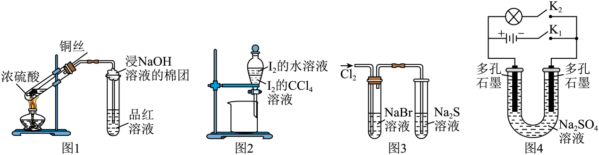

# Chemistry - 题目 133

**ID**: 1d75bb21bb694934b7181c4840ddc8a9
**年级**: Grade 12
**难度**: Medium
**题型**: Multiple-choice

## 题目
下列实验的相应操作中，错误的是（      ）​​​​​​​‌

## 解答

1. A．图1制备 ${\rm{S}}{\rm{O}}{{}_{2}}$ （铜与浓硫酸加热）， ${\rm{S}}{\rm{O}}{{}_{2}}$ 为有害气体，浸NaOH溶液的棉团可吸收逸出的 ${\rm{S}}{\rm{O}}{{}_{2}}$ ，先放置棉团再加热能防止气体逸出，操作正确，故A不符合题意；
2. B．分液时，先打开分液漏斗上方玻璃塞（或使凹槽对准小孔），使内外气压平衡，再打开下方活塞放出液体，操作正确，故B不符合题意；
3. C．图3验证非金属性Cl>Br>S，需通过单质置换反应证明， ${\rm{C}}{\rm{l}}{{}_{{{2}}}}$ 与 ${\rm{B}}{\rm{r}}{^{-}}$ 反应生成 ${\rm{B}}{\rm{r}}{{}_{{{2}}}}$ ，说明非金属性Cl> ${\rm Br，}{\rm{B}}{\rm{r}}{{}_{{{2}}}}$ 与 ${\rm{S}}{^{{{2}}{{-}}}}$ 反应生成S，说明非金属性Br>S，但若 ${\rm{C}}{\rm{l}}{{}_{{{2}}}}$ 过量，过量的也能与 ${\rm{N}}{\rm{a}}{{}_{{{2}}}}{\rm{S}}$ 反应生成 ${\rm S，}{\rm{C}}{\rm{l}}{{}_{{{2}}}}$ 会干扰Br、S的非金属性比较，故C符合题意；
4. D．图4先闭合 ${\rm{K}}{{}_{1}}$ ，形成电解池，电解 ${\rm{N}}{\rm{a}}{{}_{{{2}}}}{\rm{S}}{\rm{O}}{{}_{{{4}}}}$ 溶液生成 ${\rm{H}}{{}_{{{2}}}}$ (阴极)和 ${\rm{O}}{{}_{{{2}}}}$ (阳极)，再闭合 ${\rm{K}}{{}_{2}}$ ，形成氢氧燃料电池，可将化学能转化为电能，操作正确，故D不符合题意；
5. 故选C。

## 知识点

**中文**:
  - 二氧化硫的制备
  - 分液
  - 元素非金属性强弱的判断

**English**:
  - Preparation of Sulfur Dioxide
  - Separation of Liquids
  - Judging Non-metallic Character

---
