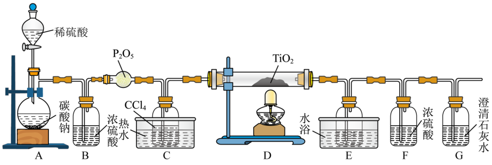

# Chemistry - 题目 88

**ID**: 350c9253d4a64bedbcb9d40094f883f8
**年级**: Grade 12
**难度**: Medium
**题型**: 非选择题

## 题目
${\rm {\rm{T}}{\rm{i}}{\rm{C}}{\rm{l}}{{}_{4}}}$ 是制备钛及其化合物的重要中间体，实验室以 ${\rm 8.​​​​​​​‌0{\rm{g}}{\rm{T}}{\rm{i}}{\rm{O}}{{}_{2}}}$ 和 ${\rm 18.4{\rm{g}}{\rm{C}}{\rm{C}}{\rm{l}}{{}_{4}}}$ 为原料制取液态 ${\rm {\rm{T}}{\rm{i}}{\rm{C}}{\rm{l}}{{}_{4}}}$ 的装置如图所示(部分夹持装置省略)｡已知：有关物质的性质如表：物质熔点/℃沸点/℃其他${\rm {\rm{C}}{\rm{C}}{\rm{l}}{{}_{{\rm{4}}}}}$-2376与 ${\rm {\rm{T}}{\rm{i}}{\rm{C}}{\rm{l}}{{}_{4}}}$ 互溶${\rm {\rm{T}}{\rm{i}}{\rm{C}}{\rm{l}}{{}_{4}}}$-25136遇水极易水解，在550℃时能被氧气氧化回答下列问题：(1)装置A中盛装碳酸钠溶液的仪器名称为｡(2)补充并分析实验步骤：①连接好装置，；②向各装置中加入药品，重新连接好装置，拧开装置A中分液漏斗活塞，缓慢加入稀硫酸，待装置G中出现白色沉淀后，关闭分液漏斗活塞；③向C中注入热水并点燃D处酒精灯……(后续步骤略)｡步骤②的作用是｡(3)装置C中热水浴的作用是；装置D中发生反应的化学方程式为｡(4)若缺少装置F，将观察到装置E中的现象是｡(5)从E处混合物中分离出 ${\rm {\rm{T}}{\rm{i}}{\rm{C}}{\rm{l}}{{}_{4}}}$ 的实验方法是(填编号)；

## 解答

1. （1）盛放碳酸钠溶液的是有支管的蒸馏烧瓶，故答案为：蒸馏烧瓶；
2. （2）装置需要通入气体，因此需要检查装置气密性，四氯化钛在550℃时能被氧气氧化，故步骤②利用二氧化碳将空气排出，防止四氯化钛被氧化，故答案为：检查气密性、利用生成的 ${\rm {\rm{C}}{\rm{O}}{{}_{2}}}$ 排除装置内的空气，防止 ${\rm {\rm{T}}{\rm{i}}{\rm{C}}{\rm{l}}{{}_{4}}}$ 被氧气氧化；
3. （3）热水浴可以使四氯化碳挥发，进入D中充当反应物；二氧化钛和四氯化碳在D中发生反应生成四氯化钛和二氧化碳： ${\rm {\rm{T}}{\rm{i}}{\rm{O}}{{}_{2}}+{\rm{C}}{\rm{C}}{\rm{l}}{{}_{4}}\hspace{-0.5em}\begin{array}{}{\underline{{\underline{~{\rm{Δ}}~}}}}\atop{}\end{array}\hspace{-0.5em}{\rm{T}}{\rm{i}}{\rm{C}}{\rm{l}}{{}_{4}}+{\rm{C}}{\rm{O}}{{}_{2}}}$ ，故答案为：使 ${\rm {\rm{C}}{\rm{C}}{\rm{l}}{{}_{4}}}$ 汽化，为D中提供反应物、 ${\rm {\rm{T}}{\rm{i}}{\rm{O}}{{}_{2}}+{\rm{C}}{\rm{C}}{\rm{l}}{{}_{4}}\hspace{-0.5em}\begin{array}{}{\underline{{\underline{~{\rm{Δ}}~}}}}\atop{}\end{array}\hspace{-0.5em}{\rm{T}}{\rm{i}}{\rm{C}}{\rm{l}}{{}_{4}}+{\rm{C}}{\rm{O}}{{}_{2}}}$ ；
4. （4）缺少F，有水蒸气进入E中，四氯化钛发生水解，产生大量的HCl而形成白色酸雾，故答案为：出现白雾；
5. （5）四氯化钛和四氯化碳的沸点相差较大，二者互溶，可以用蒸馏的方法将二者分开；根据方程式80gTiO_{2}~190gTiCl_{4}，则四氯化钛的理论产量为19g，四氯化钛的产率为：11.4g÷19g=60%，故答案为：C，60%。

## 知识点

**中文**:
  - 制备实验

**English**:
  - Preparation Experiments

---
