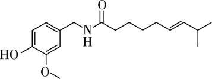

# Chemistry - 题目 321

**ID**: 41c12a0648154cf397292bc71626ae49
**年级**: Grade 12
**难度**: Medium
**题型**: Multiple-choice

## 题目
辣椒素是一种香草酰胺衍生物，其结构简式如图所示。​​​​​​​‌下列有关辣椒素的说法错误的是（      ）

## 解答

1. 由结构简式可知，辣椒素中含有（酚）羟基、醚键、酰胺基和碳碳双键4种官能团， ${\rm \mathrm{A}}$ 正确；（酚）羟基和酰胺基分别能与 ${\rm 1\mathrm{m}\mathrm{o}\mathrm{l}\mathrm{N}\mathrm{a}\mathrm{O}\mathrm{H}}$ 反应，故 $1\mathrm{m}\mathrm{o}\mathrm{l}$ 辣椒素最多能与 ${\rm 2\mathrm{m}\mathrm{o}\mathrm{l}\mathrm{N}\mathrm{a}\mathrm{O}\mathrm{H}}$ 反应， ${\rm \mathrm{B}}$ 错误；辣椒素中含有碳碳双键，且碳碳双键的碳原子上连有不同的原子和原子团，故辣椒素存在顺反异构体， ${\rm \mathrm{C}}$ 正确；该结构中含有的疏水基团多于亲水基团，故辣椒素易溶于油脂、难溶于水， ${\rm \mathrm{D}}$ 正确。

## 知识点

**中文**:
  - 常见官能团名称、组成及结构
  - 烯烃的立体异构—顺反异构

**English**:
  - Names, Composition and Structure of Functional Groups
  - Stereoisomerism (Cis-trans Isomerism)

---
