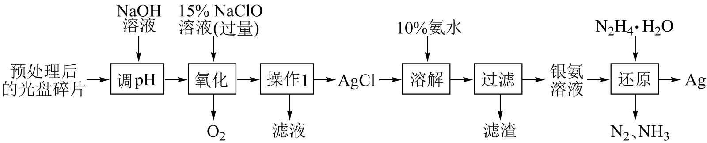

# Chemistry - 题目 56

**ID**: 42506a1e0b664da986dbdcd9cdeed80b
**年级**: Grade 12
**难度**: Medium
**题型**: Multiple-choice

## 题目
Ag是高新技术产业的基础材料之一，在一种光盘金属层中回收少量银(金属层中其他金属含量过低，对实验的影响可忽略)的工艺流程如下：已知：NaClO溶液在受热或酸性条件下易分解。​​​​​​​‌则下列有关叙述正确的是

## 解答

1. A．“氧化”过程加入氧化剂NaC1O溶液，NaC1O在受热或酸性条件下易分解，在加热和强酸性条件下进行时NaClO易分解，不利于上述氧化过程的发生，故A错误；
2. B．“操作1”为过滤，所需的玻璃仪器为玻璃棒、烧杯和(普通)漏斗，过滤不能用分液漏斗，故B错误；
3. C．“还原”过程中[Ag(NH_{3})_{2}]^{+}中银元素化合价降低生成单质银，由+1价变为0价，N_{2}H_{4}·H_{2}O中氮元素化合价升高生成N_{2}，由-2价变为0价，根据得失电子守恒，n([Ag(NH_{3})_{2}]^{+}):n(N_{2}H_{4}·H_{2}O)=4:1，故C错误；
4. D．AgCl溶解在10%氨水中的化学反应方程式为AgCl+2NH_{3}=[Ag(NH_{3})_{2}]Cl，故D正确；
5. 故本题选D。

## 知识点

**中文**:
  - 氧化反应和还原反应的判断
  - 过滤

**English**:
  - Identifying Oxidation and Reduction
  - Filtration

---
