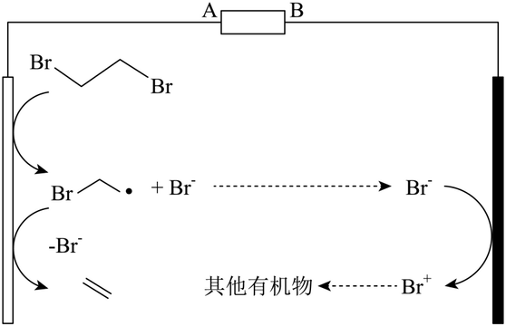

# Chemistry - 题目 83

**ID**: 474845a7470946efab580aa86f8a78f7
**年级**: Grade 12
**难度**: Medium
**题型**: Multiple-choice

## 题目
近年来，由阴极还原主导的电有机合成反应得到了更多的研究关注。​​​​​​​‌2021年，Waldvogel和Morandi等人报道了一类电化学“穿梭”成对电解反应(如下图所示)。该反应有助于我们得到B有价值的气态烯烃化合物和实现对某些污染物的高效降解。下列说法不正确的是（      ）

## 解答

1. A．由分析可知，左侧为阴极，则图中A是电池的负极，A正确；
2. B．由分析可知，图中B端所连电极为阳极，电极反应为： ${\rm{B}}{\rm{r}}{^{{{-}}}}{{-}}{{2}}{\rm{e}}{^{{{-}}}}{\rm{=}}{\rm{B}}{\rm{r}}{^{{{+}}}}{\rm ，B}$ 正确；
3. C．由分析可知，每生成1mol乙烯，转移电子数为 $2{\rm{N}}{{}_{{\rm{A}}}}{\rm ，C}$ 错误；
4. D．“六六六”曾被广泛用作杀虫剂，但是它具有高毒性且不易降解，选取“六六六”作为实验对象，由电解原理可知，在经过三次连续的双卤化反应后，转化为苯，实现对该农药的高效降解，D正确；
5. 故选C。

## 知识点

**中文**:
  - 电解池有关计算
  - 电解池的结构与判断

**English**:
  - Calculations related to Electrolytic Cells
  - Structure and Identification of Electrolytic Cells

---
