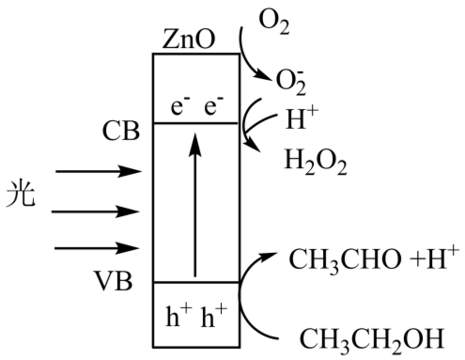

# Chemistry - 题目 139

**ID**: 4cb2262ba82e4f26be73a825606ff913
**年级**: Grade 12
**难度**: Medium
**题型**: Multiple-choice

## 题目
光照下，氧化锌纳米棒具有优异的光催化活性，可用于制备过氧化氢，反应机理如图所示（ ${\rm{h}}{^{+}}$ 表示电子跃迁产生的空穴）。​​​​​​​‌下列叙述错误的是（      ）

## 解答

1. A．反应物总能量与生成物总能量的相对大小决定反应放热或吸热，放热反应或吸热反应过程中均需要先吸收能量克服反应的活化能，不能根据吸收光能判断总反应为吸热反应，故A项错误；
2. B．中间体 ${\rm {\rm{O}}{{}_{2}^{-}}}$ 的总电子数为17，含有单电子，结构不稳定、反应活性强，故B项正确；
3. C．总反应为 ${\rm {\rm{O}}{{}_{2}}+{\rm{C}}{\rm{H}}{{}_{3}}{\rm{C}}{\rm{H}}{{}_{2}}{\rm{O}}{\rm{H}}{\rm{=}}{\rm{H}}{{}_{2}}{\rm{O}}{{}_{2}}+{\rm{C}}{\rm{H}}{{}_{3}}{\rm{C}}{\rm{H}}{\rm{O}}}$ ，生成 ${\rm {\rm{H}}{{}_{2}}{\rm{O}}{{}_{2}}}$ 和 ${\rm {\rm{C}}{\rm{H}}{{}_{3}}{\rm{C}}{\rm{H}}{\rm{O}}}$ 的物质的量之比为1:1，故C项正确；
4. D．电子跃迁产生的空穴可以获得电子，乙醇发生的反应可表示为 ${\rm {\rm{C}}{\rm{H}}{{}_{3}}{\rm{C}}{\rm{H}}{{}_{2}}{\rm{O}}{\rm{H}}+2{\rm{h}}{^{+}}{\rm{=}}{\rm{C}}{\rm{H}}{{}_{3}}{\rm{C}}{\rm{H}}{\rm{O}}+2{\rm{H}}{^{+}}}$ ，故D项正确；
5. 故本题选A。

## 知识点

**中文**:
  - 吸热反应和放热反应

**English**:
  - Endothermic and Exothermic Reactions

---
