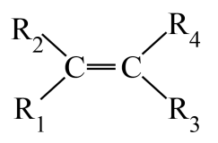
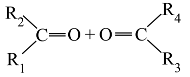
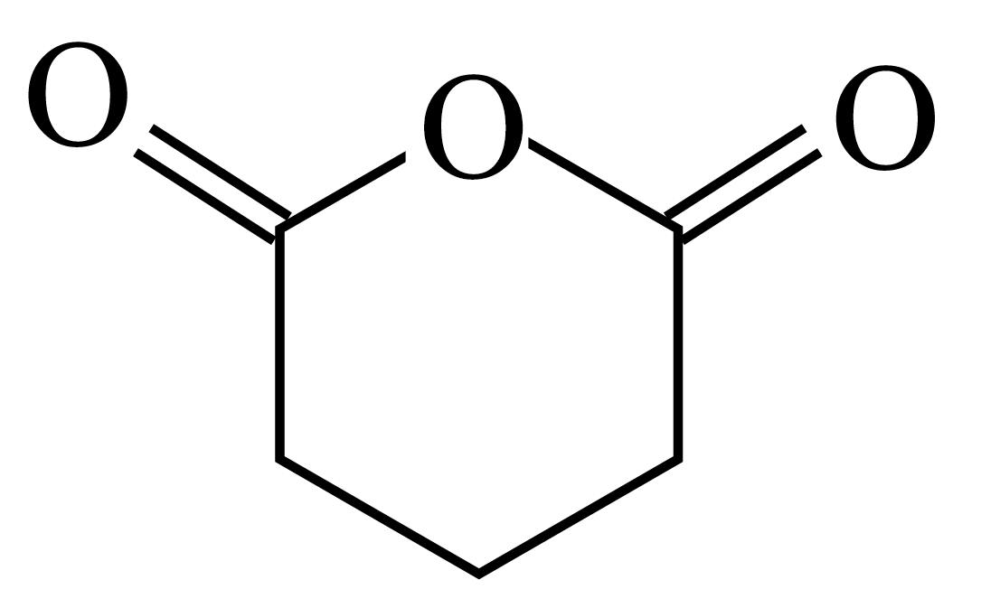
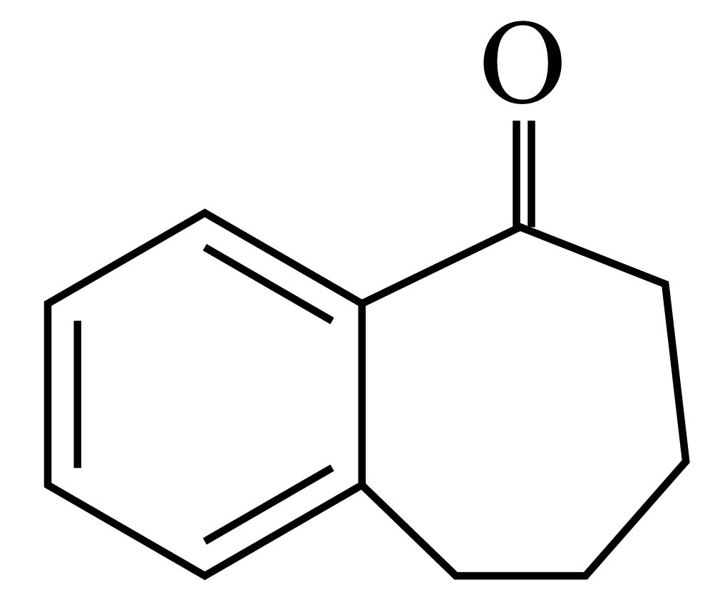

# Chemistry - 题目 311

**ID**: 66e9a5cb39fd45bc8300b01e99787133
**年级**: Grade 12
**难度**: Medium
**题型**: 非选择题

## 题目
化合物K常用作医药中间体、材料中间体，其合成路线如图所示。​​​​​​​‌已知：① ${\rm RCOOH\xrightarrow []{\mathrm{{\rm{S}}{\rm{O}}{\rm{C}}{\rm{l}}{{}_{2}}}}}$ RCOCl；②${\rm \xrightarrow [\mathrm{{\rm{2}}{\rm{)}}{\rm{Z}}{\rm{n}}{\rm{/}}{\rm{H}}{{}_{{\rm{2}}}}{\rm{O}}}]{\mathrm{{\rm{1}}{\rm{)}}{\rm{O}}{{}_{{\rm{3}}}}}}}$。回答下列问题：(1)检验苯中含有A的化学试剂为；C中官能团的名称为。(2)H→I的反应类型为；G的结构简式为。(3)J→K的化学方程式为。(4)D的同分异构体中，仅含有－OOCCH_{3}，－CH_{3}和苯环结构的有种(不考虑立体异构)。(5)根据上述信息，写出以苯和为主要原料制备的合成路线：。

## 解答

1. （1）A为，其能被酸性高锰酸钾溶液氧化，从而使酸性高锰酸钾溶液褪色，因此可用酸性高锰酸钾溶液检验苯中含有甲苯；由C的结构简式可知C中含羰基、羧基两种官能团；
2. （2）H在浓硫酸作用下发生消去反应生成I；G的结构简式为：；
3. （3）J为：；J在C_{2}H_{5}ONa作用下发生脱水反应生成K，反应方程式为：+C_{2}H_{5}ONa $\xrightarrow []{\mathrm{{\rm{一}}{\rm{定}}{\rm{条}}{\rm{件}}}}$+ C_{2}H_{5}OH+NaOH；
4. （4）D的结构简式为：；其同分异构体中，仅含有－OOCCH_{3}，－CH_{3}和苯环结构，结合组成可知除苯环和－OOCCH_{3}外，该结构中还含有3个甲基，符合的结构有：(编号代表－OOCCH_{3}位置)，共6种；
5. （5）苯与发生流程中A到B的转化生成，发生C到D的转化生成，与SOCl_{2}发生取代反应生成，在氯化铝作用下反应生成，由此得合成路线：$\xrightarrow []{\mathrm{苯}}$${\rm \xrightarrow [\mathrm{{\rm{H}}{\rm{C}}{\rm{l}}}]{\mathrm{{\rm{Z}}{\rm{n}}{\rm{-}}{\rm{H}}{\rm{g}}}}}$${\rm \xrightarrow []{\mathrm{{\rm{S}}{\rm{O}}{\rm{C}}{\rm{l}}{{}_{{\rm{2}}}}}}}$${\rm \xrightarrow []{\mathrm{{\rm{A}}{\rm{l}}{\rm{C}}{\rm{l}}{{}_{{\rm{3}}}}}}}$。

## 知识点

**中文**:
  - 有机合成与推断综合

**English**:
  - Synthesis and Deduction

---
