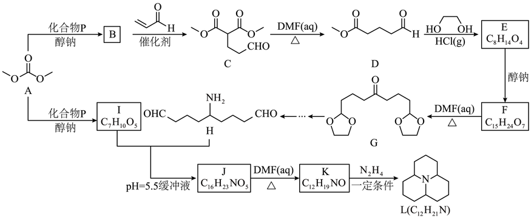
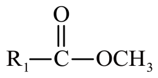
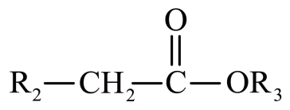
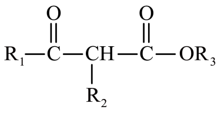
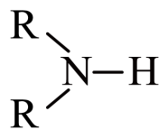
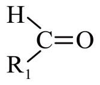
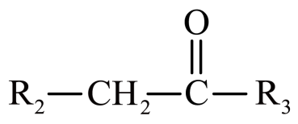
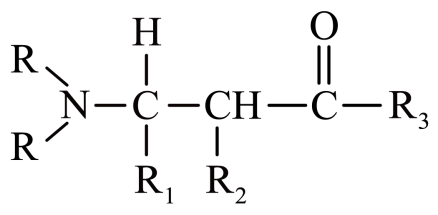
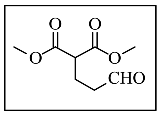

# Chemistry - 题目 207

**ID**: 6873feb2ed0143e389a4cce56ad3a148
**年级**: Grade 12
**难度**: Medium
**题型**: 非选择题

## 题目
瓢虫分泌的生物碱可用于研发杀虫剂，瓢虫生物碱前体化合物L的合成路线如下。​​​​​​​‌已知：ⅰ.$+$$\xrightarrow []{\mathrm{醇钠}}$$+{\rm{C}}{\rm{H}}{{}_{3}}{\rm{O}}{\rm{H}}$ⅱ.$+$$+$$\xrightarrow []{\mathrm{{\rm{P}}{\rm{H}}=5.5缓冲液}}$$+{\rm{H}}{{}_{2}}{\rm{O}}$(1)P的结构简式是 ${\rm{C}}{\rm{H}}{{}_{3}}{\rm{C}}{\rm{O}}{\rm{O}}{\rm{C}}{\rm{H}}{{}_{3}}$ 。用乙酸和甲醇合成P的化学方程式为。(2)B→C的反应类型是。(3)C中官能团的名称是。用虚线标注出C→D时C的断键位置：。(4)E中不含醛基，含有一个五元环，E的结构简式为。(5)I的核磁共振氢谱有两组峰，峰面积之比为 $3:2{\rm ，A}$ 和P以物质的量之比 $1:2$ 合成I的化学方程式为。(6)J中含有三个六元环，J的结构简式为。(7)K→L过程中 ${\rm{N}}{{}_{2}}{\rm{H}}{{}_{4}}$ 转变为 ${\rm{N}}{{}_{2}}$ 。理论上发生反应的K与 ${\rm{N}}{{}_{2}}{\rm{H}}{{}_{4}}$ 的物质的量之比为。

## 解答

1. （1）P为乙酸甲酯，则乙酸和甲醇发生酯化反应的方程式为： ${\rm{C}}{\rm{H}}{{}_{3}}{\rm{C}}{\rm{O}}{\rm{O}}{\rm{H}}+{\rm{C}}{\rm{H}}{{}_{3}}{\rm{O}}{\rm{H}}\xrightleftharpoons [\mathrm{△}]{\mathrm{浓硫酸}}{\rm{C}}{\rm{H}}{{}_{3}}{\rm{C}}{\rm{O}}{\rm{O}}{\rm{C}}{\rm{H}}{{}_{3}}+{\rm{H}}{{}_{2}}{\rm{O}}$ ；
2. （2）
3. 由分析可知，B为，结合C的结构简式可知，B→C为B和中碳碳双键的加成反应；
4. （3）
5. 结合C的结构简式可知，C中官能团的名称是酯基、醛基；对比C和D的结构简式可知，C→D时C的断键位置为：
6. （4）
7. 由分析可知，E的结构简式为；
8. （5）
9. 结合信息ⅰ和C的结构简式，同时结合A和P以物质的量之比 $1:2$ 合成I，且I的核磁共振氢谱有两组峰，峰面积之比为 $3:2$ ，则I为，则合成I的化学方程式为：++2CH_{3}OH；
10. （6）
11. 结合第5问分析可知，I为，同时结合信息ⅱ和H的结构简式，J中含有三个六元环，J的结构简式为；
12. （7）结合K的分子式和L的结构简式可知，K和 ${\rm{N}}{{}_{2}}{\rm{H}}{{}_{4}}$ 反应生成L和水，方程式为： ${\rm K+}{\rm{N}}{{}_{2}}{\rm{H}}{{}_{4}}$ →L+H_{2}O+N_{2}，根据元素守恒可知，所有物质的系数都是1，则理论上发生反应的K与 ${\rm{N}}{{}_{2}}{\rm{H}}{{}_{4}}$ 的物质的量之比为1∶1。

## 知识点

**中文**:
  - 取代反应与加成反应
  - 常见官能团名称、组成及结构
  - 有机合成与推断综合

**English**:
  - Substitution and Addition Reactions
  - Names, Composition and Structure of Functional Groups
  - Synthesis and Deduction

---
