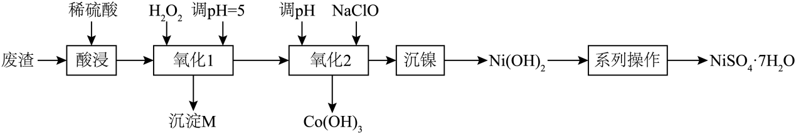
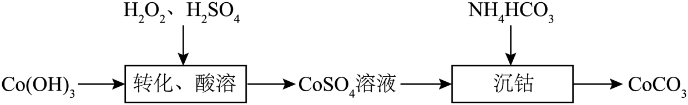

# Chemistry - 题目 289

**ID**: 79bdfe5ad62a4bf08c777abf5b52dcd7
**年级**: Grade 12
**难度**: Medium
**题型**: 非选择题

## 题目
一种以废镍氢电池的废渣[主要成分为Ni(OH)_{2}，Co(OH)_{2}，及少量Fe、Al的氧化物]为原料制备硫酸镍(NiSO_{4}·7H_{2}O)晶体的流程如图所示。​​​​​​​‌已知部分阳离子以氢氧化物形式沉淀时溶液的pH如下表。阳离子Fe^{2+}Fe^{3+}Co^{2+}Co^{3+}Al^{3+}Ni^{2+}开始沉淀的pH6.31.57.23.46.2完全沉淀的pH8.32.89.21.14.78.9回答下列问题：(1)“酸浸”中不能用盐酸替代稀硫酸，其主要原因是。(2)“氧化1”中调节pH为5的目的是，将沉淀M浸于(填化学式)溶液，经过滤、洗涤、灼烧得到红色粉末，可用于制造颜料。(3)“氧化2”中Co^{2+}被氧化生成Co(OH)_{3}的离子方程式为。(4)“沉镍”中不能加入过量氨水，其原因是Ni(OH)_{2}溶解生成硫酸四氨合镍，故过量氨水与硫酸镍反应的化学方程式为。(5)利用Co(OH)_{3}制备CoCO_{3}，的微流程如图所示：“转化、酸溶”中主要发生放热反应，如果加入双氧水过快，则消耗双氧水的量远大于理论值，其主要原因是；“转化、酸溶”中H_{2}O_{2}主要表现的性质是(填“氧化性”或“还原性”)。(6)探究Co(OH)_{3}的氧化性。取少量Co(OH)_{3}于试管中，滴加KI淀粉溶液，无明显现象，再滴加稀硫酸，立即变蓝色，其变蓝色的原因是(填化学方程式)。

## 解答

1. （1）“酸浸”中若使用稀盐酸酸浸，盐酸的 $Cl{^{-}}$ 与氧化2中的 $ClO{^{-}}$ 在酸性条件下发生归中反应生成 ${\rm{C}}{\rm{l}}{{}_{2}}$ ，所以不能用盐酸酸浸；
2. （2）由表可知，“氧化1”中调节pH为5，使得Fe^{3＋}、Al^{3＋}转化为Fe(OH)_{3}、Al(OH)_{3}沉淀而被除去；沉淀M含有Fe(OH)_{3}、Al(OH)_{3}，将其进入NaOH溶液中，Al(OH)_{3}转化为 $Na[Al\left ({OH}\right ){{}_{{{4}}}}{\rm{]}}$ ，过滤后得到Fe(OH)_{3}固体，灼烧后得到 ${\rm{F}}{\rm{e}}{{}_{{{2}}}}{\rm{O}}{{}_{{{3}}}}$ ，常用于制造红色颜料；
3. （3）“氧化2”中NaClO将Co^{2+}氧化为Co^{3+}；进而生成Co(OH)_{3}沉淀，离子方程式为： $2Co{^{2+}}+ClO{^{-}}+5{\rm{H}}{{}_{2}}{\rm{O}}=2Co\left ({OH}\right ){{}_{3}}\downarrow +Cl{^{-}}+4{\rm{H}}{^{+}}$ ；
4. （4）过量氨水与硫酸镍反应生成硫酸四氨合镍和水，化学方程式为 ${\rm{N}}{\rm{i}}{\rm{S}}{\rm{O}}{{}_{4}}{{+}}{{4}}{\rm{N}}{\rm{H}}{{}_{{{3}}}}\cdot {\rm{H}}{{}_{{{2}}}}{\rm{O}}{\rm{=}}\left [{\rm{N}}{\rm{i}}\left ({{\rm{N}}{\rm{H}}{{}_{{{3}}}}}\right ){{}_{{{4}}}}\right ]{\rm{S}}{\rm{O}}{{}_{4}}{{+}}{{4}}{\rm{H}}{{}_{{{2}}}}{\rm{O}}$ ；
5. （5）制备CoCO_{3}的流程为，在硫酸参与下，Co(OH)_{3}被H_{2}O_{2}还原为CoSO_{4}，加入 ${\rm{N}}{\rm{H}}{{}_{{{4}}}}{\rm{H}}{\rm{C}}{\rm{O}}{{}_{{{3}}}}$ 溶液得CoCO_{3}沉淀；
6. 该反应为放热反应，双氧水不稳定，温度过高易分解，所以消耗双氧水的量远大于理论值；
7. 由上述分析可知，H_{2}O_{2}表现还原性；
8. （6）淀粉KI溶液变蓝色原因是酸性条件下，Co(OH)_{3}表现氧化性，将 ${\rm{I}}{^{-}}$ 氧化为 ${\rm{I}}{{}_{2}}$ ，化学方程式为 $2Co\left ({OH}\right ){{}_{3}}+2KI+3{\rm{H}}{{}_{2}}SO{{}_{4}}=2CoSO{{}_{4}}+{\rm{K}}{{}_{2}}SO{{}_{4}}+{\rm{I}}{{}_{2}}+6{\rm{H}}{{}_{2}}{\rm{O}}$ 。

## 知识点

**中文**:
  - 物质分离和提纯的综合应用
  - 陌生氧化还原反应方程式的书写

**English**:
  - Comprehensive Applications
  - Writing Equations for Unfamiliar Redox Reactions

---
