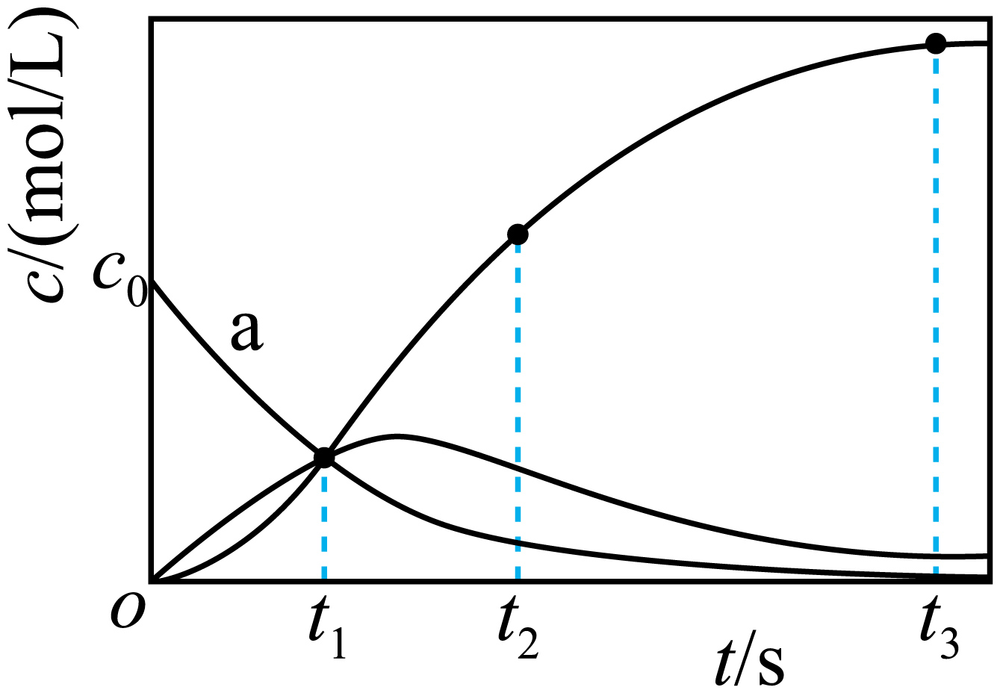

# Chemistry - 题目 298

**ID**: 810c03da3f814d8b91ebb78d759f0863
**年级**: Grade 12
**难度**: Medium
**题型**: Multiple-choice

## 题目
反应 ${\rm {\rm{X}}{\rm{=}}3{\rm{Z}}}$ 经历两步：①X→Y；②Y→3Z。​​​​​​​‌反应体系中X、Y、Z的浓度c随时间t的变化曲线如图所示。下列说法正确的是

## 解答

1. A．由图可知，分别代表3种不同物质的曲线相交于 ${\rm t{{}_{1}}}$ 时刻，因此， ${\rm t{{}_{1}}}$ 时 ${\rm c\left ({{\rm{X}}}\right )=c\left ({{\rm{Y}}}\right )=c\left ({{\rm{Z}}}\right )}$ ，A错误；
2. B．根据分析，ａ线为X的浓度 ${\rm c}$ 随时间 ${\rm t}$ 的变化曲线，B错误；
3. C． ${\rm {\rm{t}}{{}_{{\rm{1}}}}}$ s时，反应正向移动，Y的消耗速率小于生成速率，C错误；
4. D．由图可知， ${\rm t{{}_{3}}}$ 时刻反应①完成，X完全转化为Y，若无反应①发生，则 ${\rm c\left ({{\rm{Y}}}\right )=c{{}_{0}}}$ ，由于反应②Y→3Z的发生， ${\rm t{{}_{3}}}$ 时刻Y浓度的变化量为 ${\rm c{{}_{0}}-c\left ({{\rm{Y}}}\right )}$ ，变化量之比等于化学计量数之比，所以Z的浓度的变化量为 ${\rm 3c{{}_{0}}-3c\left ({{\rm{Y}}}\right )}$ ，这种关系在 ${\rm t{{}_{3}}}$ 后仍成立， 因此，D正确；
5. 故选D。

## 知识点

**中文**:
  - 化学反应速率与化学计量数之间的关系
  - 化学反应速率的计算

**English**:
  - Relationship between Rate and Stoichiometry
  - Calculation of Reaction Rate

---
