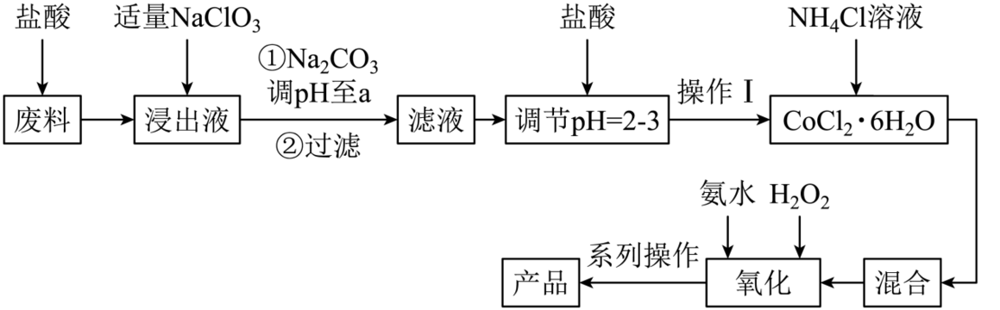
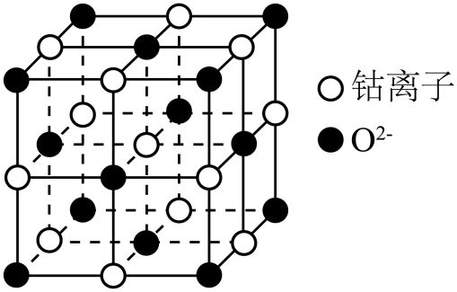
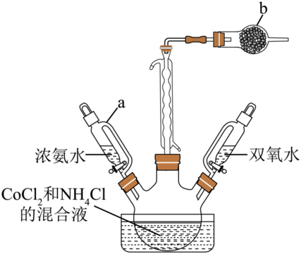

# Chemistry - 题目 19

**ID**: 9ef8b67f69464a4da98c9037ecd1b872
**年级**: Grade 12
**难度**: Medium
**题型**: 非选择题

## 题目
三氯化六氨合钴 $\left \{\left [{\rm{C}}{\rm{o}}\left ({{\rm{N}}{\rm{H}}{{}_{{{3}}}}}\right ){{}_{{{6}}}}\right ]{\rm{C}}{\rm{l}}{{}_{3}}\right \}$ 是橙黄色的配合物，是合成其他二些含钴配合物的原料。​​​​​​​‌利用含钴废料(含少量 ${\rm{F}}{\rm{e}}、{\rm{A}}{\rm{l}}$ 等杂质)制取 $\left [{\rm{C}}{\rm{o}}\left ({{\rm{N}}{\rm{H}}{{}_{{{3}}}}}\right ){{}_{{{6}}}}\right ]{\rm{C}}{\rm{l}}{{}_{3}}$ 的工艺流程如图：已知：①“浸出液”中含有 ${\rm{C}}{\rm{o}}{^{2+}}、{\rm{F}}{\rm{e}}{^{2+}}、{\rm{F}}{\rm{e}}{^{3+}}、{\rm{A}}{\rm{l}}{^{3+}}$ 等。② ${\rm{K}}{{}_{sp}}\left [{\rm{C}}{\rm{o}}({\rm{O}}{\rm{H}}){{}_{2}}\right ]=1\times 10{^{-14.2}}、{\rm{K}}{{}_{{\rm{s}}{\rm{p}}}}\left [{\rm{C}}{\rm{o}}({\rm{O}}{\rm{H}}){{}_{3}}\right ]=1\times 10{^{-43.7}}、{\rm{K}}{{}_{{\rm{s}}{\rm{p}}}}\left [{\rm{F}}{\rm{e}}({\rm{O}}{\rm{H}}){{}_{3}}\right ]=1\times 10{^{-37.4}}$ 、 ${\rm{K}}{{}_{{\rm{s}}{\rm{p}}}}\left [{\rm{A}}{\rm{l}}({\rm{O}}{\rm{H}}){{}_{3}}\right ]=1\times 10{^{-32.9}}$ ，当溶液中金属离子的物质的量浓度 $⩽10{^{-5}}{\rm{m}}{\rm{o}}{\rm{l}}\cdot {\rm{L}}{^{-1}}$ 时可以说成沉淀完全。③ $\left [{\rm{C}}{\rm{o}}\left ({{\rm{N}}{\rm{H}}{{}_{3}}}\right ){{}_{6}}\right ]{^{2+}}$ 具有较强还原性，氧化性： ${\rm{H}}{{}_{2}}{\rm{O}}{{}_{2}}>{\rm{C}}{\rm{o}}{^{3+}}$ 。回答下列问题：(1)某钴氧化物的晶胞如图所示，该氧化物中钴离子的价电子排布式为。(2)“加 ${\rm{N}}{\rm{a}}{{}_{2}}{\rm{C}}{\rm{O}}{{}_{3}}$ 调 ${\rm{p}}{\rm{H}}$ 至 $a”$ 会生成两种沉淀，同时得到含 ${\rm{c}}\left ({{\rm{C}}{\rm{o}}{^{2+}}}\right )=0.1{\rm{m}}{\rm{o}}{\rm{l}}\cdot {\rm{L}}{^{-1}}$ 的滤液，a的范围为(加入 ${\rm{N}}{\rm{a}}{\rm{C}}{\rm{l}}{\rm{O}}{{}_{3}}$ 和 ${\rm{N}}{\rm{a}}{{}_{2}}{\rm{C}}{\rm{O}}{{}_{3}}$ 时溶液的体积变化忽略)(3)如题图所示，将 ${\rm{N}}{\rm{H}}{{}_{4}}{\rm{C}}{\rm{l}}、{\rm{C}}{\rm{o}}{\rm{C}}{\rm{l}}{{}_{2}}$ 混合在三颈烧瓶中， ${\rm{N}}{\rm{H}}{{}_{4}}{\rm{C}}{\rm{l}}$ 的作用是。(4)①流程中“氧化”过程应先加入氨水后加双氧水的目的是。②写出“氧化”步骤发生反应的离子方程式：。(5)产品分离提纯。将反应后的混合物趁热过滤，待滤液冷却后加入适量浓盐酸，过滤、洗涤、干燥，得到 $\left [{\rm{C}}{\rm{o}}\left ({{\rm{N}}{\rm{H}}{{}_{{{3}}}}}\right ){{}_{{{6}}}}\right ]{\rm{C}}{\rm{l}}{{}_{{{3}}}}$ 晶体，该过程中加入浓盐酸的目的是。

## 解答

1. （1）由晶胞结构可知，晶胞中位于顶点和面心的氧离子个数为 ${\rm 8×}\frac {1}{8}{\rm +6×}$  $\frac {1}{2}{\rm =4}$ ，位于棱上和体心的钴离子个数为 ${\rm 12×}\frac {1}{4}{\rm +1=4}$ ，则氧化物的化学式为CoO，钴元素的原子序数为27，基态亚钴离子的价电子排布式为 $3{\rm{d}}{^{7}}$ ，故答案为： $3{\rm{d}}{^{7}}$ ；
2. （2）由分析可知，加入碳酸钠调节溶液pH的目的是将溶液中的铁离子、铝离子转化为氢氧化铁、氢氧化铝沉淀，由溶度积可知，铝离子完全沉淀时，铁离子已经完全沉淀，则铝离子完全沉淀时，溶液中氢氧根离子浓度大于 $\sqrt[3]{\frac {1\times 10{^{-32.9}}}{1\times 10{^{-5}}{\rm{m}}{\rm{o}}{\rm{l}}{\rm{/}}{\rm{L}}}}$ =10^{—9.3}mol/L，则溶液的pH大于4.7；溶液中亚钴离子浓度为0.1mol/L，则由溶度积可知，溶液中氢氧根离子浓度小于 $\sqrt {\frac {1\times 10{^{-14.2}}}{{{0}}{{.}}{{1}}{\rm{m}}{\rm{o}}{\rm{l}}{\rm{/}}{\rm{L}}}}$ =10^{—6.6}mol/L，溶液的pH小于7.4，所以a的范围为 $4.7\sim 7.4$ ，故答案为： $4.7\sim 7.4$ ；
3. （3）氯化铵溶液中的铵根离子可以抑制氨水的电离，可以减小氨水溶液的pH，防止氧化过程中溶液pH过大使溶液中的亚钴离子转化为氢氧化亚钴沉淀，影响三氯化六氨合钴的生成，所以氧化前需要将六水氯化亚钴溶于氯化铵溶液得到氯化亚钴和氯化铵的混合溶液，故答案为： ${\rm{N}}{\rm{H}}{{}_{4}}{\rm{C}}{\rm{l}}$ 会抑制氧化过程中 ${\rm{N}}{\rm{H}}{{}_{3}}\cdot {\rm{H}}{{}_{2}}{\rm{O}}$ 的电离，防止生成 ${\rm{C}}{\rm{o}}({\rm{O}}{\rm{H}}){{}_{2}}$ 沉淀；
4. （4）①由题给信息可知 $\left [{\rm{C}}{\rm{o}}\left ({{\rm{N}}{\rm{H}}{{}_{3}}}\right ){{}_{6}}\right ]{^{2+}}$ 具有较强还原性，便于氧化；若先加 ${\rm{H}}{{}_{2}}{\rm{O}}{{}_{2}}$ 将 ${\rm{C}}{\rm{o}}{^{2+}}$ 氧化为 ${\rm{C}}{\rm{o}}{^{3+}}$ ，后加氨水，会生成 ${\rm{C}}{\rm{o}}({\rm{O}}{\rm{H}}){{}_{3}}$ ，不利于产品的生成，所以先加入氨水再加入 ${\rm{H}}{{}_{2}}{\rm{O}}{{}_{2}}$ ，故答案为： $\left [{\rm{C}}{\rm{o}}\left ({{\rm{N}}{\rm{H}}{{}_{3}}}\right ){{}_{6}}\right ]{^{2+}}$ 具有较强还原性，便于氧化；先加 ${\rm{H}}{{}_{2}}{\rm{O}}{{}_{2}}$ 将 ${\rm{C}}{\rm{o}}{^{2+}}$ 氧化为 ${\rm{C}}{\rm{o}}{^{3+}}$ ，后加氨水，会生成 ${\rm{C}}{\rm{o}}({\rm{O}}{\rm{H}}){{}_{3}}$ ，不利于产品的生成，故先加入氨水再加入 ${\rm{H}}{{}_{2}}{\rm{O}}{{}_{2}}$ ；
5. ②由分析可知，“氧化”步骤先加入氨水，再加入过氧化氢溶液的目的是将溶液中的二氯化六氨合亚钴转化为三氯化六氨合钴，反应的离子方程式为 $2\left [{\rm{C}}{\rm{o}}\left ({{\rm{N}}{\rm{H}}{{}_{3}}}\right ){{}_{6}}\right ]{^{2+}}+2{\rm{N}}{\rm{H}}{{}_{4}^{+}}+{\rm{H}}{{}_{2}}{\rm{O}}{{}_{2}}=2\left [{\rm{C}}{\rm{o}}\left ({{\rm{N}}{\rm{H}}{{}_{3}}}\right ){{}_{6}}\right ]{^{3+}}+2{\rm{N}}{\rm{H}}{{}_{3}}\uparrow +2{\rm{H}}{{}_{2}}{\rm{O}}$ ，故答案为： $2\left [{\rm{C}}{\rm{o}}\left ({{\rm{N}}{\rm{H}}{{}_{3}}}\right ){{}_{6}}\right ]{^{2+}}+2{\rm{N}}{\rm{H}}{{}_{4}^{+}}+{\rm{H}}{{}_{2}}{\rm{O}}{{}_{2}}=2\left [{\rm{C}}{\rm{o}}\left ({{\rm{N}}{\rm{H}}{{}_{3}}}\right ){{}_{6}}\right ]{^{3+}}+2{\rm{N}}{\rm{H}}{{}_{3}}\uparrow +2{\rm{H}}{{}_{2}}{\rm{O}}$ ；
6. （5）分离提纯得到三氯化六氨合钴时，加入浓盐酸可以增大溶液中的氯离子浓度，可以降低三氯化六氨合钴的溶解度，有利于三氯化六氨合钴结晶析出，故答案为：降低 $\left [{\rm{C}}{\rm{o}}\left ({{\rm{N}}{\rm{H}}{{}_{3}}}\right ){{}_{6}}\right ]{\rm{C}}{\rm{l}}{{}_{3}}$ 在水中的溶解度，有利于其结晶析出。

## 知识点

**中文**:
  - 同离子效应对电离平衡的影响

**English**:
  - Common Ion Effect

---
