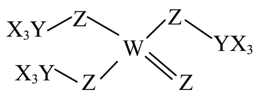

# Chemistry - 题目 180

**ID**: a86546ee571a4146b86a92433bc59542
**年级**: Grade 12
**难度**: Medium
**题型**: Multiple-choice

## 题目
已知短周期主族元素X、Y、Z、W可组成一种含磷阻燃添加剂(结构如图所示)，且原子序数依次增大，Z与Y位于同一周期。​​​​​​​‌下列说法正确的是

## 解答

1. A．W为P其含氧酸在水溶液中都不能完全电离属于弱酸，故A错误；
2. B．Z为O、Y为C，同周期元素第一电离能整体呈现增大趋势，第一电离能O＞C，故B错误；
3. C．Z为O，H_{2}O_{2}中存在非极性共价键，故C错误；
4. D．Y为C，其单质中金刚石是共价晶体、C_{60}属于分子晶体、石墨是混合晶体，故D正确；
5. 故选D。

## 知识点

**中文**:
  - 晶体类型判断

**English**:
  - Identifying Crystal Types

---
