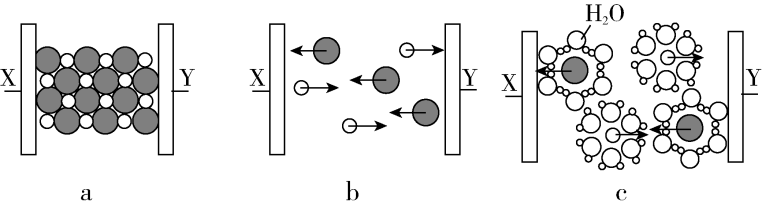

# Chemistry - 题目 344

**ID**: c3a680c47c144d8ea1f636aae46e7b4d
**年级**: Grade 12
**难度**: Medium
**题型**: 选择题:本题共16小题,共44分。第1~10小题,每小题2分;第11~16小题,每小题4分。在每小题给出的四个选项中,只有一项是符合题目要求的。

## 题目
图a~c分别为氯化钠在不同状态下的导电实验(X、Y均表示石墨电极)微观图示。​​​​​​​‌下列说法错误的是

## 解答

1. 特色题型  氯化钠的电离
2. 氯离子的半径大于钠离子,可知题图中代表氯离子,代表钠离子,氯离子的电子式为[∶ ${\rm \stackrel{¨}{\underset{¨}{Cl}}}$ ∶]^{-},A正确;氯化钠在固体状态下,钠离子和氯离子均不能自由移动,不能导电,B正确;图b中只有氯离子和钠离子定向移动,可知为电解熔融的氯化钠的过程,图c中离子被水分子包围,可知为电解氯化钠溶液的过程,电解熔融氯化钠时阴极是钠离子放电,而电解氯化钠溶液时阴极是氢离子放电,反应不同,C错误;图b能说明熔融状态下的氯化钠可以导电,可知氯化钠为离子化合物,其固体中存在离子键,D正确。

## 知识点

**中文**:
  - 电子式、结构式、结构简式、化学式、比例模型、球棍模型、化学符号及名称的综合

**English**:
  - Comprehensive Chemical Notation and Models

---
