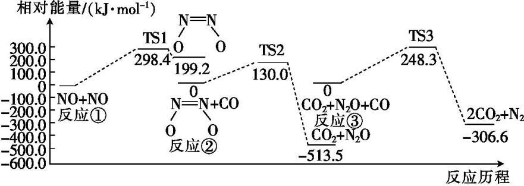
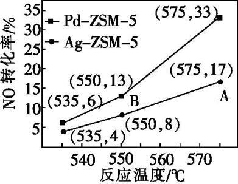
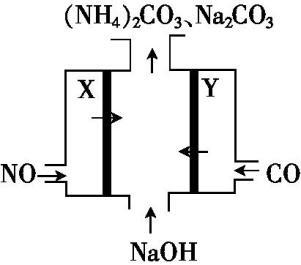

# Chemistry - 题目 123

**ID**: d453d743f31046308a360c525778c397
**年级**: Grade 12
**难度**: Medium
**题型**: 非选择题:本题共4小题,共56分。

## 题目
汽车尾气中的NO和CO气体是城市气体污染物的主要来源,NO和CO气体的无害化转化主要涉及反应2NO(g)+2CO(g) → N_{2}(g)+2CO_{2}(g)。​​​​​​​‌请回答下列问题:(1)Pd-ZSM-5分子筛可以催化NO和CO气体的无害化转化,该催化剂的催化机理如图9所示,则2NO(g)+2CO(g) → N_{2}(g)+2CO_{2}(g)　ΔH=kJ·mol^{-1}。图9(2)①某课题组以不同的过渡金属负载的ZSM-5分子筛为催化剂,测得相同时间内Pd-ZSM-5分子筛和Ag-ZSM-5分子筛在不同温度下的催化效果如图10所示,已知:2NO(g)+2CO(g) → N_{2}(g)+2CO_{2}(g)　ΔH<0,则下列说法正确的是(填字母)。图10图11

## 解答

1. (1)由图可知:2NO(g)→N_{2}O_{2}(g)　ΔH_{1}=+199.2 kJ·mol^{-1};N_{2}O_{2}(g)+CO(g)→CO_{2}(g)+N_{2}O(g)　ΔH_{2}=-513.5 kJ·mol^{-1};CO_{2}(g)+N_{2}O(g)+CO(g)→2CO_{2}(g)+N_{2}(g)　ΔH_{3}=-306.6 kJ·mol^{-1}。根据盖斯定律可得2NO(g)+2CO(g)→N_{2}(g)+2CO_{2}(g)　ΔH=-620.9 kJ·mol^{-1}。
2. (2)根据2NO(g)+2CO(g)→N_{2}(g)+2CO_{2}(g)　ΔH<0,图像上的点不是平衡点,升高温度,反应速率加快,相同时间内NO转化率升高。催化剂不能提高NO的平衡转化率,A项不正确;由图可知,相同温度下Pd-ZSM-5分子筛的催化效果比Ag-ZSM-5分子筛的催化效果好,B项正确;该反应放热,升高温度,平衡逆向移动,NO的转化率降低,C项不正确;移走CO_{2},反应速率减小,B点NO的转化率减小,D项不正确。
3. (3)设平衡时N_{2}的分压为x kPa,列三段式:
4. 2CO(g)+2NO(g)→N_{2}(g)+2CO_{2}(g)
5. 起始/kPa　　　　　　　　p_{2}0　　　0
6. 转化/kPa　　　　　　　　2x　　　　x　　　2x
7. 平衡/kPa　　　　p_{1}p_{2}-2x　　　x　　　2x
8. ${\rm p_{1}+p_{2}-2x+x+2x=p_{3},x=p_{3}-p_{1}-p_{2},K_{p}=}\frac{4{x}^{3}}{{p}_{1}^{2}({p}_{2}\text{-2x}{)}^{2}}{\rm =}$  $\frac{4({p}_{3}\text{-}{p}_{1}\text{-}{p}_{2}{)}^{3}}{{p}_{1}^{2}\text{(2}{p}_{1}+3{p}_{2}\text{-2}{p}_{3}{)}^{2}}$ 。
9. (4)N的化合价降低,得电子,X电极为电解池的阴极,Y电极的电极反应为CO-2e^{-}+4OH^{-}${\rm C{\mathrm{O}}_{3}^{2-}+2H_{2}O}$ 。

## 知识点

**中文**:
  - 与转化率变化有关图像的分析

**English**:
  - Graphs involving Conversion Rate

---
