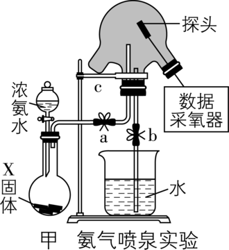
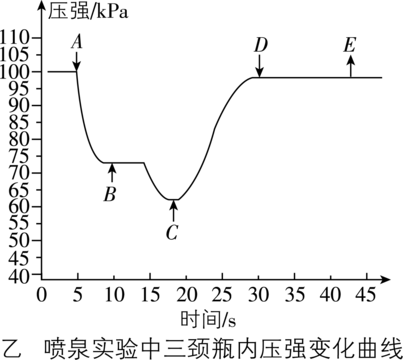

# Chemistry - 题目 136

**ID**: dc609c54f2834417b1530d5fd461cf53
**年级**: Grade 12
**难度**: Medium
**题型**: 选择题:本题共15小题,每小题3分,共45分。每小题只有一项是符合题目要求的。

## 题目
现用传感技术测定喷泉实验中三颈瓶内的压强变化来认识喷泉实验的原理,装置如图甲。​​​​​​​‌下列说法不正确的是

## 解答

1. CaO能和水反应,使c(OH^{-})增大,同时放出大量的热,有利于氨气的逸出,A正确;NH_{3}的密度比空气小,故检验氨气集满的方法是将湿润的红色石蕊试纸靠近三颈瓶口c处,若试纸变蓝色,说明NH_{3}已集满,B正确;喷泉实验实质为产生压强差,三颈瓶内气压与外界大气压之差越大,喷泉越剧烈,根据题图可知C点三颈瓶内压强最小,内外产生的压强差最大,C错误;氨气为碱性气体,碳酸氢钠溶液也显碱性,所以应该用稀盐酸处理,D正确。

## 知识点

**中文**:
  - 喷泉实验

**English**:
  - Fountain Experiment

---
