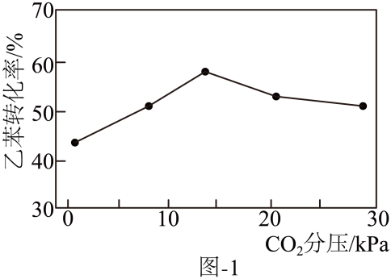
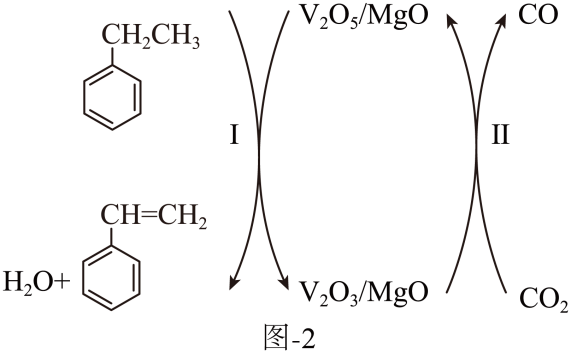
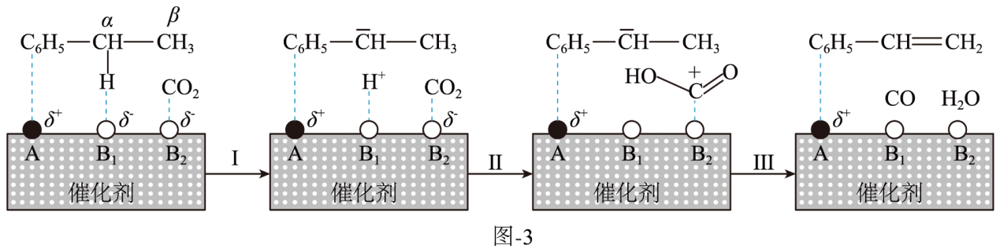

# Chemistry - 题目 144

**ID**: f1e336be680b43bdb138009c37e613e4
**年级**: Grade 12
**难度**: Medium
**题型**: 非选择题

## 题目
乙苯被吸附在催化剂表面发生脱氢可生成苯乙烯、苯甲醛等，生成苯乙烯的相关反应如下。​​​​​​​‌反应1：C_{6}H_{5}CH_{2}CH_{3}(g)=C_{6}H_{5}CH=CH_{2}(g)+H_{2}(g) △H_{1}=117.6kJ•mol^{-1}反应2：CO_{2}(g)+H_{2}(g)=CO(g)+H_{2}O(g) △H_{2}=41.2kJ•mol^{-1}反应3：2H_{2}(g)+O_{2}(g)=2H_{2}O(g) △H_{3}=-483.6kJ•mol^{-1}(1)反应4：C_{6}H_{5}CH_{2}CH_{3}(g)+ $\frac {1}{2}$ O_{2}(g)=C_{6}H_{5}CH=CH_{2}(g)+H_{2}O(g) △H_{4}=kJ•mol^{-1}。(2)较低温度下，向乙苯脱氢的反应体系中加入少量O_{2}，乙苯平衡转化率较高而苯乙烯的选择性较低，其原因可能是。(3)向乙苯脱氢反应体系中加入CO_{2}，乙苯转化率与体系中CO_{2}分压强的关系如图1所示。随CO_{2}的增加，乙苯转化率先增大后减小的可能原因为。(4)研究发现在V_{2}O_{5}/MgO催化剂表面进行CO_{2}的乙苯脱氢反应中，V(+5价)是反应的活性中心，转化过程如图2所示。①转化Ⅰ发生反应的化学方程式为。反应一段时间后，催化剂活性有所下降，原因可能有反应过程产生的积碳覆盖在活性中心表面和。②简述转化Ⅱ的作用。③CO_{2}参与的乙苯脱氢机理如图3所示(α、β表示乙苯分子中C或H原子的位置；A、B为催化剂的活性位点，其中A位点带部分正电荷，B_{1}、B_{2}位点带部分负电荷)。图中所示反应机理中步骤Ⅰ和步骤Ⅱ可描述为。

## 解答

1. （1）由盖斯定律得反应4=反应1+ $\frac {{\rm{1}}}{{\rm{2}}}$ 反应3，则△H_{4=}△H_{1+}$\frac {{\rm{1}}}{{\rm{2}}}$ △H_{3}=117.6-483.6× $\frac {{\rm{1}}}{{\rm{2}}}$ =-124.2kJ•mol^{-1。}
2. （2）氧气参与了反应3，从反应3进行分析解释有利于反应1平衡正向因素。加入少量O_{2}，H_{2}与O_{2}反应放热，氢气浓度减小和体系温度升高都使反应1平衡右移使乙苯转化率升高，但温度升高，苯乙烯(或乙苯)被进一步氧化成苯乙醛等副产物
3. （3）CO_{2}参与了反应2，且消耗H_{2}间接减少了反应1的产物。前一阶段，随着CO_{2}分压强增大，反应2的平衡正向移动，降低了c(H_{2})，促进反应1正向进行，使乙苯转化率增大。当CO_{2}分压强过大多时，CO_{2}占据了催化剂表面，使催化剂表面吸附的乙苯减少，乙苯转化率下降。
4. （4）①从图看，步骤Ⅰ是V_{2}O_{5}将乙苯氧化为苯乙烯而自身还原为V_{2}O_{3}，反应为2→+V_{2}O_{5}/MgO→2→+V_{2}O_{3}/MgO+2H_{2}O。从图看V_{2}O_{5}/MgO为催化剂，催化活性降低可能是催化剂中V(+5价)的含量减少。
5. ②转化Ⅱ中CO_{2}将V_{2}O_{3}转变为V_{2}O_{5}，所以将V_{2}O_{3}转化为V_{2}O_{5}，使催化剂获得再生，同时可以消除积碳。
6. ③图中标注电性，可以从静电吸引的角度阐述这一过程。乙苯α－H带部分正电荷，被带部分负电荷的B_{1}位点吸引，随后解离出H^{+}并吸附在B_{1}位点上；B_{1}位点上的H^{+}与B_{2}位点上CO_{2}中带部分负电荷的O作用生成生成，带部分正电荷的C吸附在带部分负电荷的B_{2}位点上。

## 知识点

**中文**:
  - 利用盖斯定律计算反应热
  - 浓度对化学平衡的影响
  - 温度对化学平衡的影响

**English**:
  - Calculating Reaction Heat using Hess's Law
  - Effect of Concentration
  - Effect of Temperature

---
