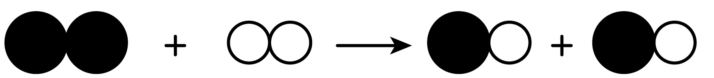

# Chemistry - 题目 154

**ID**: 11b72dc82c9f442ab2fbbbb6e4a28518
**年级**: Grade 8
**难度**: Easy
**题型**: Multiple-select

## 题目
如图表示两种气体发生的化学反应，其中相同的球代表同种原子。​​​​​​​‌下列说法正确的是（      ）

## 解答

1. A、由图可知，生成物只有一种，是纯净物，故错误；
2. B、由微粒的变化可知，化学变化的实质是分子分成原子，原子重新组合成新的分子，即在化学反应中，分子可分，原子不可再分，故正确；
3. D、根据质量守恒定律，该反应前后元素的种类不发生改变，故错误；
4. D、该反应是两种物质生成一种物质，符合“多变一”的特点，基本类型为化合反应，故正确。

## 知识点

**中文**:
  - 化合反应
  - 质量守恒的微观解释
  - 微观反应示意图

**English**:
  - Combination Reaction
  - Microscopic Explanation of Mass Conservation
  - Microscopic Reaction Diagrams

---
