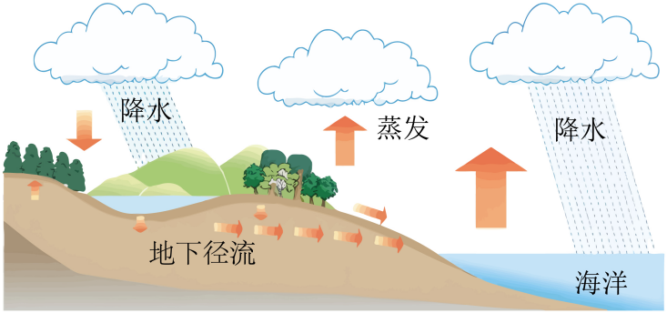

# Chemistry - 题目 235

**ID**: 48cc4d131413496bbefbc36806081d59
**年级**: Grade 8
**难度**: Medium
**题型**: 填空与简答

## 题目
水是人类生活中不可缺少的物质。​​​​​​​‌I．自然界水的循环（1）如图是自然界水循环示意图，在水蒸发过程中，下列说法不正确的是。

## 解答

1. （1）A、微粒总是在不断运动，故在水蒸发过程中，水分子在不断运动，不符合题意；
2. B、在水蒸发过程中，水由液态变为气态，分子之间的间隔变大，符合题意；
3. C、在水蒸发过程中，只是分子之间的间隔发生了改变，分子的种类不变，氢、氧原子不发生改变，不符合题意；
4. D、在水蒸发过程中，水由液态变为气态，水的状态发生了改变，符合题意。
5. 故选BD；
6. （2）活性炭结构疏松多孔，具有吸附性，故该装置利用活性炭的吸附性除去自来水中的色素和异味；
7. 超滤膜可以让水分子通过，而大分子无法通过，如图2，该过程相当于净水中的过滤操作，可将不同颗粒大小的物质分离；
8. 紫外灯照射可以杀菌消毒，发生了蛋白质变性等，一定有新物质生成，属于化学变化；
9. 该装置只能除去水中的色素和异味、细菌、病毒、大分子物质、难溶性杂质，得到的直饮水还含有可溶性杂质，属于混合物。

## 知识点

**中文**:
  - 几种净化方法的比较
  - 纯净物和混合物的定义与区别
  - 分子的定义与性质
  - 过滤操作
  - 水的天然循环

**English**:
  - Comparison of Purification Methods
  - Definition and Distinction of Pure Substances and Mixtures
  - Definition and Properties of Molecules
  - Filtration Operation
  - Natural Water Cycle

---
