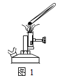

# Chemistry - 题目 114

**ID**: 848d0c5d5c0642219517585d05befa0c
**年级**: Grade 9
**难度**: Easy
**题型**: Comprehensive

## 题目
石灰石是重要的化工原料。​​​​​​​‌研究小组围绕石灰石进行了以下探究。I.石灰石分解的探究〖实验 1〗取一小块石灰石用酒精喷灯煅烧（如图 1 所示，杂质煅烧时不发生变化）。(1)煅烧石灰石时，在火焰上方倒扣一个涂有澄清石灰水的烧杯，石灰水变浑浊，产生浑浊的化学方程式为。此实验能否推断石灰石煅烧产生二氧化碳，并说明理由。(2)将煅烧后的固体放入水中，充分搅拌并滴加酚酞，生成的生石灰与水反应使酚酞变红，该反应的化学方程式为。小组同学对酚酞试液变红是否存在其他因素产生了疑问，进行了下列实验。〖实验 2〗取少量碳酸钙粉末加入 2mL 水，振荡，制成碳酸钙悬浊液，滴加 2 滴酚酞试液，酚酞试液变红。加热后，溶液红色变浅，经测定 pH 减小。另一组同学测得在常温下五种混合体系的 pH，如下表所示。混合体系①Na_{2}CO_{3}溶液②NaCl溶液③CaCl_{2}溶液④CaCO_{3}悬浊液pH11.67.07.010.1(3)根据实验 2，你认为下列说法合理的是（填序号）。

## 解答

1. (1)
2. 二氧化碳能使澄清的石灰水变浑浊，发生反应为二氧化碳和氢氧化钙反应生成碳酸钙和水，该反应的化学方程式为： ${\rm{C}}{\rm{O}}_{{\rm{2}}}{\rm{+}}{\rm{C}}{\rm{a}}{\rm{(}}{\rm{O}}{\rm{H}}{\rm{)}}_{{\rm{2}}}{\rm{=}}{\rm{C}}{\rm{a}}{\rm{C}}{\rm{O}}_{{\rm{3}}}\downarrow {\rm{+}}{\rm{H}}_{{\rm{2}}}{\rm{O}}$  ；
3. 该实验不能证明石灰石煅烧产生二氧化碳，因为在煅烧石灰石的同时，酒精也在燃烧，酒精燃烧也会产生二氧化碳，涂有澄清石灰水的烧杯是倒扣在酒精喷灯火焰上方的，所以不能证明煅烧石灰石产生了二氧化碳；
4. (2)
5. 石灰石煅烧后生成氧化钙和二氧化碳，氧化钙与水反应生成氢氧化钙，氢氧化钙溶液显碱性，能使无色的酚酞变红，反应的化学方程式为： ${\rm{C}}{\rm{a}}{\rm{O}}+{\rm{H}}_{{\rm{2}}}{\rm{O}}{\rm{=}}{\rm{C}}{\rm{a}}\left ({{\rm{O}}{\rm{H}}}\right )_{{\rm{2}}}$ ；
6. (3)
7. A、CaCO_{3}悬浊液中有少量碳酸钙溶于水，说明碳酸钙没有完全溶解，所以形成碳酸钙的饱和溶液，故A选项错误；
8. B、碳酸钙的悬浊液能使无色的酚酞溶液变红，所以说明少量碳酸钙溶于水后，溶液显碱性，升温后，溶液颜色变浅，说明溶液碱性减弱，水中溶解的碳酸钙减少，可说明CaCO_{3}的溶解度随着温度的升高而降低，故B选项正确；
9. C、碳酸钠溶液与碳酸钙悬浊液都能使酚酞溶液变红，而氯化钠和氯化钙溶液不能使酚酞溶液变红，说明钠离子、氯离子和钙离子不能使酚酞溶液变色，所以CaCO_{3}悬浊液使酚酞变红与其结构中的碳酸根离子有关，故C选项正确；
10. D、在加热碳酸钙的悬浊液时，若碳酸钙受热分解了，分解产物为氧化钙和二氧化碳，氧化钙和水反应生成氢氧化钙，氢氧化钙溶于水显碱性，溶液碱性增强，溶液颜色变深，不会变浅，由于碳酸钙在高温煅烧时才能分解，加热时达到不碳酸钙的分解温度，碳酸钙不能分解，故D选项错误。
11. 故选BC。
12. (4)
13. 石灰石的主要成分碳酸钙高温煅烧生成氧化钙和二氧化碳，如果石灰石部分分解，则粉末中含碳酸钙，碳酸钙和稀盐酸反应生成氯化钙、二氧化碳和水，氧化钙和稀盐酸反应生成氯化钙和水，故取碾碎后粉末少许于试管中，加入足量稀盐酸，产生气泡，说明部分分解；
14. (5)
15. 由表格中的数据可以得出，煅烧不同的时间，在1100℃~1200℃范围内生成的生石灰活性度均高于其它温度，故石灰石煅烧的最佳温度范围为1100℃~1200℃；
16. (6)
17. 见答案；
18. (7)
19. 石灰石高温分解生成二氧化碳，二氧化碳和焦炭在高温下反应生成一氧化碳，一氧化碳具有还原性，可还原生成更多的铁，故加入石灰石提高铁产率。

## 知识点

**中文**:
  - 化学方程式的书写与配平
  - 化学方程式的计算
  - 实验探究物质的组成成分以及含量

**English**:
  - Writing and Balancing Chemical Equations
  - Calculations Based on Chemical Equations
  - Inquiry into Composition and Content of Matter

---
