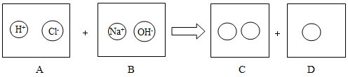

# Chemistry - 题目 113

**ID**: 75863a69e4cc441693f69e040555afd3
**年级**: Grade 9
**难度**: Easy
**题型**: Fill-in-the-blank

## 题目
下图体现了稀盐酸和氢氧化钠溶液反应的实质，请回答有关问题：（1）在上图C、D中的圆圈内填入适当的化学式或离子符号：C中、，D中；（2）用化学方程式表示图中所体现的化学反应；（3）以上变化的反应类型是。​​​​​​​‌

## 解答

1. 酸与碱发生的是中和反应，其实质是酸中的氢离子与碱中的氢氧根离子结合生成水的过程。故稀盐酸与氢氧化钠反应生成的是氯化钠和水，氯化钠是由钠离子和氯离子构成的。该反应是两种生成物交换成分生成另两种化合物，故又属复分解反应。

## 知识点

**中文**:
  - 中和反应的原理

**English**:
  - Principle of Neutralization Reaction

---
