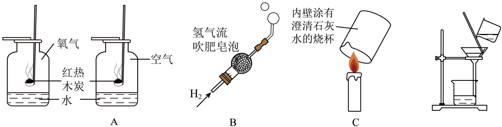

# Chemistry - 题目 305

**ID**: 0e63b516ad69428183850a9d22bb6c5e
**年级**: Grade 9
**难度**: Easy
**题型**: Multiple-choice

## 题目
下列实验设计几乎不能达到实验目的的是（      ）​​​​​​​‌

## 解答

1. A、该实验中其他条件相同，氧气浓度不同，变量唯一，能探究氧气浓度对反应剧烈程度的影响，故操作正确；
2. B、该实验中，充满氢气的肥皂泡升到空中，说明氢气密度比空气小，故操作正确；
3. C、在蜡烛火焰上方罩一个内壁涂有澄清石灰水的烧杯，观察到澄清石灰水变浑浊，说明蜡烛燃烧后有二氧化碳生成，故操作正确；
4. D、过滤实验时，不能用玻璃棒不停搅拌漏斗中的液体，以防损坏滤纸，故操作错误。

## 知识点

**中文**:
  - 实验探究物质的性质或变化规律
  - 蜡烛燃烧
  - 影响化学反应速率的因素探究
  - 过滤操作

**English**:
  - Inquiry into Properties or Change Rules of Matter
  - Combustion of a Candle   [Image of Candle combustion experiment] 
  - Inquiry into Factors Affecting Reaction Rate
  - Filtration Operation

---
