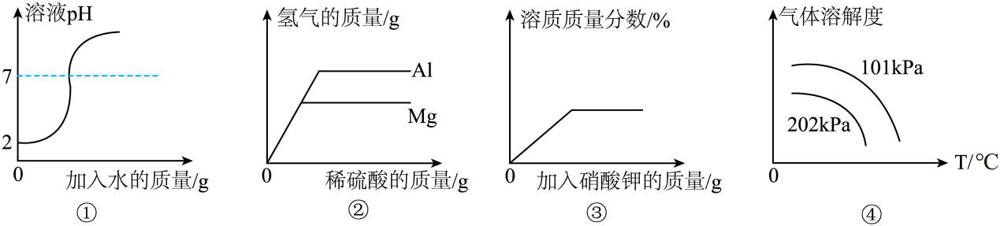

# Chemistry - 题目 212

**ID**: 2464a4717a0e41f88e864a98a537a697
**年级**: Grade 9
**难度**: Easy
**题型**: Multiple-choice

## 题目
下列图像能正确反映对应变化关系的是（      ）​​​​​​​‌

## 解答

1. A、硫酸溶液显酸性，pH＜7，加水稀释,硫酸溶液，溶液酸性减弱，pH逐渐增大至无限接近于7，但是不会等于7，更不会大于7，故A错误；
2. B、分别向等质量镁、铝中加入足量的浓度相同的稀硫酸，镁和硫酸反应生成硫酸镁和氢气，化学方程式为 ${\rm{M}}{\rm{g}}{{+}}{\rm{H}}{{}_{{{2}}}}{\rm{S}}{\rm{O}}{{}_{{{4}}}}={\rm{M}}{\rm{g}}{\rm{S}}{\rm{O}}{{}_{{{4}}}}{{+}}{\rm{H}}{{}_{{{2}}}}\uparrow $ ，每24份质量的镁消耗98份质量的硫酸生成2份质量的氢气，铝和硫酸反应生成硫酸铝和氢气，化学方程式为 ${{2}}{\rm{A}}{\rm{l}}+{{3}}{\rm{H}}{{}_{{{2}}}}{\rm{S}}{\rm{O}}{{}_{{{4}}}}={\rm{A}}{\rm{l}}{{}_{{{2}}}}\left ({{\rm{S}}{\rm{O}}{{}_{{{4}}}}}\right ){{}_{{{3}}}}{{+}}{{3}}{\rm{H}}{{}_{{{2}}}}\uparrow $ ，每54（18）份质量的铝消耗294（98）份质量的硫酸生成6（2）份质量的氢气，刚开始消耗稀硫酸的质量相同，则生成氢气质量相同，故开始两斜线重合；后因硫酸过量，金属完全反应，等质量的金属，产生氢气的质量为铝＞镁，即铝消耗的稀硫酸多，生成的氢气多，拐点高些，故正确；
3. C、20℃时，向一定量硝酸钾的不饱和溶液中加入硝酸钾，硝酸钾会继续溶解，溶质质量增大，则溶质质量分数逐渐增大，达到饱和后，硝酸钾不会继续溶解，溶质质量分数不变，但是起始不饱和硝酸钾溶液的溶质质量分数不是0，即图像起点不为零，故C错误；
4. D、气体的溶解度随温度升高而减小，随压强增大而增大，故D错误；
5. 故选：B。

## 知识点

**中文**:
  - 气体的溶解度
  - 饱和溶液与不饱和溶液
  - 酸的化学性质
  - 溶液的酸碱性与pH

**English**:
  - Solubility of Gases
  - Saturated and Unsaturated Solutions
  - Chemical Properties of Acids
  - Acidity/Basicity of Solutions and pH

---
