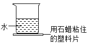

# Chemistry - 题目 327

**ID**: 24b39175903d484099912b37b30373da
**年级**: Grade 9
**难度**: Easy
**题型**: Multiple-choice

## 题目
小琪往如图所示的烧杯中加入一种物质，搅拌后，发现塑料片上的石蜡融化，塑料片掉了下来。​​​​​​​‌她加入的物质是

## 解答

1. B、烧杯中加入硝酸铵晶体，溶于水时吸收热量，使溶液的温度降低，不符合题意；
2. C、水中加入蔗糖后温度没有变化，不符合题意；
3. D、氢氧化钠固体溶于水时放出热量，温度升高，符合题意。
4. 故选D。

## 知识点

**中文**:
  - 溶解时的热量变化

**English**:
  - Heat Changes during Dissolution

---
