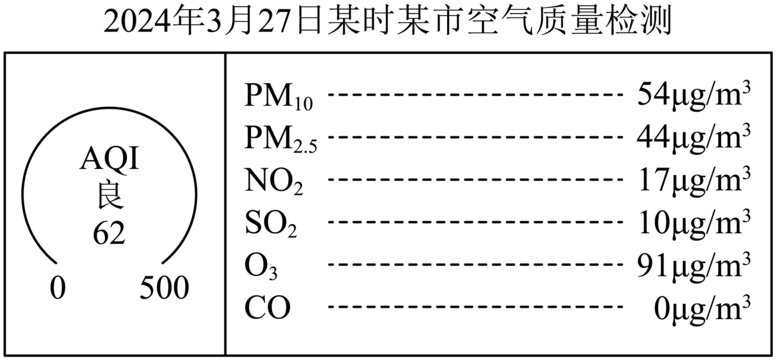

# Chemistry - 题目 125

**ID**: 3a7953bd85c9457d87543e399bc712a4
**年级**: Grade 9
**难度**: Easy
**题型**: Multiple-choice

## 题目
某跨学科实践活动小组组装了微型空气质量“检测站”，并用其检测了2024年3月27日某市空气中主要污染物的含量，结果如图所示。​​​​​​​‌（      ）下列说法中正确的是

## 解答

1. A、空气质量指数（AQI）越大，说明污染物含量越高，则空气质量状况越差，空气质量指数（AQI）越小，说明污染物含量越少，则空气质量状况越好，错误；
2. B、二氧化碳是空气的成分之一，不属于空气污染物，错误；
3. C、由图可知，臭氧指数最高，则当日首要污染物为臭氧，错误；
4. D、空气中 ${\rm{S}}{\rm{O}}{{}_{2}}$ 含量过多，二氧化硫溶于水生成酸性物质，会导致酸雨，正确；
5. 故选：D。

## 知识点

**中文**:
  - 空气污染与保护
  - 酸雨污染与防治
  - （跨学科）微型空气质量“检测站"

**English**:
  - Air Pollution and Protection
  - Acid Rain Pollution and Prevention
  - (Interdisciplinary) Micro Air Quality Station

---
