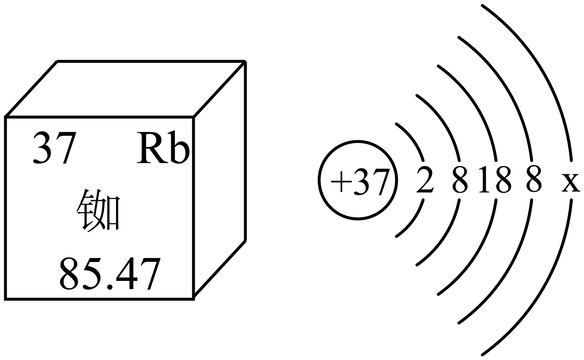

# Chemistry - 题目 205

**ID**: 3f0243e28d5348699adc808d74ca4840
**年级**: Grade 9
**难度**: Easy
**题型**: Multiple-choice

## 题目
铷原子结构示意图及其在元素周期表中的信息如图所示。​​​​​​​‌下列说法正确的是

## 解答

1. A.根据元素周期表中的一格可知，左上角的数字表示原子序数，该元素的原子序数为37；根据原子中原子序数=核电荷数=质子数，则该原子的核内质子数为37；相对原子质量为85.47，不是质子数的两倍，则原子核内中子数不等于37，故选项说法错误；
2. B.周期数=原子核外电子层数，铷元素的原子核外有5个电子层，则在元素周期表中，铷元素位于第五周期，故选项说法正确；
3. C.原子中，质子数=核外电子数，37=2+8+18+8+x，x=1，故选项说法错误；
4. D.铷原子的最外层电子数是1，小于4，在化学反应中易失去1个电子而形成阳离子，故选项说法错误。

## 知识点

**中文**:
  - 原子结构示意图
  - 周期表的规律、信息与推断

**English**:
  - Atomic Structure Diagrams
  - Trends, Information, and Inferences from Periodic Table

---
