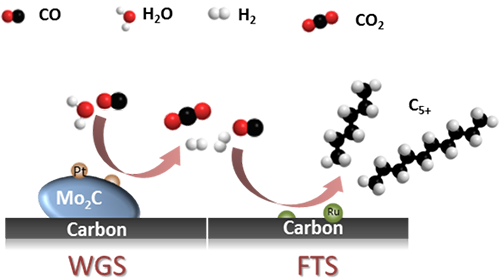

# Chemistry - 题目 215

**ID**: 554b057e3d5745e3b0ce53a0f181724d
**年级**: Grade 9
**难度**: Easy
**题型**: Multiple-choice

## 题目
北京大学科研团队以炼钢废气为原料，实现了制备油品的新催化过程，反应过程如下图所示。​​​​​​​‌相关说法正确的是

## 解答

1. A、从图中可知生成物中含有不同的分子，属于混合物，选项A错误；
2. B、反应物需要与催化剂接触才可以起到催化作用，选项B错误；
3. C、化学反应的实质是分子分成原子，原子重新组合生成新的分子的过程，选项C错误；
4. D、炼钢的废气中含有一氧化碳气体，一氧化碳有毒，属于空气污染物，将一氧化碳转化为油品，可以变废为宝，具有工业应用价值，选项D正确。故选：D。

## 知识点

**中文**:
  - 微观反应示意图

**English**:
  - Microscopic Reaction Diagrams

---
