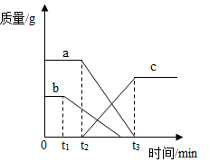

# Chemistry - 题目 313

**ID**: 6ced4c42908d409097f5a3e7d3e4cc27
**年级**: Grade 9
**难度**: Easy
**题型**: Multiple-choice

## 题目
某同学误将少量KMnO_{4}当成MnO_{2}加入KClO_{3}中进行加热制取氧气，部分物质质量随时间变化如下图所示，下列关于该过程的说法正确的是（      ）​​​​​​​‌

## 解答

1. 根据高锰酸钾加热生成二氧化锰可以做催化剂，同时生成氧气；氯酸钾在二氧化锰做催化剂和加热的条件下生成氧气判断图中a：氯酸钾，b：高锰酸钾，c：氯化钾；t_{1}时刻，KMnO_{4}开始分解产生氧气；起催化作用物质是高锰酸钾分解产生的二氧化锰，随着加热反应进行其质量先增大，直至高锰酸钾完全分解后，二氧化锰质量保持不变。故选C。

## 知识点

**中文**:
  - 氯酸钾制取氧气
  - 高锰酸钾制取氧气

**English**:
  - Preparation of Oxygen using Potassium Chlorate
  - Preparation of Oxygen using Potassium Permanganate

---
