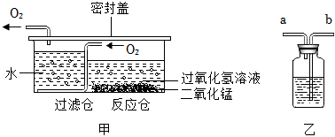

# Chemistry - 题目 268

**ID**: 9badf68623274c47a8775477c2d8896b
**年级**: Grade 9
**难度**: Easy
**题型**: 选择题（本大题共10小题，每小题2分，共20分。在每小题给出的四个选项中，只有一项最符合题意）

## 题目
化学兴趣小组开展了“设计和制作简易供氧器”的实践活动。​​​​​​​‌图甲为供氧器的工作原理，下列说法正确的是（      ）

## 解答

1. A、若输出氧气的管道堵塞，会导致装置内压强增大，可能引起爆炸，要防止输出氧气的管道堵塞，避免引发安全事故，故选项说法正确。
2. B、制氧剂不一定只能是过氧化氢溶液和二氧化锰，其他能产生氧气的物质组合也可以，只要是反应物是固体与液体混合，反应条件是不需加热，故选项说法错误。
3. C、加湿过滤仓中水的作用是对氧气进行加湿，根据加湿过滤仓水中气泡的多少，观察氧气的输出速率，而不是控制反应速率，故选项说法错误。
4. D、图乙用作加湿过滤仓时，氧气的密度小于水，a管与病人相连，这样可以保证氧气经过水的加湿后再被病人吸入，故选项说法错误。
5. 故选：A。

## 知识点

**中文**:
  - 多功能瓶的使用
  - （跨学科）简易供氧器

**English**:
  - Use of Multi-functional Bottles
  - (Interdisciplinary) Simple Oxygen Generator

---
