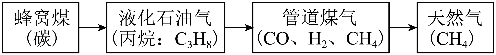

# Chemistry - 题目 353

**ID**: b3fc09e2a73c4cf4b3305e1b0c208e57
**年级**: Grade 9
**难度**: Easy
**题型**: Multiple-choice

## 题目
下图表示我市家用燃料使用的发展历程（括号内表示主要成分），下列说法错误的是​​​​​​​‌

## 解答

1. A.煤炭主要是由碳、氢元素等元素组成的，煤炭燃烧主要是利用碳元素与氧反应所放出的热量，不符合题意；B.使煤分解制成管道煤气的变化有新物质生成，属于化学变化，符合；C.石油的分馏可以得到石油气、汽油、航空煤油、柴油、润滑油、重油等产品，不符合题意；D.煤、石油、天然气都是化石燃料，不符合题意。

## 知识点

**中文**:
  - 化学变化与物理变化
  - 化石能源

**English**:
  - Chemical Changes vs. Physical Changes
  - Fossil Fuels

---
