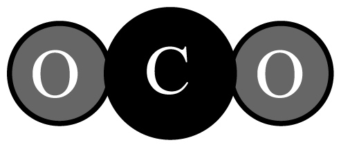

# Chemistry - 题目 32

**ID**: d3e32b38b35247109109cf0c1abe8a22
**年级**: Grade 9
**难度**: Easy
**题型**: Multiple-choice

## 题目
二氧化碳分子结构模型如图所示，下列对二氧化碳组成和构成的叙述正确的是（      ）​​​​​​​‌

## 解答

1. A、二氧化碳中只含一种物质，是由碳、氧元素组成，该选项叙述不正确；
2. B、二氧化碳是由二氧化碳分子构成，二氧化碳分子是由碳、氧原子组成，该选项叙述不正确；
3. C、二氧化碳中碳元素与氧元素质量比为 12：（16×2）=3：8，该选项叙述正确；
4. D、一个二氧化碳分子是由1个碳原子和2个氧原子构成，该选项叙述不正确。
5. 故选C。

## 知识点

**中文**:
  - 元素的质量比
  - 化学式的定义、书写和读法

**English**:
  - Mass Ratio of Elements
  - Definition, Writing, and Reading of Chemical Formulas

---
