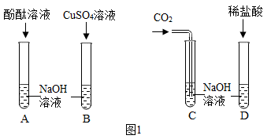
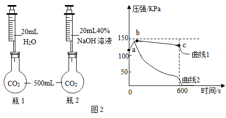
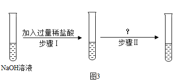

# Chemistry - 题目 76

**ID**: 9009bacbba864eaeab895371bb733251
**年级**: Grade 9
**难度**: Hard
**题型**: Experiment

## 题目
某实验小组同学对氢氧化钠的化学性质进行如下探究。​​​​​​​‌〖实验情景〗(1)图1中A、B试管中观察到的现象分别是。C、D试管中均无明显现象。〖问题思考〗C、D试管中是否发生了化学反应？同学们设计以下实验继续进行探究：〖探究一〗NaOH溶液与CO2能否发生化学反应？(2)方案一：向C试管中再加入，观察到试管中，说明两者发生了化学反应。写出加入某物质后发生反应的化学方程式。(3)方案二：小组同学在老师的指导下进行了如下实验：用两个500mL的烧瓶收集满CO2进行实验。如图2所示，同时迅速将注射器内液体全部注入各自烧瓶中，关闭活塞；一段时间后，同时振荡两个烧瓶。得到如图所示的烧瓶内压强与时间的关系曲线图。①曲线2对应的是（填“瓶1”或“瓶2”）烧瓶内压强变化，曲线1中bc段压强逐渐变小的原因是。②对比曲线1与曲线2，能得出的结论是，反应化学方程式为。〖探究二〗稀盐酸与NaOH溶液能否发生化学反应？(4)方案一：先用pH试纸测定NaOH溶液的pH值，再逐滴滴加稀盐酸，振荡，同时多次测定混合溶液的pH，测定的pH值，则能说明二者发生了化学反应。(5)方案二：利用如图3装置证明二者发生了化学反应。整个实验过程中无明显现象，也可证明氢氧化钠溶液和稀盐酸能发生化学反应，则步骤2中所加试剂为。〖归纳与总结〗(6)同学们经讨论后认为，对于无明显现象的化学反应，可以用两种思路探究反应是否发生：思路①：验证有。思路②：验证反应物减少或消失。

## 解答

1. (1)
2. 氢氧化钠溶液显碱性，能使无色酚酞试液变红，故A试管中的现象是：溶液变红；氢氧化钠和硫酸铜反应生成氢氧化铜和硫酸钠，故B试管中的现象是：产生蓝色沉淀；
3. (2)
4. 二氧化碳和氢氧化钠反应生成碳酸钠和水，碳酸钠能与稀盐酸反应生成氯化钠、二氧化碳和水，故可向C试管中加入足量的稀盐酸，观察到试管中产生大量气泡，说明二氧化碳和氢氧化钠发生了反应；
5. 加入稀盐酸后，发生反应为碳酸钠和稀盐酸反应生成氯化钠、二氧化碳和水，该反应的化学方程式为： ${\rm{N}}{\rm{a}}_{{\rm{2}}}{\rm{C}}{\rm{O}}_{{\rm{3}}}{\rm{+}}{\rm{2}}{\rm{H}}{\rm{C}}{\rm{l}}{\rm{=}}{\rm{2}}{\rm{N}}{\rm{a}}{\rm{C}}{\rm{l}}{\rm{+}}{\rm{H}}_{{\rm{2}}}{\rm{O}}{\rm{+}}{\rm{C}}{\rm{O}}_{{\rm{2}}}\uparrow $ ；
6. (3)
7. ①二氧化碳能溶于水，且能与水反应生成碳酸，使装置内气体减少，压强减小，二氧化碳能与氢氧化钠反应生成碳酸钠和水，使装置内气体减少，压强减小，氢氧化钠吸收二氧化碳的能力比水强，故曲线2对应的是瓶2；
8. 曲线1中bc段压强逐渐变小，是因为二氧化碳溶于水，且与水发生了反应，导致装置内气体减少；
9. ②对比曲线1，曲线2压强下降的多，说明二氧化碳与氢氧化钠发生了反应；
10. 二氧化碳和氢氧化钠反应生成碳酸钠和水，该反应的化学方程式为： ${\rm{C}}{\rm{O}}_{{\rm{2}}}+{\rm{2}}{\rm{N}}{\rm{a}}{\rm{O}}{\rm{H}}{\rm{=}}{\rm{N}}{\rm{a}}_{{\rm{2}}}{\rm{C}}{\rm{O}}_{{\rm{3}}}+{\rm{H}}_{{\rm{2}}}{\rm{O}}$ ；
11. (4)
12. 氢氧化钠显碱性，pH大于7，逐滴滴加稀盐酸，氢氧化钠和稀盐酸反应生成氯化钠和水，氢氧化钠被消耗，碱性减弱，当恰好完全反应时，pH=7，继续滴加稀盐酸，稀盐酸过量，pH大于7，故pH逐渐减小至小于7，说明氢氧化钠和稀盐酸发生了反应；
13. (5)
14. 氢氧化钠显碱性，能使无色酚酞试液变红，加入过量稀盐酸，氢氧化钠和稀盐酸反应生成氯化钠和水，稀盐酸过量，此时溶液显酸性，不能使无色酚酞试液变红，故步骤2中所加试剂为无色酚酞试液，溶液为无色，说明氢氧化钠发生了反应；
15. (6)
16. 对于无明显现象的化学反应，可以用两种思路探究反应是否发生：可以验证有新物质生成，如二氧化碳和氢氧化钠的反应，还可以验证反应物减少或消失。

## 知识点

**中文**:
  - 实验探究物质的性质或变化规律

**English**:
  - Inquiry into Properties or Change Rules of Matter

---
