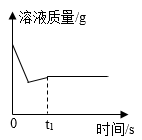

# Chemistry - 题目 167

**ID**: cc21a5597cfe456c8dea64b3d9106c8f
**年级**: Grade 9
**难度**: Hard
**题型**: Fill-in-the-blank

## 题目
3月29日17时50分，我国在太原卫星发射中心成功发射长征六号改运载火箭，搭载发射的浦江二号和天鲲二号卫星顺利进入预定轨道，发射任务获得圆满成功。​​​​​​​‌据了解，长征六号改运载火箭是我国新一代无毒无污染运载火箭，是我国首型固体捆绑运载火箭，用于发射太阳同步轨道卫星。(1)火箭外壳常用铝合金，金属铝具有优良的抗腐蚀性是因为。而铁制品易生锈是因为铁易与空气中的反应生成的铁锈很疏松。(2)火箭箱体可用铝-铜-镁系、铝-锌-镁系高强度铝合金制作。金属镁可从菱镁矿中制取。菱镁矿中主要含MgCO_{3}、FeCO_{3}和SiO_{2}。①菱镁矿属于（填“纯净物”或“混合物”）。②写出向菱镁矿中加入足量稀HCl 反应的化学方程式。（写一个）③将n 克的镁和金属R 的混合粉末加入一定量的氯化铜溶液中，溶液质量的变化情况如图所示。则金属相对原子质量 MgR（填“<”或“>”）。（金属R 在化合物中通常显+2 价）④反应至 t_{1}时段后过滤，向滤渣中加入稀盐酸，观察到有气泡产生，则滤渣中。A 只有铜

## 解答

1. （1）火箭外壳常用铝合金，金属铝具有优良的抗腐蚀性是因为铝在空气中易与空气中的氧气形成致密的氧化铝薄膜，阻止反应的进一步进行。而铁制品易生锈是因为铁易与空气中的氧气和水反应生成的铁锈很疏松。
2. （2）①根据“菱镁矿中主要含MgCO_{3}、FeCO_{3}和SiO_{2}”可知，菱镁矿是由不同物质组成，属于混合物；②碳酸镁与盐酸反应生成氯化镁、水和二氧化碳，碳酸亚铁与盐酸反应生成氯化亚铁、水和二氧化碳。向菱镁矿中加入足量稀HCl 反应的化学方程式分别为：MgCO_{3}+2HCl=MgCl_{2}+H_{2}O+CO_{2}↑，FeCO_{3}+2HCl=FeCl_{2}+H_{2}O+CO_{2}↑；③将一定量的镁和金属R的混合粉末加入一定量的氯化铜溶液中，镁与氯化铜反应生成氯化镁和铜，根据化学反应质量关系，24份质量镁生成铜64份质量，反应后固体质量增大，则反应后溶液质量减小，由溶液质量的变化情况首先发生的反应，溶液质量是减小，然后发生反应溶液质量是增大的，说明镁先与氯化铜反应，然后是R与氯化铜反应，说明金属活动性Zn＞R，根据图示可知R与氯化铜溶液反应后，溶液的质量增大，金属R 在化合物中通常显+2 价,说明R的相对原子质量大于铜，镁的相对原子质量小于铜。将n 克的镁和金属R 的混合粉末加入一定量的氯化铜溶液中，溶液质量的变化情况如图所示。则金属相对原子质量 Mg<R；④根据图示可知，反应至 t_{1}时，镁、R与硫酸铜恰好完全反应，金属活动性Zn＞R，镁先与氯化铜反应，镁完全反应后，金属R才能与氯化铜溶液反应，反应至 t_{1}时段后过滤，向滤渣中加入稀盐酸，观察到有气泡产生，则滤渣中只有铜和R，一定没有镁，故选：B；⑤设：ng的镁与足量的氯化铜溶液反应生成铜的质量为x；ng的金属R与足量的氯化铜溶液反应生成铜的质量为y。 ${\rm\hspace{-0.5em}\begin{array}{l}\rm\hspace{-0.5em}\begin{array}{}{\rm{M}}{\rm{g}}\\24\\{\rm{n}}{\rm{\;}}{\rm{g}}\end{array}\hspace{-0.5em}\begin{array}{}{\rm{+}}{\rm{C}}{\rm{u}}{\rm{C}}{\rm{l}}{{}_{{\rm{2}}}}\\\\\;\end{array}\hspace{-0.5em}\begin{array}{}{\rm{=}}{\rm{M}}{\rm{g}}{\rm{C}}{\rm{l}}{{}_{{\rm{2}}}}\\\\\;\end{array}\hspace{-0.5em}\begin{array}{}{\rm{+}}{\rm{C}}{\rm{u}}\\64\\x\end{array}\hspace{-0.5em}\end{array}\hspace{-0.5em}}$
3. ${\rm\hspace{-0.5em}\begin{array}{l}\rm \frac {24}{64}=\frac {n{\rm{g}}}{x}\\x=\frac {64n}{24}{\rm{g}}=\frac {8n}{3}{\rm{g}}\end{array}\hspace{-0.5em}}$
4. ${\rm\hspace{-0.5em}\begin{array}{l}\rm\hspace{-0.5em}\begin{array}{}{\rm{R}}\\{\rm{a}}\\{\rm{n}}{\rm{\;}}{\rm{g}}\end{array}\hspace{-0.5em}\begin{array}{}{\rm{+}}{\rm{C}}{\rm{u}}{\rm{C}}{\rm{l}}{{}_{{\rm{2}}}}\\\\\;\end{array}\hspace{-0.5em}\begin{array}{}{\rm{=}}{\rm{R}}{\rm{C}}{\rm{l}}{{}_{{\rm{2}}}}\\\\\;\end{array}\hspace{-0.5em}\begin{array}{}{\rm{+}}{\rm{C}}{\rm{u}}\\64\\y\end{array}\hspace{-0.5em}\end{array}\hspace{-0.5em}}$
5. ${\rm\hspace{-0.5em}\begin{array}{l}\rm \frac {{\rm{a}}}{64}=\frac {n{\rm{g}}}{y}\\y=\frac {64n}{{\rm{a}}}{\rm{g}}\end{array}\hspace{-0.5em}}$
6. 若金属 R 的相对原子质量为 a，则n 克混合金属粉末完全反应后生成铜的质量 m 是 ${\rm \frac {64n}{a}{\rm{g}}<m<\frac {8n}{3}{\rm{g}}}$ ；⑥在金属活动顺序中，排在前面的金属能排在后面的金属从其盐溶液中置换出来。为探究铜、镁金属的活动性，设计实验验证如下：向少量硫酸铜溶液中放入打磨光亮的镁条，一段时间后观察到铁条表面有红色固体析出，溶液由蓝色逐渐变为无色，金属活动性Mg>Cu。

## 知识点

**中文**:
  - 金属与盐溶液反应

**English**:
  - Reaction of Metals with Salt Solutions

---
