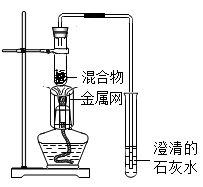

# Chemistry - 题目 249

**ID**: 12689a545a6c415b8f9bcd7710f5a462
**年级**: Grade 9
**难度**: Hard
**题型**: Scientific Inquiry

## 题目
某化学兴趣小组在实验室里进行木炭还原氧化铜的实验。​​​​​​​‌(1)（实验一）兴趣小组先按照课本实验方法进行实验。请你写出木炭还原氧化铜的化学方程式。但同学们发现，加热5分钟后仅能得到混有少量红色固体的黑色粉末。如何让木炭还原氧化铜时得到更多的铜呢？(2)（实验二）该小组同学在老师的指导下改进了实验，装置如右图。酒精灯火焰上加金属网罩的目的是，检查气密性后往试管中加入已干燥的药品并开始加热，当看到澄清的石灰水刚有气泡时，(填“能”或“不能”)确定氧化铜和炭粉已经开始反应，理由是。(3)待反应结束，用止水夹将乳胶管夹住，让产物自然冷却。若不关闭止水夹，可能出现的问题是。待产物冷却后，出现大量红色固体，实验获得了圆满成功。(4)小明发现通入澄清石灰水里的气体有逸出液面的现象，怀疑反应时还有其它气体生成，比如一氧化碳。老师首先赞扬小明有科学的质疑精神，建议化学兴趣小组继续展开探究。（设计方案）实验装置如上图(浓硫酸有吸水作用)打开K，缓缓通入干燥的氮气一段时间，关闭K，点燃酒精喷灯和酒精灯，充分反应后，熄灭酒精喷灯，打开K，再通一段时间氮气。① 实验前通入氮气是为了。② 方案一：从定性观察角度判断。若(实验现象)，则产物既有一氧化碳又有二氧化碳。③方案二：从定量计算角度判断。取一定量炭粉和4g氧化铜的混合物进行实验，若产物既有一氧化碳又有二氧化碳且最后玻璃管内只有铜剩余，则参加反应的碳的质量m的取值范围是。

## 解答

1. （1）木炭能与氧化铜在高温下反应生成铜和二氧化碳，该反应的化学方程式为 ${\rm{C}}{\rm{+}}{\rm{2}}{\rm{C}}{\rm{u}}{\rm{O}}\begin{array}{}{\underline{{\underline{高温}}}}\\\;\end{array}{\rm{2}}{\rm{C}}{\rm{u}}{\rm{+}}{\rm{C}}{\rm{O}}_{{\rm{2}}}\uparrow $ ；
2. （2）酒精灯火焰上加金属网罩的目的是集中火焰，提高温度；
3. 检查气密性后往试管中加入已干燥的药品并开始加热，当看到澄清的石灰水刚有气泡时，不能确定氧化铜和炭粉已经开始反应，因为一开始装置内空气受热逸出，不能说明氧化铜和炭粉开始反应；
4. （3）待反应结束，用止水夹将乳胶管夹住，让产物自然冷却。若不关闭止水夹，装置内压强减小，可能石灰水倒吸，导致试管炸裂；
5. （4）设计方案：① 反应可能有一氧化碳生成，一氧化碳具有可燃性，混有一定量的空气，遇到明火，容易发生爆炸，故实验前通入氮气是为了排尽装置内的空气，防止一氧化碳与空气混合在高温下发生爆炸；
6. ② 二氧化碳能使澄清石灰水变浑浊，一氧化碳具有可燃性，燃烧产生蓝色火焰，故从定性观察角度判断。若B中澄清石灰水变浑浊，D处尾气燃烧产生蓝色火焰，则产物既有一氧化碳又有二氧化碳；
7. ③如果碳只能生成一氧化碳，设参加反应的碳的质量为x
8. $\begin{array}{}{\rm{C}}\\12\\x\end{array}\begin{array}{}{\rm{+}}\\\\\;\end{array}\begin{array}{}{\rm{C}}{\rm{u}}{\rm{O}}\\80\\4{\rm{g}}\end{array}\begin{array}{}{\underline{{\underline{高温}}}}\\\begin{array}{}\\\;\end{array}\\\;\end{array}\begin{array}{}{\rm{C}}{\rm{u}}\\\\\;\end{array}\begin{array}{}{\rm{+}}\\\\\;\end{array}\begin{array}{}{\rm{C}}{\rm{O}}\\\\\;\end{array}$
9. $\frac {12}{80}=\frac {x}{4{\rm{g}}}$x=0.6g
10. 如果碳只能生成二氧化碳，设参加反应的碳的质量为y
11. $\begin{array}{}{\rm{C}}\\12\\y\end{array}\begin{array}{}{\rm{+}}\\\\\;\end{array}\begin{array}{}{\rm{2}}{\rm{C}}{\rm{u}}{\rm{O}}\\160\\4{\rm{g}}\end{array}\begin{array}{}{\underline{{\underline{高温}}}}\\\begin{array}{}\\\;\end{array}\\\;\end{array}\begin{array}{}{\rm{2}}{\rm{C}}{\rm{u}}\\\\\;\end{array}\begin{array}{}{\rm{+}}\\\\\;\end{array}\begin{array}{}{\rm{C}}{\rm{O}}_{{\rm{2}}}\uparrow \\\\\;\end{array}$
12. $\frac {12}{160}=\frac {y}{4{\rm{g}}}$y=0.3g
13. 由于反应生成了二氧化碳和一氧化碳的混合物
14. 故参加反应的碳的质量m的取值范围0.3g＜m＜0.6g。

## 知识点

**中文**:
  - 化学方程式的计算
  - 碳单质的化学性质

**English**:
  - Calculations Based on Chemical Equations
  - Chemical Properties of Carbon Allotropes

---
