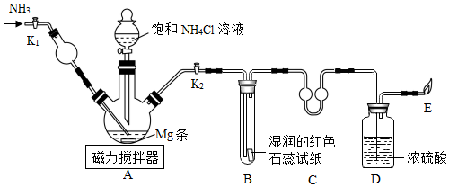

# Chemistry - 题目 119

**ID**: 143aa68eb972457aa15f576001c7d8e8
**年级**: Grade 9
**难度**: Hard
**题型**: Scientific Inquiry

## 题目
用如图装置对镁及其化合物的性质进行实验探究。​​​​​​​‌步骤一：将打磨过的镁条放入三颈烧瓶中，关闭K_{1}、打开K_{2}，加入一定量饱和NH_{4}Cl溶液，观察到镁条溶解，形成无色溶液，产生大量气泡。试管B中石蕊试纸变为蓝色。点燃E处气体产生淡蓝色火焰。①点燃E处气体前，必须进行的操作是。②镁条与NH_{4}Cl溶液反应的化学方程式为。步骤二：已知：NH_{3}+H_{2}O=NH_{3}•H_{2}O。打开K_{1}，通入少量NH_{3}观察到溶液变浑浊。过滤、洗净、低温烘干得白色固体。①某同学猜想此白色固体是Mg(OH)_{2}，理由是（用化学方程式表示）。②取少量白色固体，溶于适量的稀硝酸，再滴加AgNO_{3}溶液，观察到，则该同学猜想不正确。资料：此白色固体为碱式氯化镁[Mg_{x}（OH）_{y}Cl_{z}]，其不溶于水，能与酸反应，加热分解生成MgO、H_{2}O和HCl。步骤三：取一定量白色固体，充分加热，残留2.40g固体，将生成的气体用足量的AgNO_{3}溶液吸收，生成5.74g沉淀。则白色固体的化学式为。问题讨论：若步骤三中生成的气体未被AgNO_{3}溶液完全吸收，则测得的Mg_{x}（OH）_{y}Cl_{z}中y值（填“偏大”“不变”或“偏小”）。

## 解答

1. 步骤一：
2. ①加热或点燃可燃性气体前，必须检验气体的纯度，以防发生爆炸；
3. ②由试管B中湿润的红色石蕊试纸变成蓝色，判断反应生成了氨气，点燃气体产生淡蓝色火焰，判断反应生成了氢气，由此写出方程式：Mg+2NH_{4}Cl=MgCl_{2}+2NH_{3}↑+H_{2}↑；
4. 步骤二：
5. ①通入氨气，氨气和水反应生成NH_{3}•H_{2}O，NH_{3}•H_{2}O与 MgCl_{2}发生复分解反应生成Mg(OH)_{2}和 NH_{4}Cl，化学方程式为MgCl_{2}+2NH_{3}•H_{2}O=Mg(OH)_{2}↓+2NH_{4}C1。
6. ②Mg(OH)_{2}可溶于适量稀硝酸生成Mg(NO_{3})_{2}和 H_{2}O，再滴加AgNO_{3}溶液，无反应发生。由资料可知该白色沉淀为碱式氯化镁，溶于硝酸会产生Cl^{﹣}，再滴加AgNO_{3}溶液，会产生AgCl白色沉淀，从而产生白色浑浊的现象。
7. 步骤三：残留固体为MgO，其质量为2.40 g，可算出Mg的质量为1.44 g，5.74 g沉淀是AgCl的质量，可算出Cl的质量为1.42 g，Mg和Cl的个数比为 $\frac {1.44{\rm{g}}}{24}:\frac {1.42{\rm{g}}}{35.5}$ ＝3：2，根据电荷守恒可知 OH^{﹣}的数目为3×2﹣2＝4，所以化学式为Mg_{3}(OH)_{4}Cl_{2}。若步骤三中生成的气体未被完全吸收，则会造成Cl的质量偏少，利用电荷守恒算出的 OH^{﹣}的数目会偏大。

## 知识点

**中文**:
  - 盐的化学性质

**English**:
  - Chemical Properties of Salts

---
