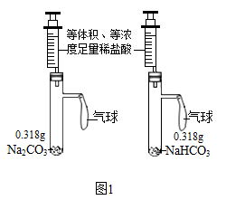
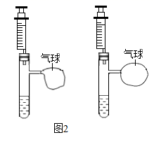
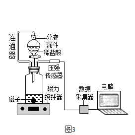
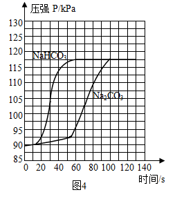

# Chemistry - 题目 30

**ID**: 2eeaac8bc9034acca7f8bfc91d3d8af8
**年级**: Grade 9
**难度**: Hard
**题型**: Scientific Inquiry

## 题目
某学习小组对碳酸钠、碳酸氢钠和稀盐酸的反应进行了探究。​​​​​​​‌（1）分别在盛有少量碳酸钠（俗称）、碳酸氢钠固体的试管中加入足量稀盐酸，观察到都剧烈反应且产生大量气泡。碳酸氢钠和稀盐酸反应的化学方程式为。（提出问题）碳酸钠、碳酸氢钠和稀盐酸反应产生二氧化碳的快慢是否相同？（设计与实验）（2）甲设计的实验如图1所示，实验时，两注射器中的稀盐酸应（填操作），观察到图2所示现象。于是他得出碳酸氢钠和稀盐酸反应产生二氧化碳较快的结论。（3）乙对甲的实验提出了质疑：①碳酸钠、碳酸氢钠固体和稀盐酸反应都很剧烈，通过观察很难判断产生气体的快慢；②当稀盐酸足量时，相同质量的固体，与稀盐酸反应生成的二氧化碳更多；他认为，应取含碳元素质量相同的碳酸钠和碳酸氢钠分别与稀盐酸反应。（4）小组同学在老师指导下设计了图3所示的实验。分别取等体积、含碳元素质量相同的碳酸钠和碳酸氢钠稀溶液，以及相同体积、相同浓度的足量稀盐酸进行实验。实验时，广口瓶内压强随时间变化如图4所示。（实验结论）（5）分析图4所示的实验数据可得到的结论是：相同条件下，和稀盐酸反应产生二氧化碳较快，理由是。（反思与应用）（6）小组同学查阅资料分析实验现象和图4数据，得出碳酸钠和稀盐酸反应产生二氧化碳较慢的原因是：碳酸钠先与稀盐酸反应生成碳酸氢钠和氯化钠，反应生成的碳酸氢钠再与稀盐酸反应。（7）通过以上探究与分析，小组同学设计了只用试管和胶头滴管鉴别碳酸钠溶液和稀盐酸的实验。操作现象与结论未知溶液分别编号为a、b，取适量a于试管中，用胶头滴管逐滴滴入b并振荡①若刚开始无明显现象，后随着b不断滴入产生较多气泡，则b是；②若立即产生大量气泡，则b是。

## 解答

1. （1）碳酸钠俗称纯碱、苏打；
2. 碳酸氢钠和稀盐酸反应生成氯化钠、二氧化碳和水，该反应的化学方程式为： ${\rm{N}}{\rm{a}}{\rm{H}}{\rm{C}}{\rm{O}}_{{\rm{3}}}{\rm{+}}{\rm{H}}{\rm{C}}{\rm{l}}{\rm{=}}{\rm{N}}{\rm{a}}{\rm{C}}{\rm{l}}{\rm{+}}{\rm{C}}{\rm{O}}_{{\rm{2}}}\uparrow {\rm{+}}{\rm{H}}_{{\rm{2}}}{\rm{O}}$ ；
3. 设计实验：（2）该实验是探究碳酸钠、碳酸氢钠和稀盐酸反应产生二氧化碳的快慢是否相同，故除了碳酸钠和碳酸氢钠不同，其它因素都应相同，故两注射器中的稀盐酸应同时全部注入，才好区分反应速率的快慢；
4. （3）②碳酸氢钠与稀盐酸反应： ${\rm{N}}{\rm{a}}{\rm{H}}{\rm{C}}{\rm{O}}_{{\rm{3}}}{\rm{+}}{\rm{H}}{\rm{C}}{\rm{l}}{\rm{=}}{\rm{N}}{\rm{a}}{\rm{C}}{\rm{l}}{\rm{+}}{\rm{C}}{\rm{O}}_{{\rm{2}}}\uparrow {\rm{+}}{\rm{H}}_{{\rm{2}}}{\rm{O}}$ ，碳酸钠与稀盐酸反应： ${\rm{N}}{\rm{a}}_{{\rm{2}}}{\rm{C}}{\rm{O}}_{{\rm{3}}}{\rm{+}}{\rm{2}}{\rm{H}}{\rm{C}}{\rm{l}}{\rm{=}}{\rm{2}}{\rm{N}}{\rm{a}}{\rm{C}}{\rm{l}}{\rm{+}}{\rm{C}}{\rm{O}}_{{\rm{2}}}\uparrow {\rm{+}}{\rm{H}}_{{\rm{2}}}{\rm{O}}$ ，碳酸氢钠的相对分子质量为84，每84份质量的碳酸氢钠能生成44份质量的二氧化碳；碳酸钠的相对分子质量为106，每106份质量的碳酸钠能生成44份质量的二氧化碳。故相同质量的碳酸氢钠和碳酸钠，碳酸氢钠生成的二氧化碳更多；
5. 实验结论：
6. （5）由图4可知，相同时间内，碳酸氢钠的压强更大，说明碳酸氢钠与稀盐酸反应更快，相同时间内，产生的二氧化碳较多，压强较大，故填：碳酸氢钠；相同时间内，压强越大，产生的二氧化碳气体越多或产生相同量的二氧化碳，碳酸氢钠所需时间少；
7. （7）取适量a于试管中，用胶头滴管逐滴滴入b并振荡，①若刚开始无明显现象，后随着b不断滴入产生较多气泡，则b是稀盐酸，因为一开始，碳酸钠过量，稀盐酸不足，碳酸钠和稀盐酸反应先生成碳酸氢钠，故无气体产生，后随着稀盐酸的增多，碳酸氢钠与稀盐酸反应生成二氧化碳气体；
8. ②若立即产生大量气泡，则b是碳酸钠溶液，因为一开始稀盐酸过量，碳酸钠和稀盐酸反应生成碳酸氢钠，碳酸氢钠会立即和稀盐酸反应产生二氧化碳气体，故填：稀盐酸；碳酸钠溶液。

## 知识点

**中文**:
  - 碳酸钠、碳酸氢钠和碳酸钙

**English**:
  - Sodium Carbonate, Sodium Bicarbonate, and Calcium Carbonate

---
