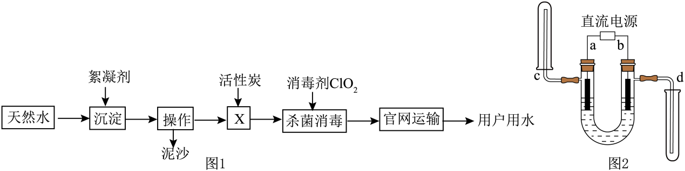
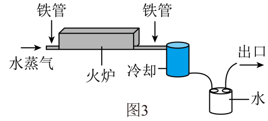

# Chemistry - 题目 296

**ID**: 4e342f149aa7454f8a5b06100d955420
**年级**: Grade 9
**难度**: Medium
**题型**: Comprehensive

## 题目
自来水厂净水主要过程如图1所示：（1）净水：①上述过程中，活性炭利用其性，除去颜色和异味。​​​​​​​‌“杀菌消毒”过程中发生了(填“物理”或“化学”)变化。②流程中操作的名称是。（2）探水：①如图2为电解水的实验装置。该反应过程中，电能转化为能，c中收集到的气体是(填化学式)。②1783年，拉瓦锡研究水的组成，装置示意图如图3 所示，将水加热成蒸气通过灼热的铁管，一段时间后，在出口处收集到一种可燃性气体，实验后称量发现水的质量减少，铁管质量增加，拉瓦锡研究并判断铁转化为氧化物。下列说法正确的是。

## 解答

1. （1）①活性炭疏松多孔具有吸附性，可除去水中的颜色和异味；
2. “杀菌消毒” 过程中，细菌病毒体内的蛋白质变性，有新物质生成，发生化学变化。
3. ②流程中 “操作” 是分离泥沙和水，名称为过滤。
4. （2）①电解水过程中，电能转化为化学能；
5. 电解水时，正极产生氧气，负极产生氢气，氧气密度比空气大，可用向上排空气法收集，氢气密度比空气小，可用向下排空气法收集，c采用向下排空气法，收集到的气体是H_{2}。
6. ②A、氧气不可燃，收集到的可燃性气体不是氧气，该选项错误。
7. B、催化剂能改变化学反应速率，且自身的质量和化学性质在化学反应前后保持不变。铁管质量增加，说明铁参与反应，不是催化剂，该选项错误。
8. C、该实验收集到的可燃性气体是氢气，铁转化为氧化物（含有氧元素），证明水由氢、氧元素组成，推翻了 “水是单一元素物质” 的观点，该选项正确。
9. D、实验中，冷却后得到水，说明水蒸气未全部参加反应，该选项错误。

## 知识点

**中文**:
  - 几种净化方法的比较
  - 自来水厂的净化流程
  - 电解水实验

**English**:
  - Comparison of Purification Methods
  - Water Treatment Plant Process
  - Electrolysis of Water Experiment

---
